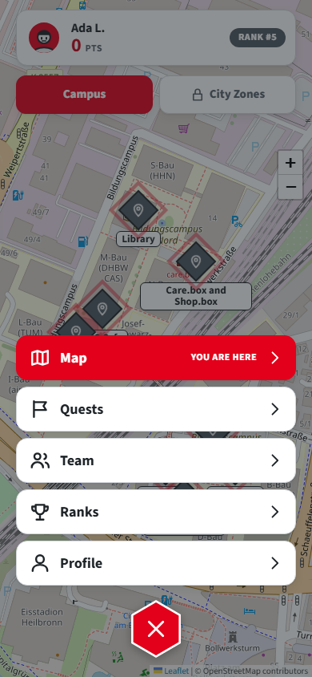
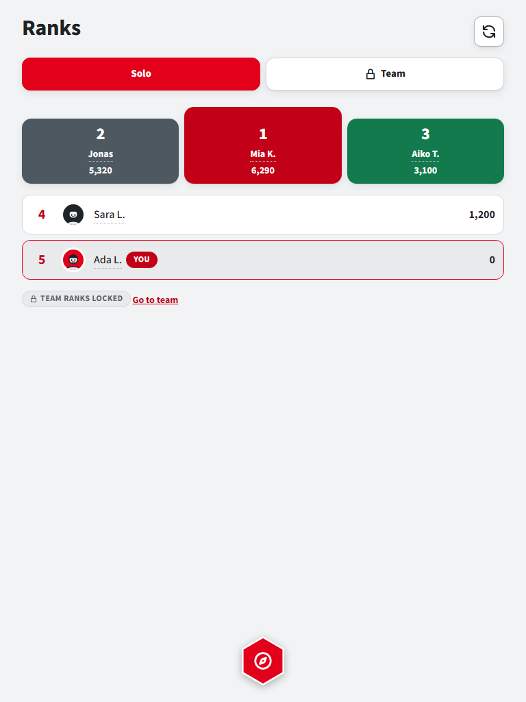
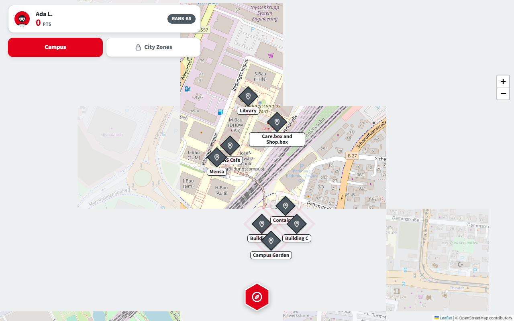

# Campus & City Quest

> A gamified, mobile-friendly onboarding web app for incoming international students at **DHBW Heilbronn** — verify your location at campus places, answer quiz questions, earn points, climb the leaderboard.

**Project no.** DHBW-INT-2027-01 · **Course:** Business Processes and their Implementation (Project Planning, Incomings 2026) · **Lecturer:** Prof. Dr. Aliona von der Trenck

---

## ⚡ Quick start: run the game on your computer

You need **Git**, **Node.js 20 or newer** and **Docker Desktop** (it runs the MySQL database for you; nothing else to install).

```bash
git clone git@wi-git.heilbronn.dhbw.de:yih.lim.26/campus-city-quest.git
cd campus-city-quest
git checkout wip/<your_name>/feature     # your own branch, see section 4
npm install                              # installs everything and creates your .env files
npm run dev                              # starts MySQL, creates the tables, loads the seed data, starts API + web app
```

Then open **http://localhost:5173** (the API runs on http://localhost:3000). The first `npm run dev` takes a minute because Docker downloads MySQL once. Start Docker Desktop first; `npm run dev` tells you if it is not running.

**How to use it**

1. Press *Start* and enter an address that ends with `heilbronn.dhbw.de`. In development without SMTP settings no e-mail is sent: the code is printed in the terminal that runs `npm run dev`, and the code screen has an *Open mock inbox* button that shows it and fills it in for you. To receive real e-mails, fill in the `SMTP_*` values in `backend/.env` (examples are in `backend/.env.example`); the server prints `[mail] SMTP ready` when the login works. The sixth digit logs you in.
2. New address: create your player card (name, nickname, one of six avatars or your own photo). Then you are on the map.
3. Tap a checkpoint pin, then *Start quest*. Accept the location notice once; the phone is asked for its position (the *radar* screen). To test without walking across campus, set `VITE_DEV_FAKE_LOCATION=true` in `frontend/.env` and tick *Pretend I am here*, or use your browser's location override (Chrome DevTools → Sensors).
4. Read the three facts on the info page (no timer yet), press *I'm ready*, answer the quiz, see the result and your rank change.
5. The red hexagon at the bottom opens the menu: Map, Quests, Team, Ranks, Profile. In the profile you can switch dark mode, font size (S to XL) and the language (Deutsch / English).

The questions in the seed data are **placeholders** (marked "PLACEHOLDER"); the real ones are added before the pilot (see [docs/question-bank.md](docs/question-bank.md)). The checkpoint centres are on the Bildungscampus Heilbronn (from OpenStreetMap) and still need the on-site check; the "Sensoricum" centre is an estimate next to Building C and must be confirmed on site (see [docs/geofencing.md](docs/geofencing.md); how to test the location check at a PC: [testing/location-testing-guide.md](testing/location-testing-guide.md)).

| I want to… | Command |
|---|---|
| Start everything | `npm run dev` |
| Try only the web app without Docker or a backend (fake data in the browser) | `npm run dev:mock` |
| Run all checks before a push (lint, format, tests, build) | `npm run check` |
| Browser tests on phone, tablet and laptop sizes | `npm run test:e2e` |
| Same tests and save a screenshot of every screen | `npm run screenshots` |
| One smoke test through the real stack | `npm run test:e2e:full` |
| Stop the database | `npm run db:down` |
| Delete all data and start fresh | `npm run db:reset` |

**Screens** (made by `npm run screenshots` into [design/screenshots/](design/screenshots/); the design follows the campusGO prototype, see [design/decisions.md](design/decisions.md)):

| Phone | Tablet | Laptop |
|---|---|---|
|  |  |  |

**Troubleshooting**

| Problem | What to do |
|---|---|
| "Docker is not running" | Start Docker Desktop, wait until it says *running*, run `npm run dev` again |
| Port 3000, 3307 or 5173 is already in use | Close the other program, or change `PORT` in `backend/.env` / the `3307` host port in `docker-compose.yml` |
| No Docker allowed on your machine | Install MySQL 8 yourself, set `DATABASE_URL` in `backend/.env`, run `SKIP_DOCKER=1 npm run dev` |
| The map is grey | The map tiles need internet; the pins and the rest still work |
| "Please check your location" never succeeds | Allow location for `localhost`, or use the fake location above |
| Login code does not arrive | Development without SMTP prints it in the terminal. Otherwise check the `[mail]` line at server start: `SMTP check failed` means wrong host, port or password (Gmail and Microsoft 365 need an app password). Production refuses to start without `SMTP_HOST` |
| Something is odd after pulling | `npm install` again; `npm run db:reset` if the database structure changed |

---

## 📌 Start here (read this first)

Every team member reads these before working:

| # | Document | What it is |
|---|---|---|
| 1 | **This README** | The briefing: what we build, the rules in short, who, when |
| 2 | [docs/business-rules.md](docs/business-rules.md) | **Source of truth:** the 25 business rules (BR01–BR25), resolved ambiguities, scoring formula with 15 worked examples, state machine, 25 acceptance checks |
| 3 | [docs/data-model.md](docs/data-model.md) | The 13 entities (ER diagram), constraints, seed data, proposed additions |
| 4 | [docs/geofencing.md](docs/geofencing.md) | How location verification works |
| 5 | [docs/question-bank.md](docs/question-bank.md) | Where we write and review the quiz questions (76 needed) |
| 6 | [docs/traceability.md](docs/traceability.md) | Rule → work package → entity → test matrix |
| 7 | [requirements.md](requirements.md) | What to install (npm only) and which commands to run |
| 8 | [Git Basics](#5-git-basics--learn-git-in-10-minutes) (below) + [docs/git-workflow.md](docs/git-workflow.md) | **New to Git? Start with the Git Basics.** Then the mandatory branching strategy |
| 9 | [CLAUDE.md](CLAUDE.md) | Rules for AI assistants (and for us when using them) incl. AI logging |
| 10 | [docs/project_handbook.md](docs/project_handbook.md) | The project plan: scope, WBS, schedule, roles, effort, risks, budget, tools |
| 11 | [project_brief.md](project_brief.md) · [project_chater.md](project_chater.md) | Project brief and charter |

> **AI assistants:** read `CLAUDE.md` and `docs/git-workflow.md` before processing any prompt.

---

## 1. The Briefing

### The problem
Incoming international students face a steep learning curve in their first weeks: they struggle to find campus facilities. Static PDF guides are unengaging and rarely read.

### The solution
A mobile-responsive **web app** (no app-store download, no extra hardware — just the student's phone). Students visit **8 pilot checkpoints** on campus, prove with **live location** that they are there, answer a short quiz about the place and earn points.

**Flow**

1. **Log in** with a one-time password (OTP) sent to the school e-mail (must end with `heilbronn.dhbw.de`). First-time users enter first/last name (optional picture and nickname). Optionally join or create a **team** (1–5 members) by invitation.
2. **Go to a checkpoint.** The app verifies the location when you start an attempt. Poor GPS accuracy or denied permission? Just check again — it costs no attempt and starts no timer.
3. **Take the quiz:** 5 questions (Mensa, Library, Building B, Building C) or 3 questions (Sensoricum, CAS Cafe, Care.box and Shop.box, Campus Garden); **1 minute per question**; a wrong answer shows the right one on the spot; no retries.
4. **Pass** with 4 of 5 or 2 of 3 correct. If you fail or time runs out you can try again; a checkpoint is done for good once passed.
5. **Earn points** (below) and see the **solo** and **team leaderboards**.

### The 8 checkpoints

| Checkpoint | Questions per attempt | Hard-question option (attempt 1) | Pass at |
|---|---|---|---|
| Mensa | 5 | yes | 4/5 |
| Library | 5 | yes | 4/5 |
| Building B | 5 | yes | 4/5 |
| Building C | 5 | yes | 4/5 |
| Sensoricum | 3 | no | 2/3 |
| CAS Cafe | 3 | no | 2/3 |
| Care.box and Shop.box | 3 | no | 2/3 |
| Campus Garden | 3 | no | 2/3 |

### Scoring in short (details and examples: [business-rules.md](docs/business-rules.md) §3)

| Item | Points |
|---|---|
| Normal question correct | 1,000 |
| Hard question correct | 2,000 (wrong = 0, only the Full Clear bonus is lost) |
| Time Bonus | 1 per whole second left (only on a passed attempt) |
| Full Clear Bonus | 200 when every question is correct |
| Attempt multiplier (applied **after** bonuses) | attempt 1: 100% · 2: 85% · 3: 70% · 4: 55% · 5: 40% · 6 and later: 0% |
| Rounding | Fractions are rounded up (BR04) |

`points = (correct-answer points + time bonus + full clear) × multiplier`. Hard question: on attempt 1 only, if questions 1–4 are correct you may swap question 5 for a hard one. Points are credited only when the attempt ends. All point values live in database tables, not in code (BR11).

### Demo data, admin area, photos and route

- `npm run dev` also loads **fictional demo data** (24 players, 6 teams, quests over several days, a pending invitation, a blocked, an archived and a reported account) so the ranks and the admin pages have something to show. It is never loaded in production (`npm run db:seed:demo` runs it alone; `npm run db:reset` starts from an empty database).
- **Admin area** (`/admin`): sign in with `sekretariat.dski@heilbronn.dhbw.de` (the same e-mail code login; the address is set in `ADMIN_EMAIL`). Users (create, edit, block, archive, report, delete, sessions, quests and activity log), teams, and name rules. In development the code is printed in the terminal, or use *Open mock inbox* on the code screen.
- **Name rules:** German and English banned words, whole-word matching so "Cass" is fine. List: [docs/banned-terms.md](docs/banned-terms.md).
- **Photos** of the places are in `frontend/public/places/` with credits in `CREDITS.md`. They are generic Bildungscampus photos from Wikimedia Commons, **not** pictures of the single places; replace them with the team's own photos before the pilot (list: `frontend/src/api/places.json`, then `npm run db:seed`).
- **Walking route:** the *Show walking route* button in a checkpoint draws the way with OpenStreetMap data; your position is used in the browser only.
- **Delete my account:** in the profile (the person, their picture and e-mail are removed; the e-mail can be used again).
- Backend handover for Yuri: [design/yi_heng/backend-handover.md](design/yi_heng/backend-handover.md).

### Leaderboards

- **Solo:** total points per student. **Team:** average of the members' totals (only teams with ≥ 2 members; only visible to students in a team).
- Equal scores share a rank number; the student/team that reached the score earlier is listed first (BR24).

### Goals (measurable)

| Goal | Target |
|---|---|
| Rules | All 25 business rules implemented, each traceable to a test |
| Scoring | The 15 worked examples in business-rules §3.3 pass exactly |
| Performance | ≥ 50 simultaneous sessions; first question ≤ 1.5 s after the quiz starts |
| Campus completion | ≥ 90% of incoming international students complete all campus checkpoints within 30 days (verified in the project by a pilot with 10 volunteers) |

### Scope (MoSCoW summary)
- **Must:** everything in BR01–BR25 — login and sessions, sign-up, teams and invitations, 8 checkpoints, location verification, quiz engine, scoring, leaderboards, content in the database, privacy.
- **Should:** read-first info page per checkpoint.
- **Could:** weekly streak reminders, random time-based events.
- **Won't:** supermarket/clothing-store locators, native apps, NFC/student-card readers, duo and nationality leaderboards. (An admin area and "delete my account" were added as proposals, see docs/business-rules.md section 9.)

Details: [docs/project_handbook.md §1](docs/project_handbook.md).

---

## 2. Team

| Member | Role |
|---|---|
| **Yi Heng** | Project Lead |
| **Catalina** | UI/UX & Frontend Developer |
| **Ryan** | Backend & Database Engineer |
| **Yuri** | Location & Integration Specialist (login, e-mail, location) |
| **Akil** | QA & Documentation Lead |

Client: DHBW International Office (contact to be confirmed). Escalation: team member → project lead → lecturer.

---

## 3. Timeline

**Project: 13.10.2026 – 16.11.2026**

| Milestone | Date |
|---|---|
| M1 UI/UX wireframes, ER model and architecture approved | 20.10.2026 |
| M2 OTP login, 8 checkpoints and location check working | 02.11.2026 |
| M3 Full quiz, scoring and leaderboards; 76 questions loaded; integration tests done | 10.11.2026 |
| M4 Pilot complete; time-tracking reports final | 16.11.2026 |

Course deadlines: planning submission 19.10.2026, 12:15 · final presentation 18.11.2026 (16.11. tbd) · final report 07.12.2026.

Effort: **230 h** total (about 46 h per person). Gantt chart and critical path: [docs/project_handbook.md §3](docs/project_handbook.md).

---

## 4. How We Work with Git (summary)

```
main  ←  preproduction  ←  wip/[your_name]/feature
                           wip/[your_name]/bugfix
```

In GitLab the branches look like folders — everyone has `feature` and `bugfix` side by side:

```
main
preproduction
wip/
  catalina/  feature  bugfix
  ryan/      feature  bugfix
  yuri/      feature  bugfix
  akil/      feature  bugfix
  yi_heng/   feature  bugfix
```

- `main` and `preproduction` are **protected** — never push to them directly.
- **Nobody merges a feature branch into `main`.** Feature/bugfix branches are merged into **`preproduction`** by Merge Request; the project lead merges `preproduction` → `main` at milestones.
- Everyone owns two permanent branches: `wip/[your_name]/feature` (new work) and `wip/[your_name]/bugfix` (fixes), e.g. `wip/catalina/feature`, `wip/yuri/bugfix`. Never delete them and never push to someone else's.
- The task is named in your commit messages and in the MR title, because the branch name is fixed.
- Title issues/MRs with a tag: `FEATURE: …`, `BUG-FIX: Fixing feature 1 issue of …`, `DOCS: …`, `REFACTOR: …`.
- **1 approval from another member** is required — never merge your own MR unreviewed.
- Commit with **Conventional Commits**: `feat: add quiz timer`, `fix: resolve crash`.

Quick start:

```bash
git clone git@wi-git.heilbronn.dhbw.de:yih.lim.26/campus-city-quest.git
cd campus-city-quest
git checkout preproduction && git pull origin preproduction
npm ci
git checkout wip/[your_name]/feature        # your own branch already exists
git merge origin/preproduction               # get the latest team code
```

Full guide with all commands, conflict handling and the do/don't checklist: **[docs/git-workflow.md](docs/git-workflow.md)**.

---

## 5. Git Basics — Learn Git in 10 Minutes

New to Git? Read this once, then keep it open while you work. Every command here is used in our workflow ([docs/git-workflow.md](docs/git-workflow.md)).

### 5.1 The idea in 6 words

| Word | Meaning |
|---|---|
| **Repository (repo)** | The project folder with its whole history |
| **Commit** | A saved snapshot of your changes, with a message |
| **Branch** | Your own line of work, so you don't disturb others |
| **Remote / origin** | The copy of the repo on GitLab |
| **Push / Pull** | Send your commits to GitLab / get others' commits from GitLab |
| **Merge** | Combine the work of two branches |

Your files move through three places:

```
 your files  ──git add──▶  staging area  ──git commit──▶  local history  ──git push──▶  GitLab
 (working dir)             (ready to save)                (your computer)               (everyone)
```

### 5.2 One-time setup

```bash
git config --global user.name "Your Name"
git config --global user.email "your.name@your-university-email"
git config --global pull.rebase false        # makes "git pull" merge (simple and predictable)
```

Add an SSH key to GitLab (**Preferences → SSH Keys**), then test it:

```bash
ssh-keygen -t ed25519 -C "your.name@your-university-email"   # press Enter for defaults
cat ~/.ssh/id_ed25519.pub                                    # copy this into GitLab
ssh -T git@wi-git.heilbronn.dhbw.de                          # should greet you by name
```

### 5.3 The commands you need

#### `git clone` — download the project the first time
```bash
git clone git@wi-git.heilbronn.dhbw.de:yih.lim.26/campus-city-quest.git
cd campus-city-quest
```

#### `git status` — what changed? (use it all the time)
```bash
git status
```
Shows which branch you are on, changed files, and what is staged. **When unsure, run `git status`.**

#### `git branch` — list, create, delete branches
```bash
git branch                                   # list local branches (* = current)
git branch -a                                # also list branches on GitLab
git branch -d some-old-local-branch         # delete a merged local branch (never your wip/... branches)
```

#### `git checkout` — switch branches (or create one with `-b`)
```bash
git checkout preproduction                                  # switch to an existing branch
git checkout -b my-experiment                               # create a new branch and switch to it (for experiments only)
```
`git switch <branch>` / `git switch -c <branch>` do the same thing in newer Git.

#### `git add` — choose what goes into the next commit
```bash
git add path/to/file        # stage one file (recommended)
git add src/                # stage a folder
git add .                   # stage everything (check `git status` first!)
```

#### `git commit` — save a snapshot with a message
```bash
git commit -m "feat: add quiz timer"
```
Use **Conventional Commits**: `<type>: <short description>`.

| Type | Use for | Example |
|---|---|---|
| `feat` | new feature | `feat: add login page` |
| `fix` | bug fix | `fix: resolve crash on empty answer` |
| `docs` | documentation | `docs: update setup guide` |
| `refactor` | cleanup, no behaviour change | `refactor: simplify user queries` |
| `test` | tests | `test: add 5-minute limit tests` |
| `chore` | tooling/config | `chore: update eslint config` |

Good message: short, imperative, lowercase, no full stop ("add", not "added"). One logical change per commit.

#### `git log` and `git diff` — look at history and changes
```bash
git log --oneline            # short history
git log --oneline --graph --all   # history of all branches as a picture
git diff                     # unstaged changes
git diff --staged            # staged changes (what the next commit will contain)
```

#### `git push` — send your commits to GitLab
```bash
git push -u origin my-experiment                        # first push of a new branch
git push                                                # every later push on that branch
```
You can only push your own branch. `main` and `preproduction` are protected.

#### `git pull` — get the latest commits from GitLab
```bash
git checkout preproduction
git pull origin preproduction
```
`git pull` = `git fetch` (download) + `git merge` (apply). To only look without changing your files: `git fetch`.

#### `git merge` — bring another branch into yours
```bash
git checkout wip/[your_name]/feature
git merge origin/preproduction       # get the team's latest work into your branch
```
Merging **your branch into `preproduction`** is done through a **Merge Request on GitLab**, not on your computer. If Git reports a conflict, see [docs/git-workflow.md §4](docs/git-workflow.md).

#### `git stash` — park unfinished work temporarily
```bash
git stash                    # put your uncommitted changes aside
git checkout other-branch
git checkout -               # come back
git stash pop                # get your changes back
```

### 5.4 Undo and "oops" cheat sheet

| Situation | Command |
|---|---|
| Edited a file, want the last committed version back | `git restore path/to/file` |
| Staged a file by mistake | `git restore --staged path/to/file` |
| Typo in the **last** commit message (not yet pushed) | `git commit --amend -m "new message"` |
| Committed on the wrong branch (not yet pushed) | ask a teammate before doing anything drastic |
| Merge conflict and you panic | `git merge --abort` |
| Want to see what you did to a file | `git log --oneline -- path/to/file` |

⚠️ Avoid `git reset --hard` and `git push --force` — they can destroy work, and force-push is forbidden on shared branches.

### 5.5 Your daily routine (copy this)

```bash
git checkout preproduction
git pull origin preproduction                        # 1. get the latest team code
npm ci                                               #    install dependencies
git checkout wip/[your_name]/feature                     # 2. switch to your own branch (it already exists)
# ... edit files ...
git status                                           # 3. what did I change?
git add path/to/file                                 #    stage it
git commit -m "feat: add quiz timer"                 #    save it
npm run check                                        # 4. lint + format + tests must pass
git push origin wip/[your_name]/feature                  # 5. send it to GitLab
# 6. open a Merge Request on GitLab -> target: preproduction -> ask a teammate to review
```

### 5.6 Common beginner mistakes

| Mistake | Fix |
|---|---|
| Working directly on `main` or `preproduction` | Always `git checkout wip/[your_name]/feature` first; check with `git status` |
| "rejected — protected branch" when pushing | You tried to push to `main`/`preproduction`; push your own branch instead |
| Forgetting to pull before starting | `git pull origin preproduction` at the start of every work session |
| Huge commits with many unrelated changes | Commit small and often; one logical change per commit |
| Committing `.env` or `node_modules/` | They are in `.gitignore`; never force-add them |
| "Please tell me who you are" error | Run the one-time setup in 5.2 |

### 5.7 Learn more
- Official book (free): https://git-scm.com/book
- Interactive practice: https://learngitbranching.js.org
- Ask the team for help — there are no stupid Git questions.

---

## 6. Install and Check (npm only)

Install Node.js LTS (≥ 20), Git and Docker Desktop, then see [requirements.md](requirements.md).

```bash
npm install          # installs frontend + backend, creates backend/.env and frontend/.env
npm run dev          # database + API + web app
npm run check        # ESLint + Prettier + backend and frontend tests + build, zero warnings
```

Use `npm ci` instead of `npm install` for a clean, reproducible install from `package-lock.json`.

| Task | Command |
|---|---|
| Lint / auto-fix | `npm run lint` / `npm run lint:fix` |
| Format check / format | `npm run format:check` / `npm run format` |
| All tests (backend + frontend) | `npm test` |
| Browser tests, 6 screen sizes (installs Chromium on first run) | `npm run test:e2e` |
| Database: start / stop / reset / migrate / seed | `npm run db:up` / `db:down` / `db:reset` / `db:migrate` / `db:seed` |

`npm test` and `npm run dev` start the database themselves (`pretest` / `predev` hooks), so nobody has to remember it.

---

## 7. Repository Layout

```
campus-city-quest/
├── README.md               ← you are here
├── requirements.md         what to install
├── package.json            npm workspaces (frontend, backend) and all scripts
├── docker-compose.yml      MySQL 8.4 for development and tests
├── eslint.config.js, .prettierrc
├── CLAUDE.md               rules for AI assistants + AI logging
├── project_chater.md       project charter
├── project_brief.md        project brief (+ archived original pitch)
├── backend/                Express API
│   ├── index.js            starts the server
│   ├── src/routes|services|db|middleware
│   ├── src/db/migrations   SQL schema; seed.js = scoring tables, checkpoints, placeholder questions
│   ├── tests/              Vitest + Supertest against a test database
│   └── .env.example
├── frontend/               React + Vite web app
│   ├── src/api|components|hooks|pages|styles|assets
│   ├── tests/              Vitest + React Testing Library
│   ├── e2e/                Playwright on phone, tablet and laptop sizes (mock API)
│   ├── e2e-fullstack/      one smoke test through the real stack
│   └── .env.example
├── design/                 problem statement, architecture, ER diagram, API docs, decisions,
│   │                       UI spec (arena result), prototype reference, screenshots
│   └── yi_heng/            use cases, API documentation, database schema notes
├── docs/
│   ├── business-rules.md   BR01-BR25, scoring, state machine (source of truth)
│   ├── data-model.md       13 entities, constraints, seed data
│   ├── geofencing.md       location verification architecture
│   ├── question-bank.md    quiz questions to write and review
│   ├── traceability.md     rule -> work package -> test matrix
│   ├── git-workflow.md     branching strategy and workflow
│   └── project_handbook.md full project plan
├── ai-logs/                one folder per member (catalina, yuri, ryan, yi_heng, akil)
├── .gitlab/                issue and merge request templates
└── scripts/                setup.mjs (runs after npm install), ensure-db.mjs (starts the database), setup-repo.sh
```

---

## 8. Tools

| Area | Tool |
|---|---|
| Project management, wiki, code | DHBW WI GitLab — https://wi-git.heilbronn.dhbw.de/ |
| Time tracking | GitLab `/estimate` and `/spend` on every issue |
| Team chat | Discord |
| Dev tooling | npm: ESLint, Prettier, Vitest, Supertest, Playwright |
| Location | Browser Geolocation API (HTTPS; real Android/iOS test phones) |
| E-mail | SMTP server or provider for OTP e-mails |
| AI | Claude Code and others — always disclosed and logged |

**Tech stack (decided in WBS 2.2):** React 18 + Vite, Express on Node 20+, MySQL 8.4 in Docker Compose, Leaflet map. Details and reasons: [design/architecture.md](design/architecture.md) and [design/decisions.md](design/decisions.md).

---

## 9. Things Everyone Must Do

1. **Track your time** in GitLab (hours, not minutes) for every task — research, meetings and documentation count. Use one label per issue: `cat::conception`, `cat::implementation` or `cat::organisation`. Hours are reviewed with the lecturer.
2. **Log every AI session** in `ai-logs/[your_name]/YYYY-MM-DD-[topic].md` (date, objective, prompts used, decisions made — format in [CLAUDE.md](CLAUDE.md)). AI use is allowed but must be disclosed and critically reflected; the final presentation and report each end with a section **"Use of AI Tools"**.
3. **Never commit secrets:** no `.env`, no passwords, no API keys.
4. **Protect personal data:** e-mail, names, pictures and location are personal data — ask for location consent, store only "inside the radius yes/no + time", never log or commit raw coordinates, never store OTP codes or session tokens in plain text.
5. **Keep to the plan and the rules:** work on issues linked to a work package (WBS code) and name the business rules (BR..) you implement; never hard-code points, multipliers or bonuses (they live in the database, BR11); scope or rule changes go through the project lead and are written into `docs/business-rules.md` first.
6. **Use npm only** and run `npm run check` before every push.

---

## 10. Communication (summary)

| With | What | Frequency |
|---|---|---|
| Team | Weekly sync (Discord/in person, 1 h) | Every Monday |
| Team | Tasks, MRs, docs | Ongoing in GitLab |
| Client (International Office) | Status updates | Bi-weekly |
| Client | Milestone acceptance with signed minutes | At each milestone |
| Lecturer | Status + time-tracking review (10–15 min) | Integration-seminar dates |

Minutes go into the GitLab wiki immediately after each session.

---

## 11. Contact & Support

- Project lead: **Yi Heng Lim**
- GitLab access/user assignment: Tessa Steinigke (DHBW WI)
- Lecturer: Prof. Dr. Aliona von der Trenck
