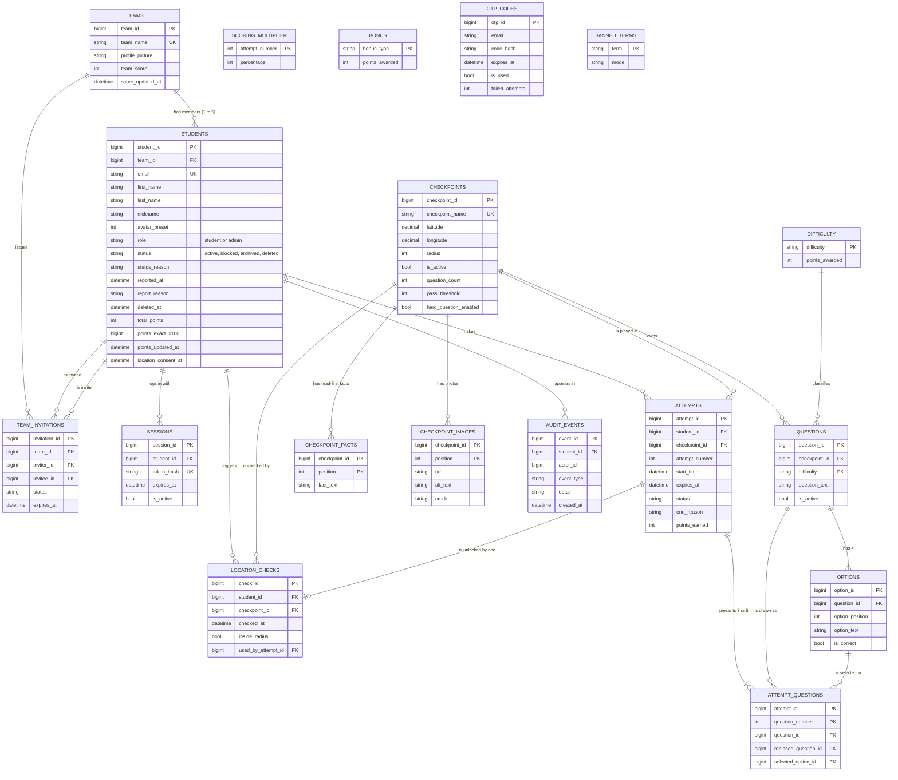

# Entity-relationship diagram

Source of the tables: [backend/src/db/migrations/001_init.sql](../backend/src/db/migrations/001_init.sql). Rules behind them: [docs/data-model.md](../docs/data-model.md) and [docs/business-rules.md](../docs/business-rules.md). A PNG export of the diagram is not part of the repository; the Mermaid text below renders on GitLab and in VS Code.

`OTP_CODES` is keyed by the e-mail address, not by a student, because a student may not exist yet when the first code is requested. Scoring tables (`SCORING_MULTIPLIER`, `BONUS`, `DIFFICULTY`) are read by the code at run time (BR11); no point value is written into the program.
