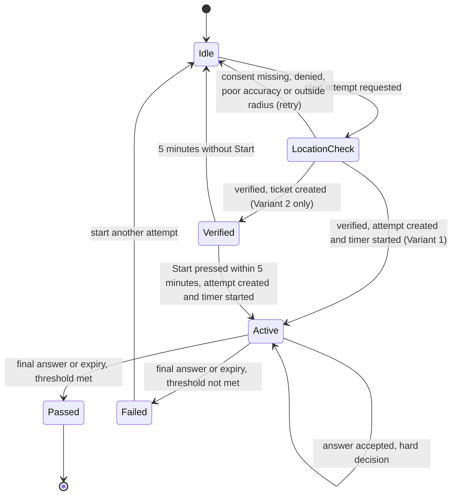
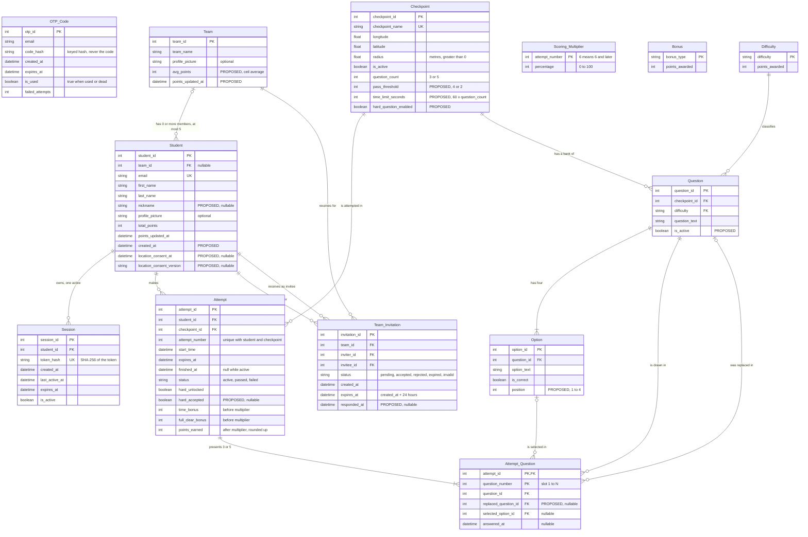

# Admin dashboard and navigation: design spec

> Chosen by a two-agent /arena run on 2026-10-28 (round 1, a001 beat a002, 83 to 75). The full record is in `.arena/` (git-ignored). Differences in the build: test mode is a server-side bypass for administrators in `POST /checkpoints/:id/verify` (no location, no consent, inactive checkpoints allowed, earlier test attempts of that checkpoint cleared) instead of an `is_test` flag; the open menu has no shortcut chips (the admin tab row does the job on every screen size); the stats endpoint is `GET /admin/stats` with the shape below.


---

# Campus & City Quest: Business Rules

## 0. Purpose, scope and how to read this file

This file is the single source of truth for the behaviour of "Campus & City Quest", a mobile-responsive web app in which incoming international students of DHBW Heilbronn verify their live location at 8 pilot checkpoints on campus and then take a short multiple-choice quiz about the place. It defines the 25 business rules (BR01-BR25), resolves every ambiguity in them, and gives the exact scoring formula, the attempt state machine, the validation limits and the open points. `docs/data-model.md` holds the matching database model. If the two files ever disagree, this file wins and the data model must be corrected.

**Status.** The "Main Project Document" is the newest source and overrides every earlier idea. These earlier ideas no longer exist and must not be implemented: the 30-second leave rule, the 5 original checkpoints, the old point values (10 points per answer, speed bonus of 20), the fixed 5-question 80% rule for every checkpoint, duo and nationality leaderboards, and the cool-down between attempts. Other documents in the repository that still describe them are out of date.

**Priority.** Every rule BR01-BR25 is a **Must**.

**Out of scope.** City locators, Google Maps, native apps, NFC or card readers, an admin UI (content is loaded by seed scripts or SQL), and the "Geofencing Architecture" document (empty in the source; a separate document will cover distance calculation and any extra anti-spoofing checks).

**Optional (Should), not covered by the rules.** A read-first *info page* for each checkpoint, shown after a successful location check and before the quiz starts, with no timer. See RES-33 for how it interacts with the timer.

**Tags used in this file.**

| Tag | Meaning |
|---|---|
| (source) | Stated by the Main Project Document or by the team's binding decisions. |
| (assumption) | The source is silent or ambiguous. This is our reading. The team confirms it (see section 8). |
| (proposal) | A concrete number or technical choice that the source does not give. Change it freely, but change it in one place (section 3.10). |

**Wording.** "Must" is mandatory. "The server" means the backend. All times are server times in UTC. The client is never trusted for time, location outcome, correctness of an answer, or points.

---

## 1. The 25 business rules (clean English)

| ID | Rule |
|---|---|
| BR01 | Each user is identified by a unique school e-mail address. A user can enter the app only by logging in with a one-time password (OTP) sent to that e-mail address. A successful OTP login starts the session. |
| BR02 | When signing up, a new user must enter a first name and a last name. A profile picture is optional. A nickname is possible. |
| BR03 | A student may have only one active session (on their phone). Each session belongs to exactly one student and expires after a set period of inactivity. |
| BR04 | A solo leaderboard is built from the total points of each individual user. A team leaderboard is built from the average of the total points of all members of each team. Users who are not in a team cannot view the team leaderboard. Fractional points of users and of teams are rounded up. |
| BR05 | A team has 1 to 5 members. Only teams with at least 2 members are active in the team leaderboard. Each user can belong to one and only one team. Users can create teams. A team must have a team name and may have a profile picture. |
| BR06 | A user can invite other users to their team by entering the invitee's e-mail address. The invitee can accept or reject the invitation in the web app. A rejected invitation becomes invalid automatically. An invitation to a team that is already full cannot be accepted and becomes invalid automatically. An invitation expires after 24 hours and becomes invalid automatically. A user who is already in a team cannot be invited to a team. |
| BR07 | The pilot has eight checkpoints: Mensa, Library, CAS Cafe, Campus Garden, Care.box and Shop.box, Building B, Building C, Containers. |
| BR08 | Each checkpoint has a unique name, GPS coordinates, a positive geofence radius and an active/inactive status (`is_active` true/false). Only active checkpoints can unlock quizzes. |
| BR09 | Each checkpoint attempt randomly selects 3 or 5 distinct questions from the question bank of the active checkpoint, depending on the checkpoint (larger areas such as Library, Mensa, Building B and Building C use 5; Containers uses 3). The question bank must contain at least 2 times the normal questions in play and 3 times the hard questions in play. A new checkpoint attempt makes a fresh random selection; questions from earlier attempts may appear again. |
| BR10 | Each question belongs to exactly one checkpoint, has four answer options and has exactly one correct option. |
| BR11 | Questions, options, answer keys and point values are maintained in the database and can be changed without changing backend code. |
| BR12 | Location verification is required when starting each checkpoint attempt. Poor GPS accuracy or denied permission requires another check and neither consumes an attempt nor starts the timer. Leaving the geofence afterwards does not end the attempt and does not block submissions. |
| BR13 | Each checkpoint attempt has a time limit of 1 minute per question in the quiz, starting when the quiz unlocks. |
| BR14 | A wrongly answered question earns no points. The correct answer is revealed immediately. The user cannot retry the question and must move on to the next one. |
| BR15 | A user passes a checkpoint only by answering at least 4 of 5 questions, or at least 2 of 3 questions, correctly. The checkpoint stays incomplete until the user passes; the user is then prompted to start another attempt. |
| BR16 | Points are credited only at the end of a successfully completed attempt. An attempt that ends by time expiry awards the points of its correctly answered questions only if the passing threshold is met. Otherwise no points are awarded, the attempt is used up, and the user is prompted to start another attempt. |
| BR17 | A successfully completed attempt awards a "Time Bonus" of one point per whole second remaining, provided the passing threshold is met. This applies to every attempt. |
| BR18 | A "Full Clear Bonus" of 200 points is awarded when all questions of the attempt are correct. This applies to every attempt. |
| BR19 | A failed checkpoint may be attempted again. Attempts 2 to 5 award points at decreasing rates (multiplier table). The multiplier is applied after the bonuses (Time Bonus, Full Clear Bonus) have been added. Attempt 6 and later can complete the checkpoint but award zero points. |
| BR20 | On checkpoint attempt 1 only, answering the first four questions correctly on the first selection unlocks the option to replace question five with a hard question. |
| BR21 | The hard question is worth 2,000 points if correct and 0 if wrong, with no retry. A wrong answer to it forfeits only the Full Clear Bonus. The checkpoint can still be passed, because the first four questions already meet the 4/5 threshold. |
| BR22 | The server accepts answer selections and final submissions only while the attempt is active and before its timer has expired. |
| BR23 | A passed attempt cannot be reopened or edited by the student. Each new attempt creates a new attempt record. Once a student passes a checkpoint, it is permanently completed for the pilot and cannot be replayed. Further attempts are allowed only while the checkpoint is incomplete. |
| BR24 | Equal scores show the same rank number. Among equal scores, the user or team that reached that score earlier is listed higher, while the rank number stays the same. |
| BR25 | Assigned questions stay the same after a refresh or reconnect. The server keeps the question sequence, the selection history and the hard-question eligibility. |

### Constants taken from the source tables

| Item | Value |
|---|---|
| Normal question | 1,000 points |
| Hard question | 2,000 points |
| Full Clear Bonus | 200 points |
| Time Bonus | 1 point per whole remaining second |
| Multiplier, attempt 1 / 2 / 3 / 4 / 5 | 100% / 85% / 70% / 55% / 40% |
| Multiplier, attempt 6 and later | 0% (the source says "6 and below"; BR19 says "6 and further"; we read it as attempt 6 and later) |

| Checkpoint | Questions per attempt | Hard question possible | Pass threshold | Time limit |
|---|---|---|---|---|
| Mensa | 5 | yes | 4 of 5 | 5 min (300 s) |
| Library | 5 | yes | 4 of 5 | 5 min (300 s) |
| Building B | 5 | yes | 4 of 5 | 5 min (300 s) |
| Building C | 5 | yes | 4 of 5 | 5 min (300 s) |
| Containers | 3 | no | 2 of 3 | 3 min (180 s) |
| CAS Cafe | 3 | no | 2 of 3 | 3 min (180 s) |
| Care.box and Shop.box | 3 | no | 2 of 3 | 3 min (180 s) |
| Campus Garden | 3 | no | 2 of 3 | 3 min (180 s) |

---

## 2. Definitions

| Term | Meaning |
|---|---|
| Checkpoint attempt (attempt) | One run of the quiz at one checkpoint by one student. It exists as an `Attempt` record from the moment the location check succeeds. |
| Question slot | Position 1..N in an attempt (N = 3 or 5). Slot 5 of a 5-question attempt is the only slot a hard question can take. |
| Correct count | Number of slots whose selected option is the correct one. Unanswered slots are not correct. |
| Passed | Correct count is at least the pass threshold (4 for N = 5, 2 for N = 3). |
| Completed checkpoint | A checkpoint for which the student has one attempt with status `passed`. Permanent (BR23). |
| Whole second | `floor` of the real number of seconds. 112.9 s is 112 whole seconds. |
| Attempt number | 1 for the student's first attempt at that checkpoint, 2 for the next, and so on. It never resets. |

---

## 3. Resolutions of ambiguities

Each item is a testable rule. Numbered items (RES-01 to RES-39) and bold-named items can be cited by tests and tickets.

### 3.1 Accounts, sign-up, login, sessions (BR01, BR02, BR03)

**Options considered for the sign-up and login flow**

| Option | Hides whether an account exists (binding) | Meets BR02 (names at sign-up) | Simple for the student | Extra tables |
|---|---|---|---|---|
| A. Separate "Sign up" and "Log in" forms | Poor: sign-up must say "already registered" or run a second generic flow | Yes | Two flows | none |
| B. One e-mail form; names asked only after a correct OTP for an unknown address | Good | Yes | One flow | none |
| C. One form that always asks for names | Good | Yes | Poor: names re-entered at every login | none |

**Chosen: B.**

- **RES-01 (source).** The e-mail must end with `heilbronn.dhbw.de`. **Precise reading (assumption):** after trimming and lower-casing, the part after the single `@` must be exactly `heilbronn.dhbw.de` or must end with `.heilbronn.dhbw.de`. So `name@heilbronn.dhbw.de` is valid, and `name@evilheilbronn.dhbw.de` and `name@heilbronn.dhbw.de.example.com` are invalid. The suffix is a configuration value. Whether real student mailboxes use a sub-domain is TBC.
- **RES-02 (source).** The "request OTP" operation always answers with exactly this text, with the same status code, the same shape and no measurable timing difference, whatever the e-mail is (unknown, known or throttled; the only exception is a wrong domain, see RES-03): "If the account exists, an email containing the OTP has been sent."
- **RES-03 (assumption).** An e-mail that fails the domain rule or the syntax rule is rejected with a validation error before any OTP is created. This reveals only the domain rule, which is public.
- **RES-04 (assumption).** OTPs are sent to every valid-domain address, including addresses with no account yet, because the same flow is used for first-time sign-up. The generic text of RES-02 is kept word for word anyway.
- **RES-05 (proposal).** The OTP is 6 decimal digits from a cryptographically secure generator, valid for 10 minutes, usable once, with at most 5 wrong guesses (`failed_attempts`). After the fifth wrong guess the OTP is dead (`is_used = true`) and the student must request a new one. Requesting a new OTP does **not** invalidate earlier OTPs: up to 3 unused, unexpired OTPs of one e-mail may be valid at the same time; when a 4th is requested, the oldest is marked used. This stops a third party who knows the address from killing the owner's code by requesting new ones. Resend throttle: at most 1 request per 60 s and 5 per hour per e-mail. A throttled request still returns the generic text of RES-02 but sends nothing, creates no OTP and invalidates no OTP. Residual risk (accepted, open point 28): a third party can burn the 5 guesses or the hourly quota of a known address and so delay a login; the owner waits and requests again. The OTP is stored only as a keyed hash (HMAC-SHA-256 with a server secret), never in clear text.
- **RES-06 (assumption).** Verify operation: input is e-mail and code. A wrong, expired, used or unknown code returns one generic error ("The code is invalid or has expired.") and adds 1 to `failed_attempts` of every unused, unexpired OTP of that e-mail (so splitting guesses over several OTPs gains nothing). A correct code matches any one of the valid OTPs of that e-mail; only the matching OTP is marked used.
- **RES-07 (assumption).** If the code is correct and a student with this e-mail exists, the OTP is marked used and a session is created (RES-10).
- **RES-08 (assumption).** If the code is correct and no student exists, the server answers "profile required" and does not consume the OTP. The client sends the same e-mail and code again together with first name, last name and optionally nickname and profile picture. The server then marks the OTP used, creates the student (`total_points` = 0, `points_updated_at` = now, no team) and creates the session. Only the holder of the mailbox can see "profile required", so no account existence leaks to outsiders.
- **RES-09 (assumption).** Names are mandatory only for new students. Changing profile data later is not part of BR01-BR25 (open point 13).
- **RES-10 (source + proposal).** One active session per student. A successful login runs in one database transaction: set `is_active = false` on every session of that student, then insert the new session. The old phone's next request fails with "session ended" and must log in again. A session is valid only if `is_active = true` and `now < expires_at`.
- **RES-11 (proposal).** Inactivity timeout: 30 minutes. Every authenticated request sets `last_active_at = now` and `expires_at = now + 30 min` (sliding). The session token is 32 random bytes from a secure generator, sent to the client once, stored only as a SHA-256 hash (`token_hash`).
- **RES-12 (assumption).** A running quiz attempt does not depend on the session. If the session expires or is replaced, the attempt and its server timer continue; after a new login the student resumes the active attempt (BR25).
- **RES-13 (assumption).** A "log out" operation sets the session inactive. It is not a business rule but is harmless and expected.

**Nickname (BR02).** The entity list has no nickname column.

| Option | Meets BR02 "nickname possible" | Privacy on leaderboards | Cost |
|---|---|---|---|
| A. Ignore nicknames | No | Full names exposed | none |
| B. Optional `nickname` column on `Student` | Yes | Student can hide behind a nickname | 1 column |
| C. Nickname mandatory | Over-delivers (new requirement) | Good | 1 column, extra rule |

**Chosen: B.**

- **RES-14 (proposal).** Add nullable `Student.nickname` (2-30 characters, not unique). **Display name** = nickname if set, otherwise first name plus the first letter of the last name and a dot ("Mira K."). Leaderboards, invitations and team pages show only the display name, the profile picture and (for teams) the team name. They never show an e-mail address. Whether nicknames must be unique is TBC (open point 12).

### 3.2 Teams and invitations (BR05, BR06)

- **RES-15 (assumption).** A student not in a team can create a team. The creator becomes its first member (`Student.team_id` is set in the same transaction). A student who is already in a team cannot create another. Team names are not unique (the source does not mark `team_name` as unique); invitations use ids, so duplicates do not break anything (open point 14).
- **RES-16 (assumption).** Members of a team are exactly the students whose `team_id` points to it. Size = number of members, between 1 and 5. The size limit is enforced in the application inside a transaction that locks the team row (see data model).
- **RES-17 (assumption).** Any member can invite. The inviter must be in a team with fewer than 5 members at the time of inviting. The invitee must be an **existing student** (`invitee_id` is required, see data model). The e-mail is looked up case-insensitively after trimming.
- **RES-18 (assumption).** The invite operation always returns the same generic text ("If a student with this e-mail exists and can be invited, an invitation has been sent."), so that account existence and team membership of others are not revealed. No row is created when the e-mail is unknown, belongs to a student already in a team, equals the inviter's own address (this one gets an explicit error, the inviter knows it), or the invitee already has a pending invitation to the same team (no duplicate).
- **RES-19 (source + assumption).** Statuses: `pending`, `accepted`, `rejected`, `expired`, `invalid`. A new invitation is `pending` with `expires_at = created_at + 24 hours`. Transitions (all others are forbidden and terminal states never change):

| From | To | Trigger | Guard / side effects |
|---|---|---|---|
| pending | accepted | Invitee accepts | The invitee is the logged-in student; the invitee has no team; the team has fewer than 5 members; `now < expires_at`. Sets `invitee.team_id`. Then RES-20 runs. |
| pending | rejected | Invitee rejects | Terminal. A rejected invitation can no longer be accepted ("invalid" in the sense of BR06). |
| pending | expired | `now >= expires_at` | Set lazily when read or accepted, and by a periodic job. Acceptance after `expires_at` is always refused, even if the job has not run yet. |
| pending | invalid | The team is full when the invitee tries to accept; or the team became full; or the invitee joined another team | See RES-20. |

BR06 says a rejected invitation "becomes automatically invalid". We keep `rejected` as its own recorded status (it is in the entity list) and treat it as unusable, exactly like `invalid`, `expired` and `accepted`. The word "invalid" is therefore used in two senses: the unusable group of statuses, and the specific status `invalid`.

- **RES-20 (assumption).** Side effects when a student joins a team (accepts, or creates one): (a) all the student's other `pending` invitations become `invalid`; (b) if the team now has 5 members, all other `pending` invitations to that team become `invalid`; (c) the team's score is recalculated (section 3.8). Accepting an invitation to a full team is refused and that invitation becomes `invalid`.
- **RES-21 (assumption).** Several pending invitations to the same team may exceed the free places. The first acceptances win until the team has 5 members.
- **RES-22 (assumption).** Leaving a team, removing a member and deleting a team are **not** in BR01-BR25 and are not specified (open point 15). Until decided, team membership never ends.

### 3.3 Checkpoints and question bank (BR07-BR11)

- **RES-23 (source).** The 8 checkpoints of BR07 are loaded by seed script. Question counts: Mensa, Library, Building B, Building C = 5; Containers, CAS Cafe, Care.box and Shop.box, Campus Garden = 3.
- **RES-24 (assumption).** Which checkpoints can offer a hard question: exactly those with 5 questions per attempt (Mensa, Library, Building B, Building C). It is stored per checkpoint (`hard_question_enabled`, data model P2), so a change needs no code change (BR11).
- **RES-25 (assumption, resolves "2x vs 8 rows").** "Questions in play" are the questions drawn at attempt start: 5 normal for a 5-question checkpoint (slot 5 starts as a normal question), 3 normal for a 3-question checkpoint, and 1 hard for hard-enabled checkpoints. Minimum bank size:

| Checkpoint group | Normal questions in play | Required normal in bank (2x) | Hard in play | Required hard in bank (3x) | Template rows in the source | Action |
|---|---|---|---|---|---|---|
| Mensa, Library, Building B, Building C | 5 | **10** | 1 | **3** | Library/B/C: 8 normal + 3 hard; Mensa: 3 normal + 3 hard visible | Library, B, C need at least 2 more normal questions; Mensa needs at least 7 more. Hard rows already fit (3). |
| Containers, CAS Cafe, Care.box and Shop.box, Campus Garden | 3 | **6** | 0 | 0 | 6 normal each | Already fits. |

  The 8-row template is therefore a template, not the target. The seed validation (data model section 5) fails if a checkpoint has fewer than the minimum **active** questions.
- **RES-26 (assumption).** Start guard: an attempt cannot start if the checkpoint has fewer active normal questions than its question count (an impossible draw). This returns "checkpoint unavailable" and consumes no attempt. The 2x/3x minimum is checked by the seed validation, not at runtime.
- **RES-27 (source + assumption).** Draw: at attempt start the server picks `question_count` distinct normal questions of that checkpoint, uniformly at random without replacement, using a secure or database random source, and stores them in slots 1..N. Hard questions are never drawn at start. A new attempt draws again independently; repeats across attempts are allowed (BR09).
- **RES-28 (source).** Each question has exactly four options and exactly one correct option (BR10). Seed validation rejects anything else. Options are always shown in their stored order (`position`).
- **RES-29 (assumption).** Deactivating a checkpoint (`is_active = false`) stops new attempts only; a running attempt can finish. A deactivated checkpoint can never be completed while inactive, which is intended (BR08).

### 3.4 Location verification (BR12)

- **RES-30 (assumption).** Consent operation. Before the first location check the app shows a consent text (wording TBC with the university, open point 24) that says what is checked (only "inside the radius yes/no" is kept) and what is not kept (coordinates). The operation "give consent" takes the consent text version (a short string, 1-20 characters, must equal the current version) and sets `Student.location_consent_at` = server time and `Student.location_consent_version`. The operation "withdraw consent" sets both to null; from then on no check can be started (outcome `consent_required`) but existing attempts, points and history stay. When the consent text version changes, students must consent again (a stored version different from the current one counts as no consent). Consent is separate from the browser permission: consent is the app's record, the browser permission is the device's. A student with consent whose browser permission is denied or revoked gets outcome `denied` (RES-31 step 5); a student with browser permission but no recorded consent gets `consent_required`. Neither consumes an attempt. Without consent no sample is read by the server at all.
- **RES-31 (assumption).** Verification is one server operation, "start attempt", which receives one location sample and checks it in this order. **Step 0 comes first:** the server finalises every expired `active` attempt of this student (state machine T6) before any other check, so an expired but not yet finalised attempt never blocks a new start and is never "resumed".

| Order | Check | Outcome if it fails | Attempt consumed | Timer started |
|---|---|---|---|---|
| 0 | Finalise this student's expired active attempts (T6) | (no outcome; it only makes the following checks see the true state) | n/a | n/a |
| 1 | Session valid, checkpoint exists and `is_active` | Error "unauthorised" / "checkpoint inactive" | No | No |
| 2 | Checkpoint not completed by this student | Error "checkpoint completed" | No | No |
| 3 | Another attempt of this student is still active and not expired (other checkpoint) | Error "attempt already active" with its id. For the same checkpoint the existing attempt is returned instead (resume). | No | No |
| 4 | Consent recorded and current (RES-30) | Outcome `consent_required` | No | No |
| 5 | Permission denied, position unavailable or timeout (reported by the browser; no coordinates sent) | Outcome `denied` or `unavailable`: "try again" | No | No |
| 6 | `accuracy_m` is a positive number and at most the accuracy threshold | Outcome `poor_accuracy`: "try again" | No | No |
| 7 | Distance from sample to checkpoint centre is at most the checkpoint radius | Outcome `outside_radius`: "you are not at the checkpoint" | No | No |
| 8 | All passed | Outcome `verified`: attempt created, timer starts (or, with the optional info page, a verification ticket is created, RES-33) | Yes (number assigned when the attempt row is created) | Yes (at attempt creation) |

  **None of the failures consume an attempt or start the timer.** The outside-radius case is not named in BR12; we treat it like the other failures (assumption). The distance method (for example haversine) is defined by the Geofencing document; until then use great-circle distance.

  **Time in a sample is never trusted.** The phone's own timestamp of a position (and the phone's clock) is not used for any decision, because the client is never trusted for time and a phone with a wrong clock must not be locked out. The server treats the sample as taken at the moment the request is received (server clock). The client is expected to ask the browser for a fresh position (no cached position, `maximumAge` 0); the server cannot prove that, and says so (see 3.9). A server-issued one-time challenge to bind a sample to one request is a possible extra measure for the Geofencing document (open point 17).
- **RES-32 (proposal).** Accuracy threshold: 50 m, configurable (`GEO_MAX_ACCURACY_M`). The sample's reported position is used for the distance test; the accuracy circle is only used for the threshold.
- **RES-33 (assumption).** Timer start and the optional info page. The info page is a Should feature; the core rules are complete without it, and the two variants below are the only two allowed.
  - **Variant 1, no info page (the baseline, covered by the state machine in section 5).** The quiz unlocks at `verified`; the attempt row is created then, `start_time` is set then and slot 1 is shown at once.
  - **Variant 2, info page built.** `verified` creates a single-use **verification ticket** instead of the attempt: one `Location_Check` row (data model P8, which is **required** in this variant) with outcome `verified`, `student_id`, `checkpoint_id`, `checked_at` and `consumed_at` null. The student reads the info page (no timer, no attempt number used). Pressing Start calls "start quiz", which, in one transaction, checks the session, checkpoint active and not completed, no other active attempt, that the ticket exists for this student and checkpoint, is not consumed and is at most 5 minutes old (proposal; shorter than a quiz, to keep presence close to the start), marks it consumed and creates the attempt (T3). The timer starts at that moment. Without a valid ticket "start quiz" is refused with `verification_required` and the student repeats the location check. One ticket creates at most one attempt. A new `verified` outcome for the same student and checkpoint replaces any unconsumed ticket.
  - **Limit that Variant 2 accepts (stated openly).** Between `verified` and Start the student may walk away (at most 5 minutes). This is consistent with BR12 because BR12 only requires verification when starting an attempt and allows leaving the geofence afterwards, but it widens the gap between presence and timer start. If the team does not accept this, it should not build Variant 2 (open point 18).
  - In both variants the timer never runs during a failed check.
- **RES-34 (source + privacy).** What the server stores about location: nothing but the result. It must never store or log raw coordinates, not in tables, application logs, error reports, request logs or analytics. Request bodies of the start operation must be redacted from logs. The permanent record of a success is `Attempt.start_time` (the attempt exists only if the check was `verified`). Failed checks may be stored only in the `Location_Check` table (optional in Variant 1, required in Variant 2 of RES-33) as outcome plus timestamp (`inside_radius` yes/no, outcome code, `checked_at`). Tests and fixtures must use invented coordinates, never real student locations.
- **RES-35 (assumption).** Resuming an active attempt after a refresh or reconnect needs no new location check (BR12 requires it only when starting an attempt). Leaving the geofence has no effect at all (BR12).

### 3.5 Attempts, timing, answering, pass (BR13-BR16, BR22, BR23, BR25)

- **RES-36 (source + assumption).** Time limit in seconds = 60 x number of questions in the attempt: **300 s (5 min) for 5 questions, 180 s (3 min) for 3 questions**. It is stored as `Attempt.expires_at = start_time + limit`. Replacing slot 5 with a hard question does not change the limit and does not pause or extend the timer. Time spent on the hard-question offer counts.
- **RES-37 (assumption).** Server-side time. `now` is the database/server clock. An answer is accepted only if `attempt.status = active` and `now < expires_at` (strictly before). At `now >= expires_at` it is rejected. There is no grace period (open point 20). The client may show a countdown but it is cosmetic; the server sends `expires_at` and its current time so the client can align.
- **RES-38 (assumption).** Answering rules. A student answers slots in order 1..N. The server accepts a selection only if the attempt is active, the slot is the lowest unanswered one, the slot has no selection yet, and the option belongs to the question in that slot. The **first accepted selection is final** (BR14, no retries). A second submission for the same slot is refused and changes nothing. The response to an accepted answer states whether it was correct and names the correct option ("revealed on the spot"). The server delivers only the current slot's question text, never later ones.
- **RES-39 (assumption).** There is no separate "submit" step: answering the last slot is the final submission and finalises the attempt immediately. The same finalisation runs at expiry.
- **Unanswered slots at expiry (assumption).** A slot without selection counts as **not correct**, earns 0 points, and cannot contribute to Full Clear. Its `selected_option_id` stays null. Its correct option is not revealed to the student after expiry except through the final result screen of the finished attempt (no extra rule; may be revealed since the attempt is over).
- **Expiry finalisation (assumption).** An attempt past `expires_at` is finalised the first time anything touches it (any request about it, the student's next start attempt, a leaderboard recalculation) and by a periodic job, with `finished_at = expires_at` (not the detection time). The result is identical whenever it runs. Finalisation is idempotent and runs under a row lock so a late answer and the job cannot both finalise it.
- **Pass (source).** Passed if correct count >= threshold: 4 of 5 slots, or 2 of 3 slots. The hard question, when present, is slot 5 and is counted as one slot. Because a hard question is only offered after slots 1-4 are correct, a hard answer can never change pass or fail.
- **Time bonus after expiry (assumption).** Remaining whole seconds = `max(0, floor(expires_at - finished_at))`. For an attempt that ended by expiry this is 0, so the Time Bonus is 0. It is also 0 for failed attempts (BR17 needs the threshold).
- **Full Clear when everything was answered (assumption).** An attempt that ends by expiry has at least one unanswered slot (otherwise it would have ended on the last answer), so it can never earn Full Clear.
- **Attempt used up (source).** An attempt number is consumed when the attempt is created (`verified`). A failed attempt ends as `failed`; the student is then prompted to start another one, with attempt number + 1. There is no limit on attempts and, because the 2-minute cool-down is gone, no waiting time (open point 21).
- **After completion (source).** If the student already has a `passed` attempt for the checkpoint, "start attempt" is refused (RES-31 order 2). The passed attempt and its answers can be viewed but never changed (BR23); after finalisation the server refuses every write to an attempt that is not `active`.
- **Persistence (source).** The slot order, the selections with timestamps, the hard eligibility and the hard decision are stored on the server at the moment they happen and never recomputed from the client (BR25). A refresh or reconnect returns the same attempt, the same questions in the same order, with the same remaining time.

### 3.6 Hard question (BR20, BR21)

- **BR20 "first selection" (assumption).** Because BR14 forbids retries, every slot has exactly one selection, so "correct on the first selection" means only "correct". The server unlocks the option when the student's attempt number is 1, the checkpoint is hard-enabled, and slots 1-4 are all correct. Only the first attempt qualifies; later attempts never offer it.
- **Moment and storage (assumption).** The check runs when slot 4 is answered. If it holds, `Attempt.hard_unlocked = true` and the response says "hard question offered". Slot 5 is not shown until the student decides:
  - **Accept:** the server draws one hard question of the checkpoint at random, replaces the question in slot 5 (the originally drawn normal question is kept in `replaced_question_id`) and sets `hard_accepted = true`.
  - **Decline:** `hard_accepted = false`; the normal question stays in slot 5.
  - The offer lapses once slot 5 has a selection. If time runs out during the decision, slot 5 is unanswered.
- **Scoring of the hard slot (source).** Correct = 2,000 points (value of `Difficulty` row "hard"); wrong or unanswered = 0, and then Full Clear is not awarded. Base points of slots 1-4 and the Time Bonus are unaffected (BR21 "forfeits only the Full Clear Bonus").
- **Full Clear when the hard question was offered but declined (assumption).** Declining does not forfeit Full Clear. If the student then answers the normal slot 5 correctly, all 5 slots are correct and Full Clear (200) is awarded. Reason: the rules take Full Clear away only for an incorrect hard selection (BR21).
- **Full Clear with the hard question (assumption).** If the hard question is accepted and correct, all 5 slots are correct, so Full Clear applies.

### 3.7 Points (BR16-BR19) - decisions, formula in section 4

- **Rounding (assumption).** Rounding up happens **once per attempt**, on the final value after the multiplier, so `points_earned` and `total_points` are always whole numbers. This is where BR04's "fractional points of users" arise. Team averages are rounded up again (section 3.8). An alternative (keep fractions, round only for display) is open point 5.
- **Multiplier lookup (source + assumption).** Multiplier = `Scoring_Multiplier` row for `min(attempt_number, 6)`; row 6 means "6 and later" and has 0%.
- **Attempt 6 and later (source + assumption).** The attempt can pass and complete the checkpoint (status `passed`, checkpoint completed), but `points_earned = 0`. `time_bonus` and `full_clear_bonus` are still stored with the values the student earned **before** the multiplier (for audit and statistics); they are not credited. `total_points` does not change and `points_updated_at` is not touched.
- **Stored bonus columns (assumption).** `time_bonus` and `full_clear_bonus` hold the raw, pre-multiplier bonus values (0 for failed attempts). `points_earned` holds the final credited points.
- **Credit (source).** Points are credited only at finalisation of a passed attempt, in the same transaction that sets the status, `finished_at`, the bonuses and `points_earned`, adds `points_earned` to `Student.total_points` and recalculates the team score. A failed attempt never changes any total.
- **Only the first pass scores (source).** Because a checkpoint can be passed only once (BR23), each checkpoint contributes at most one attempt's points per student.
- **Constants are data (source).** Points per difficulty, bonus values and multipliers are read from `Difficulty`, `Bonus` and `Scoring_Multiplier` at finalisation. Changing them affects future attempts only; stored attempts are never recalculated.

### 3.8 Leaderboards (BR04, BR24)

- **Solo leaderboard (assumption).** Contains every student, ordered by `total_points` descending. Each row: rank, display name, profile picture, total points. Students with 0 points are included. The app shows the top 50 and always the viewing student's own row (list size is a proposal).
- **Team leaderboard (source + assumption).** Visible only to students who are in a team; other students get "not allowed". It lists only teams with at least 2 members. A student in a team of 1 can open the leaderboard; their team is not listed and the screen says it needs a second member.
- **Team score (assumption).** Team score = `ceil(sum of members' total_points / member count)`. All current members count, including members with 0 points. In integers: `(sum + count - 1) div count`. The score is stored on the team (`Team.avg_points`) and recomputed in the same transaction as every event that changes it: a member's points are credited, or a member joins.
- **Rank number (assumption).** Rank = 1 + number of entries with a strictly higher score ("standard competition ranking": scores 5312, 5312, 4140 give ranks 1, 1, 3).
- **Display order (source).** Score descending, then reached-at ascending (earlier is higher), then id ascending as a final stable order. Equal scores keep one rank number (BR24).
- **User "reached the score" (source + assumption).** `Student.points_updated_at` = the time the student's `total_points` last changed (set at registration, then at each credit that adds more than 0 points). Since points never decrease, this is the moment the student reached the current score. Zero-point students tie-break by registration time.
- **Team "reached the score" (assumption).** Defined as the time the team's current rounded average value was last set.

| Option for storing it | Exact | Simple | Matches the student model |
|---|---|---|---|
| A. Derive from members: latest of members' `points_updated_at` and join times | No: changes when an event does not move the rounded average | Medium | No |
| B. Store `Team.avg_points` and `Team.points_updated_at`; update the timestamp only when the new rounded average differs from the stored one | Yes | Yes | Yes (mirrors `Student`) |
| C. Ignore ties | No | Yes | Breaks BR24 |

  **Chosen: B.** Created team: `avg_points` = the creator's total, `points_updated_at` = creation time. Event that leaves the rounded average unchanged: timestamp stays. (This is a data model proposal P5.)
- **Freshness (assumption).** "Live" means: every read reflects all committed credits. The delivery mechanism (refresh, polling, push) is not specified (open point 22).

### 3.9 Remaining cheating risks and the mitigations that stay

BR12 deliberately lets a student leave the geofence after the start. These risks therefore remain and are accepted by the rules:

| Risk | Why it remains | Mitigation that stays in the rules (or proposals) |
|---|---|---|
| Verify at the checkpoint, then answer from elsewhere (look it up, ask a friend, use a search engine) | No leave rule (BR12) | Short server-side timer (BR13, BR22); random selection from a bank at least 2x the questions in play (BR09); one pass only (BR23); decreasing multipliers (BR19) |
| Spoofed or mock GPS | Browser location can be faked | Accuracy threshold (RES-32); further checks (movement plausibility, one-time challenge) in the Geofencing document (TBC). The server cannot detect a spoofed position by itself. |
| One person at the place checks in for others | The phone is the proof | One session per student (BR03) limits sharing; location is checked again at every attempt start (BR12) |
| Sharing questions and answers (the correct answer is shown after every answer, BR14) | Required by BR14 | 2x question bank and fresh random draw per attempt (BR09); attempts 2-5 pay less, 6+ pay nothing (BR19) |
| Many fast attempts to farm points | No attempt limit | Multiplier falls to 40% and then 0%; only the first pass scores (BR19, BR23) |
| Fake or duplicate accounts | - | School e-mail domain and OTP (BR01, RES-01) |
| Session theft or sharing of an account | - | One active session, inactivity timeout, hashed tokens (BR03, RES-10/11) |
| Client manipulates time, correctness or points | - | All of these are decided on the server only (BR22) |
| Replaying an old location result | The server cannot tell whether a sample is fresh, because the sample's own timestamp is client data and is ignored (RES-31) | A location result is never reused: each attempt start (or each Variant 2 ticket, valid 5 min and single use) needs its own sample at request time. Resubmitting a sample still has to pass the radius test, so replay helps only a student who already had a valid in-radius sample. A one-time challenge is an option for the Geofencing document. |

Optional proposal (not a rule): rate-limit "start attempt" to 1 request per student per 10 s.

### 3.10 Proposed configuration values (all proposals unless marked)

| Name | Value | Used by |
|---|---|---|
| E-mail domain suffix | `heilbronn.dhbw.de` (source) | RES-01 |
| OTP length / lifetime / max wrong guesses | 6 digits / 10 min / 5 | RES-05 |
| OTP request throttle | 1 per 60 s, 5 per hour per e-mail | RES-05 |
| Session inactivity timeout | 30 min | RES-11 |
| Invitation lifetime | 24 h (source) | RES-19 |
| Accuracy threshold | 50 m | RES-32 |
| Info page verification ticket validity (only if the info page exists) | 5 min | RES-33 |
| Location consent text version | current version string, kept in configuration | RES-30 |
| Active OTPs per e-mail at one time | 3 | RES-05 |
| Seconds per question | 60 (source) | RES-36 |
| Picture maximum size | 2 MB | section 6 |

---

## 4. Scoring

### 4.1 Formula

For an attempt with `N` slots (3 or 5), attempt number `n`:

```
passed         = correct_count >= pass_threshold            (4 of 5, or 2 of 3)
base           = sum of Difficulty.points_awarded of every correctly answered slot
                 (normal = 1000, hard = 2000)
remaining_s    = max(0, floor(expires_at - finished_at))      whole seconds
time_bonus     = passed ? remaining_s * Bonus[time].points_awarded : 0     (1 per second)
full_clear     = (passed AND all N slots correct) ? Bonus[full_clear].points_awarded : 0   (200)
subtotal       = base + time_bonus + full_clear
pct            = Scoring_Multiplier[ min(n, 6) ].percentage      (100, 85, 70, 55, 40, 0)
points_earned  = passed ? ceil( subtotal * pct / 100 ) : 0
```

Integer form: `points_earned = (subtotal * pct + 99) div 100` (integer division).

Rules in one sentence: the multiplier is applied to base plus both bonuses (BR19), rounding up happens once at the end, and a failed attempt earns exactly 0.

Credit: `Student.total_points += points_earned`. Team score and leaderboards follow (section 3.8).

### 4.2 Maximum points per checkpoint type and attempt

"Without time" assumes no Time Bonus. "Ceiling" adds the theoretical largest Time Bonus (the full time limit in seconds), which no student can reach because reading and answering take time; real maxima are below it.

| Checkpoint type | Subtotal without time | Ceiling subtotal | Att. 1 (100%) | Att. 2 (85%) | Att. 3 (70%) | Att. 4 (55%) | Att. 5 (40%) | Att. 6+ (0%) |
|---|---|---|---|---|---|---|---|---|
| 5 questions, normal only (any attempt; the only 5-question type from attempt 2 on) | 5,000 + 200 = 5,200 | 5,200 + 300 = 5,500 | 5,200 / 5,500 | 4,420 / 4,675 | 3,640 / 3,850 | 2,860 / 3,025 | 2,080 / 2,200 | 0 / 0 |
| 5 questions with the hard question accepted and correct (attempt 1 only, Mensa, Library, Buildings B and C) | 4,000 + 2,000 + 200 = 6,200 | 6,200 + 300 = 6,500 | 6,200 / 6,500 | not possible | not possible | not possible | not possible | not possible |
| 3 questions (Containers, CAS Cafe, Care.box and Shop.box, Campus Garden) | 3,000 + 200 = 3,200 | 3,200 + 180 = 3,380 | 3,200 / 3,380 | 2,720 / 2,873 | 2,240 / 2,366 | 1,760 / 1,859 | 1,280 / 1,352 | 0 / 0 |

Each cell reads "without time / ceiling". Check of one cell: 5,500 x 85% = 4,675; 3,380 x 55% = 1,859.

### 4.3 Worked examples

Notation: S = subtotal, P = `points_earned`. "Remaining" means whole seconds left at `finished_at`.

| # | Situation | Arithmetic | Result |
|---|---|---|---|
| 1 | Library (5 questions), attempt 1, 5 of 5 correct, hard question offered and declined, 112.7 s left, so 112 whole seconds | Base 5 x 1,000 = 5,000. Time 112 x 1 = 112. Full Clear 200. S = 5,000 + 112 + 200 = 5,312. 5,312 x 100% = 5,312. | P = **5,312**, passed |
| 2 | Mensa, attempt 1, slots 1-4 correct, hard question accepted and correct, 95 s left | Base 4 x 1,000 + 2,000 = 6,000. Time 95. Full Clear 200. S = 6,000 + 95 + 200 = 6,295. x 100%. | P = **6,295**, passed |
| 3 | Building B, attempt 1, slots 1-4 correct, hard question accepted and wrong, 140 s left | Base 4 x 1,000 + 0 = 4,000. Time 140. Full Clear 0 (forfeited, BR21). S = 4,000 + 140 = 4,140. x 100%. Correct count 4 of 5, passed. | P = **4,140**, passed |
| 4 | Containers (3 questions), attempt 1, 2 of 3 correct, 60 s left | Base 2 x 1,000 = 2,000. Time 60. Full Clear 0. S = 2,060. x 100%. Threshold 2 of 3 met. | P = **2,060**, passed |
| 5 | CAS Cafe (3 questions), attempt 2, 3 of 3 correct, 100 s left (multiplier after bonuses) | Base 3,000. Time 100. Full Clear 200. S = 3,300. 3,300 x 85% = 2,805. (Wrong way, multiplier only on base: 3,000 x 85% + 300 = 2,850. Not allowed.) | P = **2,805**, passed |
| 6 | Library, attempt 5, 4 of 5 correct (all answered), 80 s left | Base 4,000. Time 80. Full Clear 0. S = 4,080. 4,080 x 40% = 1,632. | P = **1,632**, passed |
| 7 | Building C, attempt 6, 5 of 5 correct, 120 s left | Base 5,000. Time 120. Full Clear 200. S = 5,320 (stored as `time_bonus` 120, `full_clear_bonus` 200). 5,320 x 0% = 0. | P = **0**, status `passed`, checkpoint completed, `total_points` unchanged |
| 8 | Mensa, attempt 2, time expired, slots 1-4 correct, slot 5 unanswered | Correct count 4 of 5, threshold met. Base 4,000. Remaining 0, so Time 0. Full Clear 0 (slot 5 not correct). S = 4,000. 4,000 x 85% = 3,400. | P = **3,400**, status `passed` |
| 9 | Containers, attempt 1, time expired, slot 1 correct, slot 2 wrong, slot 3 unanswered | Correct count 1 of 3, threshold 2 not met. No points, no bonuses. | P = **0**, status `failed`, attempt 1 used up, next attempt is number 2 |
| 10 | Care.box and Shop.box, attempt 5, 3 of 3 correct, 37 s left (fractional result) | Base 3,000. Time 37. Full Clear 200. S = 3,237. 3,237 x 40 / 100 = 129,480 / 100 = 1,294.8. Round up. | P = **1,295** |
| 11 | Mensa, attempt 3, 5 of 5 correct (hard not offered, because it is not attempt 1), 33 s left | Base 5,000. Time 33. Full Clear 200. S = 5,233. 5,233 x 70 / 100 = 366,310 / 100 = 3,663.1. Round up. | P = **3,664** |
| 12 | Mensa, attempt 1, slots 1-4 correct, hard accepted but not answered before expiry | Correct count 4 of 5, passed. Base 4,000. Time 0. Full Clear 0. S = 4,000. x 100%. | P = **4,000**, status `passed` |

### 4.4 Examples for teams and ranks

- **Team average.** Members have total points 5,312 (example 1), 2,060 (example 4) and 0. Sum = 7,372. 7,372 / 3 = 2,457.33... Round up gives **2,458**. Integer check: (7,372 + 3 - 1) div 3 = 7,374 div 3 = 2,458.
- **Solo ranks and ties.** Ana 5,312 (reached 10:02), Ben 5,312 (reached 10:07), Cem 4,140. Order: Ana, Ben, Cem. Ranks: 1, 1, 3.
- **Team ties.** Team Alpha 2,458 (reached 11:00), Team Beta 2,458 (reached 11:30), Team Gamma 2,000. Order Alpha, Beta, Gamma. Ranks 1, 1, 3. A team of 1 member is not listed.

---

## 5. Attempt state machine

### 5.1 States

| State | Persisted | Meaning |
|---|---|---|
| Idle | no row | The student has no attempt in progress at this checkpoint. |
| LocationCheck | no (transient, inside one request) | The server is evaluating one location sample. Only the `Location_Check` log is written (optional in Variant 1). |
| Verified (Variant 2 only) | `Location_Check` row with `consumed_at` null | The location check succeeded and the student is reading the info page. No attempt exists, no attempt number is used, no timer runs. Left by Start (T3b) or after 5 minutes without Start (back to Idle). Not part of the baseline. |
| Active | `Attempt.status = active` | Quiz running, timer running. Sub-states are derived: *Answering* (waiting for the answer to slot k) and *HardOffer* (attempt 1, slots 1-4 correct, `hard_unlocked = true`, `hard_accepted` null). |
| Passed | `status = passed` | Terminal. Checkpoint completed forever. |
| Failed | `status = failed` | Terminal for this attempt. The student may start a new attempt (Idle again, attempt number + 1). |



### 5.2 Transitions, guards and writes

| # | Transition | Guards (all must hold; otherwise the request is refused and nothing is written) | Writes |
|---|---|---|---|
| T1 | Idle to LocationCheck | **First** T6 is run on every expired `active` attempt of this student (RES-31 step 0). Then: valid session (RES-10); checkpoint exists and `is_active`; no `passed` attempt of this student for it; the student has no other `active` (and unexpired) attempt (if the active attempt is for this checkpoint, return it instead); location consent recorded and current; enough active questions (RES-26) | T6 writes for any expired attempt found; otherwise none |
| T2 | LocationCheck to Idle | Any failure of RES-31 steps 4-7 | `Location_Check` row (outcome, timestamp, no coordinates; optional in Variant 1). **No Attempt row, no timer.** |
| T3 | LocationCheck to Active (Variant 1) | RES-31 step 8 passed | Within one transaction: `Attempt` with `attempt_number` = 1 + number of the student's earlier attempts at this checkpoint, `start_time` = now, `expires_at` = now + 60 s x N, `status = active`, `finished_at` null, `hard_unlocked = false`, `hard_accepted` null, `time_bonus = 0`, `full_clear_bonus = 0`, `points_earned = 0`; N `Attempt_Question` rows (`question_number` 1..N, distinct random normal questions, `selected_option_id` null, `answered_at` null). |
| T3a | LocationCheck to Verified (Variant 2 only) | RES-31 step 8 passed | `Location_Check` row: outcome `verified`, `consumed_at` null; any earlier unconsumed ticket of this student and checkpoint is marked consumed. No Attempt row, no timer. |
| T3b | Verified to Active (Variant 2 only) | Same guards as T1 (including step 0), plus an unconsumed ticket for this student and checkpoint with `checked_at` at most 5 minutes ago | One transaction: ticket `consumed_at` = now, then the same writes as T3. |
| T4 | Active to Active (answer) | `status = active`; `now < expires_at`; slot = lowest unanswered; no selection yet; option belongs to that slot's question; the logged-in student owns the attempt | `selected_option_id`, `answered_at` = now. If this was slot 4 of an attempt-1 attempt at a hard-enabled checkpoint and slots 1-4 are all correct: `hard_unlocked = true`. If this was the last slot: run T6. Response: correct yes/no, correct option. |
| T5 | Active to Active (hard decision) | `status = active`; `now < expires_at`; `hard_unlocked = true`; `hard_accepted` is null; slot 5 has no selection | Accept: slot 5 `question_id` becomes a random hard question of the checkpoint, old question id saved in `replaced_question_id`, `hard_accepted = true`. Decline: `hard_accepted = false`. |
| T6 | Active to Passed or Failed | Triggered by the last answer (`finished_at` = now) or by expiry (`now >= expires_at`, `finished_at` = `expires_at`). Runs under a row lock; skipped if the status is no longer `active`. | `finished_at`, `status`, `time_bonus`, `full_clear_bonus`, `points_earned` (formula 4.1). If passed and `points_earned > 0`: `Student.total_points += points_earned`, `Student.points_updated_at` = now. If passed: recalculate `Team.avg_points` (and `Team.points_updated_at` when the value changed) of the student's team, if any. |
| T7 | Failed to Idle | Student requests another attempt | none (same guards as T1) |

All of T3 to T6 are single transactions. The partial unique index "one active attempt per student" is therefore never hit by an expired leftover, because T1 and T3b finalise it first. Concurrent requests for the same attempt are serialised by a row lock.

### 5.3 Server-side time checks (BR22)

1. Every write to an attempt (T4, T5) first compares `now` with `expires_at`. If `now >= expires_at` the server runs T6 and then refuses the request with "attempt expired", returning the final result.
2. Reading an attempt past its `expires_at` also triggers T6.
3. A periodic job finalises abandoned expired attempts so leaderboards do not wait for the student to come back. Correctness never depends on the job: the start operation (T1, T3b) finalises the student's own expired attempts first.
4. No time value from the client is ever used.
5. After finalisation (`passed` or `failed`) every write to the attempt is refused (BR23).

---

## 6. Validation and error rules

All input is validated on the server. Limits marked (proposal) are not from the source. Error responses must not leak whether an account exists (RES-02, RES-18).

| Input | Rule | Error |
|---|---|---|
| E-mail | Trim and lower-case. At most 254 characters. Exactly one `@`, non-empty local part, no spaces. Domain per RES-01. | `invalid_email` (proposal) |
| OTP code | Exactly 6 digits (proposal). Valid, unused, unexpired, fewer than 5 failed guesses. | Generic `invalid_code` |
| First name, last name | Required for new students only. 1-50 characters after trim (proposal). Letters of any alphabet, spaces, hyphen, apostrophe, dot. No control characters or markup. | `invalid_name` |
| Nickname | Optional. 2-30 characters after trim (proposal). Same character rule as names plus digits. | `invalid_nickname` |
| Profile picture (student or team) | Optional. JPEG, PNG or WebP, detected by content, not by file name. At most 2 MB and at most 1,024 x 1,024 px (proposal). The server re-encodes it and removes all metadata (EXIF may contain GPS). | `invalid_picture` |
| Team name | Required. 3-40 characters after trim (proposal). Same character rule as names plus digits. | `invalid_team_name` |
| Invitation e-mail | As e-mail rule. Generic success text per RES-18. | `invalid_email`; own address: `cannot_invite_self` |
| Invitation action | Accept or reject. Invitee only. Guards per RES-19. | `invitation_not_usable` |
| Location sample | `latitude` number in [-90, 90]; `longitude` in [-180, 180]; `accuracy_m` number > 0. Any timestamp the client sends is ignored. Received only to compute the outcome; never stored or logged. | `invalid_location`; outcomes per RES-31 |
| Consent | `consent_version` string of 1-20 characters equal to the current version (give); no input (withdraw). | `invalid_consent_version` |
| Start quiz (Variant 2 only) | `checkpoint_id`; a valid unconsumed ticket (RES-33). | `verification_required` |
| Start attempt | `checkpoint_id` integer of an existing checkpoint. | `unknown_checkpoint`, `checkpoint_inactive`, `checkpoint_completed`, `attempt_already_active`, `consent_required`, and the location outcomes of RES-31 |
| Answer selection | `attempt_id`, `question_number` (integer 1..N), `option_id` (integer). Option must belong to the question in that slot of that attempt. The client sends no correctness, time or points. | `attempt_not_active`, `attempt_expired`, `wrong_question_order`, `already_answered`, `invalid_option` |
| Hard decision | `attempt_id`, `accept` boolean. Allowed only per T5 guards. | `hard_not_available` |
| Ownership | A student may read or change only their own attempts, sessions, invitations (as invitee or inviter) and their own team's data. | `forbidden` / `not_found` |
| Team leaderboard | Only for students with a team. | `not_in_team` |
| Seed data (checked by a script) | Each question has exactly 4 options and exactly one correct; question text not empty; bank sizes per RES-25; radius > 0; coordinates in range; question counts 3 or 5; multiplier percentages 0-100. | script fails and loads nothing |

---

## 7. Traceability hint

Main entities and tables each rule touches. The full matrix is built separately. `Location_Check`, new columns and new tables are proposals from `docs/data-model.md`.

| Rule | Main entities / tables |
|---|---|
| BR01 | `OTP_Code`, `Student`, `Session` |
| BR02 | `Student` (`first_name`, `last_name`, `profile_picture`, proposed `nickname`) |
| BR03 | `Session`, `Student` |
| BR04 | `Student` (`total_points`, `points_updated_at`), `Team` (proposed `avg_points`, `points_updated_at`) |
| BR05 | `Team`, `Student` (`team_id`) |
| BR06 | `Team_Invitation`, `Team`, `Student` |
| BR07 | `Checkpoint` (seed data) |
| BR08 | `Checkpoint` (`checkpoint_name`, `latitude`, `longitude`, `radius`, `is_active`) |
| BR09 | `Checkpoint` (`question_count`), `Question`, `Difficulty`, `Attempt_Question`, `Attempt` |
| BR10 | `Question`, `Option` |
| BR11 | `Question`, `Option`, `Difficulty`, `Bonus`, `Scoring_Multiplier`, `Checkpoint` (seed scripts) |
| BR12 | `Checkpoint` (position, radius), `Attempt` (`start_time`), optional `Location_Check`, `Student` (proposed consent) |
| BR13 | `Attempt` (`start_time`, `expires_at`), `Checkpoint` (`question_count`, proposed `time_limit_seconds`) |
| BR14 | `Attempt_Question`, `Option` (`is_correct`) |
| BR15 | `Attempt` (`status`), `Attempt_Question`, `Option`, `Checkpoint` (proposed `pass_threshold`) |
| BR16 | `Attempt` (`status`, `finished_at`, `points_earned`), `Student` (`total_points`), `Team` |
| BR17 | `Attempt` (`time_bonus`), `Bonus` |
| BR18 | `Attempt` (`full_clear_bonus`), `Bonus` |
| BR19 | `Attempt` (`attempt_number`, `points_earned`), `Scoring_Multiplier` |
| BR20 | `Attempt` (`hard_unlocked`, `attempt_number`), `Attempt_Question`, `Checkpoint` (proposed `hard_question_enabled`) |
| BR21 | `Attempt` (`hard_accepted`, `full_clear_bonus`), `Attempt_Question`, `Question`, `Difficulty` |
| BR22 | `Attempt` (`status`, `expires_at`), `Attempt_Question` |
| BR23 | `Attempt` (unique and partial-unique constraints), `Attempt_Question` |
| BR24 | `Student` (`total_points`, `points_updated_at`), `Team` (`avg_points`, `points_updated_at`) |
| BR25 | `Attempt`, `Attempt_Question`, `Attempt.hard_unlocked`, `hard_accepted` |

---

## 8. Assumptions and open points

Confirm with the client (DHBW contact) or the lecturer. "TBC" means unknown; nothing about the university has been invented.

1. **E-mail domain.** Is `heilbronn.dhbw.de` the exact mail domain of student mailboxes, or do they use a sub-domain (RES-01)? TBC.
2. **OTP delivery.** Which mail server or service sends OTP e-mails, and does it deliver reliably within a minute? TBC. Wording of the e-mail and of the generic text in German as well as English? TBC.
3. **Sign-up for unknown addresses.** RES-04 sends OTPs to addresses without an account so first-time students can register. The binding generic text stays as given. Confirm this reading.
4. **Proposed numbers.** OTP length/lifetime/guesses/throttle, session timeout 30 min, accuracy 50 m, sample age, picture size, name lengths (section 3.10, 6). Confirm or change.
5. **Rounding.** Rounding up once per attempt (RES in 3.7) versus keeping exact values and rounding only the total. The two can differ by a few points. Confirm.
6. **"6 and below".** Read as attempt 6 and later (BR19). Confirm.
7. **Question-bank minimum.** 10 normal + 3 hard for the four 5-question checkpoints; 6 normal for the others (RES-25). The source template has fewer rows for Mensa (3 normal visible) and 8 for Library, B and C. Content team must write the missing questions.
8. **Question content.** The sample question "How many steps are there on the Mensa staircase?" (answer 100) is unverified. All questions need factual verification before release. TBC.
9. **Time limit when hard replaces slot 5.** Kept at 5 minutes with no extension (RES-36). Confirm.
10. **Full Clear when the hard question was declined.** Awarded if all five normal answers are correct (3.6). Confirm.
11. **Full Clear and Time Bonus stored before the multiplier** and not credited at attempt 6+ (3.7). Confirm.
12. **Nicknames.** Optional, not unique, display name rule (RES-14). Confirm whether uniqueness or moderation is wanted.
13. **Profile edits.** Can a student change names, nickname or picture after sign-up? Not in the rules, not specified.
14. **Team names.** Not unique in the source; duplicates allowed (RES-15). Confirm.
15. **Leaving or removing members, deleting teams.** Not in BR01-BR25. Needed? Affects BR05 and BR24.
16. **Outside-radius outcome.** Treated like poor accuracy, no attempt consumed (RES-31). Confirm.
17. **Geofencing document.** Empty in the source. It must define the distance method, checkpoint coordinates and radii, any multi-sample or movement checks, and radius versus the 50 m accuracy threshold (a radius below the accuracy threshold is hard to satisfy), and whether to add a server-issued one-time challenge to bind each sample to one request (the sample's own client timestamp is ignored, RES-31). Coordinates and radii are TBC; the seed script must not contain invented values.
18. **Info page (Should).** If built, confirm RES-33 Variant 2 (verification ticket valid 5 min, timer starts at Start, requires the `Location_Check` table). If the team dislikes the gap between verification and Start, do not build it.
19. **Expiry finalisation job.** Frequency (for example every minute) is a stack decision. TBC.
20. **Grace period** for network delay at expiry: none specified. Confirm that none is wanted.
21. **Unlimited attempts and no cool-down.** From attempt 6 the attempt is worth 0 points; confirm that no waiting time or cap is wanted.
22. **Leaderboard delivery.** "Live" mechanism and list size (top 50 is a proposal). TBC.
23. **Zero-point students** are shown on the solo leaderboard (3.8). Confirm.
24. **Data protection.** Legal basis and consent text, retention periods (suggested: OTP rows 24 h, ended sessions 30 days, `Location_Check` 90 days), deletion and anonymisation procedure, hosting location, data protection officer. All TBC with the university.
25. **Technology.** Web framework and relational database are not chosen. Partial unique indexes (data model) need PostgreSQL or SQLite; on MySQL use a generated-column workaround or enforce in the application.
26. **Multiple devices.** BR03 says "on their phone"; the server cannot verify the device type, so it only enforces one active session (RES-10).
27. **Scoring constants as data.** Changing a value changes only future attempts (3.7). Confirm.
28. **OTP denial of service.** A third party who knows an address can still burn its 5 wrong guesses or its hourly request quota (RES-05). Accepted for the pilot; confirm or add a stronger control (for example a per-IP limit; stack decision).
29. **Consent.** Consent text, its version string and whether withdrawal must also delete past `Location_Check` rows (RES-30). TBC with the university's data-protection contact.

---
---

# docs/data-model.md

---

# Campus & City Quest: Data Model

## 0. Scope and conventions

This file describes the 13 entities of the Main Project Document, their relationships, constraints and indexes, the proposed additions, the seed-data approach and the privacy notes. The behaviour is defined in `docs/business-rules.md` (called "BR file" below, with RES-xx for its resolutions). If the files disagree, the BR file wins.

- Table and column names follow the source (`Option`, `Session` and so on; the final names depend on the chosen database).
- Types in the diagram are logical types: `int`, `string`, `float`, `boolean`, `datetime` (UTC). The team picks exact SQL types.
- Surrogate keys are generated integers. Access is always authorised by the logged-in student, so key guessing gives no access.
- Columns marked **PROPOSED** are additions to the source model; they are listed in section 4 and must be agreed by the team before they are built. Everything else is the source model.
- Stack (web framework, database) is not chosen. Constraints say whether the database can enforce them (**DB**) or the application must (**APP**).

---

## 1. Entity-relationship diagram



**Notes on the diagram**

- `OTP_Code` has no foreign key. It is linked to a student only by the e-mail text, on purpose: OTPs must exist for addresses that have no account yet (RES-04, RES-08).
- `Scoring_Multiplier` and `Bonus` are lookup tables read by code. They are not foreign keys, because attempt numbers above 6 map to row 6 and bonus types are looked up by name. `Difficulty` is a real foreign key target of `Question.difficulty`.
- The relationship `Question |o--o{ Attempt_Question` ("was replaced in") is the proposed `replaced_question_id`.
- A `Student` row with `team_id` null is a student without a team. One team per student follows from the single `team_id` column.

---

## 2. Constraints and indexes

**DB** = can be enforced by the database. **APP** = the application must enforce it (inside a transaction where noted). "Partial unique index" means a unique index with a `WHERE` condition (PostgreSQL, SQLite; MySQL needs a workaround, see BR file open point 25).

### 2.1 Uniqueness

| Table | Constraint | Rule | Enforced |
|---|---|---|---|
| Student | unique `email` | BR01. Stored lower-case, with check `email = lower(email)`. | DB |
| Checkpoint | unique `checkpoint_name` | BR08 | DB |
| Session | unique `token_hash` | Source | DB |
| Session | partial unique index on `(student_id)` where `is_active = true` | At most one active session per student (BR03). Login deactivates old sessions first, in one transaction (RES-10). | DB |
| Attempt | unique `(student_id, checkpoint_id, attempt_number)` | One record per attempt number (BR23) | DB |
| Attempt | partial unique index on `(student_id, checkpoint_id)` where `status = 'passed'` | At most one passed attempt per student and checkpoint; makes completion permanent (BR23) | DB |
| Attempt | partial unique index on `(student_id)` where `status = 'active'` | At most one active attempt per student | DB |
| Attempt_Question | primary key `(attempt_id, question_number)` | Source | DB |
| Attempt_Question | unique `(attempt_id, question_id)` | Distinct questions in one attempt (BR09) | DB |
| Option | partial unique index on `(question_id)` where `is_correct = true` | At most one correct option (BR10) | DB |
| Option | unique `(question_id, position)` (PROPOSED) | At most four options, one per position | DB |
| Option | unique `(question_id, option_id)` | Target of the composite foreign key below | DB |
| Question | unique `(checkpoint_id, question_text)` (PROPOSED) | Makes seed scripts repeatable without duplicates | DB |
| Team_Invitation | partial unique index on `(team_id, invitee_id)` where `status = 'pending'` | No duplicate pending invitation (RES-18) | DB |
| Student | `team_id` is a single column | One team per student (BR05) | DB |

### 2.2 Not-null, check and value constraints

| Table | Constraint | Enforced |
|---|---|---|
| Student | `email`, `first_name`, `last_name`, `total_points`, `points_updated_at` not null; `total_points >= 0`; nickname null or 2-30 characters | DB (lengths also APP) |
| Team | `team_name` not null; `avg_points >= 0`; `points_updated_at` not null | DB |
| Checkpoint | `radius > 0` (BR08); `latitude` in [-90, 90]; `longitude` in [-180, 180]; `question_count` in (3, 5); `pass_threshold` between 1 and `question_count`; `time_limit_seconds > 0`; `hard_question_enabled` implies `question_count = 5` | DB |
| Scoring_Multiplier | `attempt_number >= 1`; `percentage` between 0 and 100 | DB |
| Bonus, Difficulty | `points_awarded >= 0` | DB |
| Attempt | `status` in (`active`, `passed`, `failed`); `expires_at > start_time`; `finished_at` is null exactly when `status = 'active'`; `attempt_number >= 1`; `time_bonus >= 0`; `full_clear_bonus >= 0`; `points_earned >= 0`; `points_earned = 0` when `status = 'failed'`; `hard_accepted` not null implies `hard_unlocked = true` | DB |
| Attempt_Question | `question_number >= 1`; `selected_option_id` null exactly when `answered_at` is null | DB |
| Option | `position` between 1 and 4; `option_text` not empty | DB |
| Question | `question_text` not empty | DB |
| OTP_Code | `failed_attempts >= 0`; `expires_at > created_at`; `code_hash` not null | DB |
| Team_Invitation | `status` in (`pending`, `accepted`, `rejected`, `expired`, `invalid`); `inviter_id <> invitee_id`; `expires_at > created_at` | DB |
| Session | `expires_at > created_at` | DB |

### 2.3 Foreign keys

| From | To | Delete behaviour |
|---|---|---|
| Session.student_id | Student | restrict (history); sessions removed by cleanup |
| Student.team_id | Team | set null is not used because teams are never deleted (BR file RES-22); restrict |
| Attempt.student_id | Student | restrict |
| Attempt.checkpoint_id | Checkpoint | restrict |
| Question.checkpoint_id | Checkpoint | restrict |
| Question.difficulty | Difficulty | restrict |
| Option.question_id | Question | restrict (questions are retired with `is_active = false`, not deleted) |
| Attempt_Question.attempt_id | Attempt | restrict |
| Attempt_Question.question_id, replaced_question_id | Question | restrict |
| Attempt_Question.(question_id, selected_option_id) | Option.(question_id, option_id) | restrict. This **composite** foreign key guarantees that the selected option belongs to the question in that slot (DB). |
| Team_Invitation.team_id | Team | restrict |
| Team_Invitation.inviter_id, invitee_id | Student | restrict |

### 2.4 Rules the application must enforce

| Rule | Why not the database | How |
|---|---|---|
| Team has at most 5 members (BR05) | Needs a count across rows | In the join transaction: lock the team row, count members, then set `team_id`. A trigger is also possible. |
| Student is in at most one team and cannot be invited while in a team (BR05, BR06) | Cross-table rule | Check `team_id is null` at invite time and again at accept time, in the transaction. |
| Invitation transitions and expiry (BR06, RES-19, RES-20) | State logic | Single service function; accept is refused when `now >= expires_at` regardless of stored status. |
| Each question has exactly 4 options, exactly 1 correct (BR10) | "Exactly" needs a deferred check | Seed validation script and test (section 5); optionally a deferred constraint trigger. |
| Question bank minimums, 2x normal and 3x hard (BR09) | Depends on checkpoint settings | Seed validation (section 5) and a test; runtime guard only for impossible draws (RES-26). |
| Attempt questions belong to the attempt's checkpoint, are normal at start, and slot 5 is replaced only with a hard question of the same checkpoint | Cross-table | Draw and replace logic; test. |
| Attempt number = 1 + earlier attempts of the student at that checkpoint | Cross-row | Computed in the start transaction; the unique index catches races. |
| All time checks, pass/fail, points, rounding (BR13-BR23) | Business logic and server clock | Formula in BR file section 4; row lock on the attempt; finalisation is idempotent. |
| Immutability of finished attempts (BR23) | Can be a trigger, but logic is clearer in code | Refuse every write when `status <> 'active'`. A DB trigger may add a second safety. |
| `Student.total_points` equals the sum of `points_earned` of the student's passed attempts | Derived value | Updated in the finalisation transaction; a consistency test and an optional nightly check. |
| `Team.avg_points = ceil(sum(total_points) / member count)` | Derived value | Recomputed in the same transaction as every credit and join; `points_updated_at` only changes when the value changes. |
| E-mail domain rule (BR file RES-01) | Domain is configuration | Application check before OTP creation and before student creation. |
| OTP rules: lifetime, single use, 5 guesses, throttle (RES-05) | Time and rate logic | Application. |
| Session validity and sliding expiry (RES-11) | Time logic | Application. |
| Location outcome, consent and ticket validity (RES-30, RES-31, RES-33) | Not stored | Application; nothing but the outcome is persisted. |

### 2.5 Indexes (beyond the unique indexes above)

| Table | Index | Purpose |
|---|---|---|
| Student | `(total_points DESC, points_updated_at ASC, student_id ASC)` | Solo leaderboard order (BR04, BR24) |
| Student | `(team_id)` | Members of a team, team size |
| Team | `(avg_points DESC, points_updated_at ASC, team_id ASC)` | Team leaderboard order |
| Session | `(student_id)` and `(expires_at)` | Login deactivation, cleanup |
| OTP_Code | `(email, created_at DESC)` and `(expires_at)` | Latest OTP of an e-mail, throttle count, cleanup |
| Attempt | `(student_id, checkpoint_id)` and `(status, expires_at)` | Attempt history, expiry job |
| Question | `(checkpoint_id, difficulty, is_active)` | Random draw |
| Team_Invitation | `(invitee_id, status)` and `(team_id, status)` and `(status, expires_at)` | Pending invitations, bulk invalidation, expiry job |

---

## 3. What each table stores about each attempt step

| Moment | Writes |
|---|---|
| Location check fails | Nothing (optional `Location_Check` row with outcome and timestamp, section 4 P8) |
| Location check succeeds (Variant 1, no info page) | `Attempt` row with `start_time`, `expires_at`; N `Attempt_Question` rows |
| Location check succeeds (Variant 2, info page) | `Location_Check` row `verified`; then on Start: ticket `consumed_at`, `Attempt` row and N `Attempt_Question` rows |
| Answer | `selected_option_id`, `answered_at` |
| Hard decision | `hard_accepted`; on accept: slot 5 `question_id` replaced, `replaced_question_id` set |
| Finalisation | `finished_at`, `status`, `time_bonus`, `full_clear_bonus`, `points_earned`; `Student.total_points` and `points_updated_at`; `Team.avg_points` and `points_updated_at` |

---

## 4. Proposed additions and corrections to the source model

These are proposals. Each needs a team decision before it is built, because they change the 13-entity source model. Where a proposal is dropped, the BR file text that depends on it must change too.

| # | Proposal | Reason | BR file reference |
|---|---|---|---|
| P1 | `Student.nickname` (nullable) | BR02 allows a nickname; the source has no column. Leaderboards show the display name. | RES-14 |
| P2 | `Checkpoint.pass_threshold`, `Checkpoint.time_limit_seconds`, `Checkpoint.hard_question_enabled` | BR15 thresholds (4/5 and 2/3, not a fixed percentage), BR13 time limit and the set of checkpoints that may offer the hard question are data, so they can change without code (BR11). Seed: 4/300/true for the four 5-question checkpoints, 2/180/false for the others. | RES-24, RES-36 |
| P3 | `Attempt.hard_accepted` (nullable: null = not offered or undecided, true = accepted, false = declined) and `Attempt_Question.replaced_question_id` (nullable) | BR20/BR21/BR25 need the decision and the replacement stored, and the original slot-5 question kept for history. | 3.6 |
| P4 | `Option.position` (1-4) | Stable option order after refresh (BR25); a database-level cap of four options (BR10). | RES-28 |
| P5 | `Team.avg_points` and `Team.points_updated_at` | The team leaderboard (BR04) and the tie-break "reached the score earlier" (BR24) need a stored team score and the time it last changed. Mirrors `Student.total_points` and `points_updated_at`. | 3.8 |
| P6 | `Student.created_at`, `Student.location_consent_at` and `Student.location_consent_version` (both consent columns nullable; null = no consent) | Registration time starts the tie-break clock for zero-point students; consent must be recorded, with the text version it was given for, before location checks (privacy decision); withdrawal sets both to null. | 3.8, RES-30 |
| P7 | `Question.is_active` (default true) | Retire a question without deleting it, because old attempts point to it (restrict). Draws and bank-size checks count only active questions. | RES-25 |
| P8 | Table `Location_Check` (`check_id` PK, `student_id` FK, `checkpoint_id` FK, `outcome` one of verified, consent_required, denied, unavailable, poor_accuracy, outside_radius, `inside_radius` boolean, `checked_at` datetime, `consumed_at` datetime nullable). No coordinates, no accuracy value. Index `(student_id, checkpoint_id, checked_at DESC)`; partial unique index on `(student_id, checkpoint_id)` where `outcome = 'verified'` and `consumed_at` is null (one open ticket). | **Optional in Variant 1** (audit and rate limiting only). **Required in Variant 2** (info page built): a `verified` row is the single-use ticket valid 5 minutes, consumed when the quiz starts. It is not in the 13-entity diagram because it is optional; add it to the diagram if Variant 2 is chosen. | RES-33, RES-34 |
| P9 | `Team_Invitation.responded_at` (nullable) | When the invitee accepted or rejected; useful for support and tests. | RES-19 |
| P10 | Optional `Attempt.end_reason` (completed, expired) | Statistics only; derivable from `finished_at` and `expires_at`. Not needed for the rules. | 3.5 |
| P11 | Unique `(checkpoint_id, question_text)` on `Question` | Repeatable seed scripts. | section 5 |
| P12 | Stored `time_bonus` and `full_clear_bonus` are **pre-multiplier** values; `points_earned` is the final credit | Makes attempt 6+ auditable and avoids ambiguity. Not a new column, a meaning for existing ones. | 3.7 |

**Options considered for storing the hard-question replacement (P3)**

| Option | Keeps history (BR25) | Fits the `(attempt_id, question_number)` key | Simple to read |
|---|---|---|---|
| A. Overwrite slot 5 and keep the old question in `replaced_question_id` | Yes | Yes | Yes |
| B. Add a slot 6 for the hard question and mark slot 5 skipped | Yes | Yes | No: slot count no longer equals N |
| C. Overwrite slot 5 with no record | No | Yes | Yes |

**Chosen: A.**

---

## 5. Seed data (BR11)

Nothing is edited through the app (no admin UI). Reference data and the question bank are loaded by scripts or SQL files kept in the repository (folder name TBC with the stack, for example `db/seeds/`).

**Approach**

1. Scripts are **repeatable** (insert or update by natural key: `difficulty`, `bonus_type`, `attempt_number`, `checkpoint_name`, `(checkpoint_id, question_text)`), so running them twice changes nothing.
2. Load order: `Difficulty`, `Bonus`, `Scoring_Multiplier`, `Checkpoint`, `Question`, `Option`.
3. Question content lives in data files (for example one file per checkpoint) that reviewers can read and change; the script reads them. Checkpoint coordinates and radii come from a data file filled from the Geofencing document. They are **TBC**: do not invent them, and keep a checkpoint `is_active = false` until real values are in.
4. A **validation script**, run also as an automated test, stops the load or fails when: a question has not exactly 4 options or not exactly 1 correct option; a question or option text is empty; a checkpoint has fewer than 2x its normal questions in play (10 for 5-question checkpoints, 6 for 3-question ones) or fewer than 3 hard questions where `hard_question_enabled`; or a value is out of range.
5. Changing points, bonuses, multipliers, thresholds or questions means editing the seed data or running SQL and takes effect for **future** attempts only. Existing attempt rows keep the values they stored; they are never recalculated.
6. Retire a question with `is_active = false`; do not delete it once attempts reference it.
7. Seed data and test fixtures contain no real student data and no real student locations.

**Initial contents**

`Difficulty`

| difficulty | points_awarded |
|---|---|
| normal | 1000 |
| hard | 2000 |

`Bonus`

| bonus_type | points_awarded | Meaning |
|---|---|---|
| full_clear | 200 | Once, when all questions of a passed attempt are correct |
| time | 1 | Per whole remaining second of a passed attempt |

`Scoring_Multiplier`

| attempt_number | percentage | Note |
|---|---|---|
| 1 | 100 | |
| 2 | 85 | |
| 3 | 70 | |
| 4 | 55 | |
| 5 | 40 | |
| 6 | 0 | Used for attempt 6 and every later attempt (code uses `min(attempt_number, 6)`) |

`Checkpoint` (name, question_count, pass_threshold, time_limit_seconds, hard_question_enabled; coordinates, radius TBC; `is_active` false until coordinates exist)

| checkpoint_name | question_count | pass_threshold | time_limit_seconds | hard_question_enabled | Normal needed | Hard needed |
|---|---|---|---|---|---|---|
| Mensa | 5 | 4 | 300 | true | 10 | 3 |
| Library | 5 | 4 | 300 | true | 10 | 3 |
| Building B | 5 | 4 | 300 | true | 10 | 3 |
| Building C | 5 | 4 | 300 | true | 10 | 3 |
| Containers | 3 | 2 | 180 | false | 6 | 0 |
| CAS Cafe | 3 | 2 | 180 | false | 6 | 0 |
| Care.box and Shop.box | 3 | 2 | 180 | false | 6 | 0 |
| Campus Garden | 3 | 2 | 180 | false | 6 | 0 |

The question-bank template in the source has fewer normal rows than the "Normal needed" column for Mensa (3 visible) and for Library, Building B and Building C (8 each); those must be extended. The source's sample hard question for Mensa (answer "100") is unverified and must be checked before it is loaded.

---

## 6. Privacy notes

Location data is personal data. The following apply to the stored data and to the code that handles it.

| Data | Where | Sensitivity | Rules |
|---|---|---|---|
| E-mail (`Student.email`, `OTP_Code.email`) | Student, OTP_Code | Direct identifier | Only students whose address ends in the school domain. Never shown to other students (leaderboards and invitations show display names). Do not write it to logs in clear text (mask it). OTP rows are deleted after a short period (suggested 24 h, TBC). |
| First and last name, nickname | Student | Personal data | Names are used for the display name only when no nickname is set (first name and last initial). |
| Profile pictures (student, team) | Student, Team (stored as a file path or URL) | Personal data, may show faces | Optional. Re-encoded and stripped of metadata on upload (EXIF may hold GPS). Size and type limits per BR file section 6. Deleted with the account. |
| OTP code | OTP_Code | Secret | Stored only as `code_hash` (keyed hash with a server secret). Never logged, never returned. |
| Session token | Session | Secret | Only `token_hash` (SHA-256 of a 256-bit random token) is stored. The token is never logged. |
| Location | Not stored | Special care | The server keeps only the **result** "inside radius yes/no" with a timestamp, represented by the attempt's `start_time` (and the optional `Location_Check` rows, outcome plus time). **Raw coordinates and accuracy values are never stored and never logged**: not in tables, application logs, error tracking, request logs or analytics. Request bodies of the start operation are redacted. Consent is asked before the first check and recorded with its text version (`location_consent_at`, `location_consent_version`); withdrawing it clears both. The phone's own position timestamp is not used or stored. |
| Points, attempts, answers | Attempt, Attempt_Question, Student | Behavioural data | Visible to the student themselves. Others see only totals on the leaderboards. |
| Team data | Team, Team_Invitation | Social relation | Team members see each other's display names. Invitations are visible only to inviter and invitee. |

Further points, all **TBC** with the university's data-protection contact: legal basis and consent wording, retention periods (suggested: ended sessions 30 days, `Location_Check` 90 days), how a student's data is deleted or anonymised on request (suggestion: replace names, nickname, picture and e-mail with placeholders and keep numeric attempt history so leaderboards stay consistent), and where the data is hosted. Tests, fixtures, seed files and commits must never contain real student data or real student locations.
