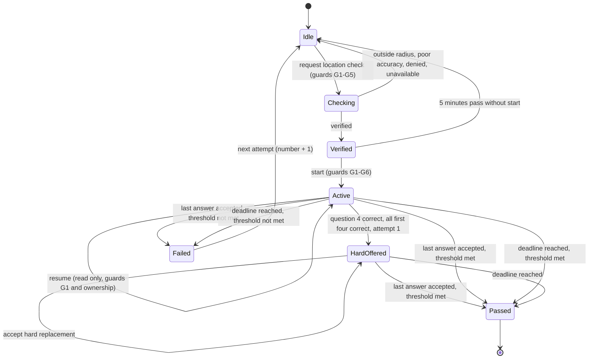

# Campus & City Quest: Business Rules

## 0. Purpose, scope and how to read this file

This file is the single source of truth for the behaviour of the Campus & City Quest pilot: a mobile web app in which incoming international students verify their live location at 8 campus checkpoints and then take a short multiple-choice quiz. It is derived from the team's newest Main Project Document, which overrides every earlier idea. Not part of this pilot: the old 30-second leave rule, the old 5 checkpoints, old point values, duo and nationality leaderboards, city locators, native apps, NFC. (A small admin area was added as a proposal, see section 9.)

Conventions:

- **BRxx** is a rule of the Main Project Document. All 25 rules are **Must**. Section 1 restates them in clean English with the same meaning.
- **R-nn** is a numbered resolution in section 2. Each one is tagged **[Source]** (follows directly from a rule), **[Assumption]** (the source is silent; the team may change it) or **[Proposal]** (a tunable number or design choice; the value is a suggestion).
- **DM-Pn** refers to a proposed addition in `docs/data-model.md`, section 3. Where a rule here needs such an addition, it says so.
- "Server time" means the database or server clock in UTC. The client clock is never trusted for any decision.
- The read-first **info page** (shown after a successful location check and before the quiz starts, no timer) is a **Should** feature and is not covered by the rules. Where it matters, the text says "if the info page is built".

## 1. The 25 business rules in clean English

| ID | Rule |
|---|---|
| BR01 | Each user is identified by a unique school e-mail address. A user can only enter the app by logging in with a one-time password (OTP) sent to that address; a successful login starts the session. |
| BR02 | When signing up, a new user must enter a first name and a last name. A profile picture is optional. A nickname is possible. |
| BR03 | A student may have only one active session (on their phone). Each session belongs to exactly one student and expires after a set period of inactivity. |
| BR04 | A solo leaderboard ranks individual users by their total points. A team leaderboard ranks teams by the average of the total points of all their members. Users who are not in a team cannot view the team leaderboard. Fractional points of users and teams are rounded up. |
| BR05 | A team has 1 to 5 members. Only teams with at least 2 members take part in the team leaderboard. Each user can belong to one and only one team (read as "never more than one team", see R-40). Users can create teams; a team must have a name and may have a profile picture. |
| BR06 | A user can invite another user to their team by e-mail address. The invited user can accept or reject the invitation in the web app. A rejected invitation automatically becomes invalid. An invitation to a team that is already full cannot be accepted and becomes invalid. Invitations expire after 24 hours and become invalid. A user who is already in a team cannot be invited to a team. |
| BR07 | The pilot has eight checkpoints: Mensa, Library, CAS Cafe, Campus Garden, Care.box and Shop.box, Building B, Building C, Sensoricum. |
| BR08 | Each checkpoint has a unique name, GPS coordinates, a positive geofence radius and an active/inactive status (`is_active`). Only active checkpoints can unlock quizzes. |
| BR09 | Each checkpoint attempt randomly selects 3 or 5 distinct questions from the checkpoint's question bank, depending on the checkpoint (larger areas such as Library, Mensa, Building B and Building C use 5; Sensoricum uses 3). The bank should contain at least 2 times as many normal questions and 3 times as many hard questions as are in play. A new attempt makes a fresh random selection; questions from earlier attempts may appear again. |
| BR10 | Each question belongs to exactly one checkpoint and has four answer options, exactly one of which is correct. |
| BR11 | Questions, options, answer keys and point values are maintained in the database and can be changed without changing backend code. |
| BR12 | Location verification is required when starting each checkpoint attempt. Poor GPS accuracy or denied permission requires another check and does not consume an attempt or start the timer. The check is lenient on purpose (see `docs/geofencing.md`): a reading counts as inside up to 30 m beyond the radius plus the reading's own error margin (at most 50 m of it), and readings up to 200 m accuracy are accepted. Leaving the geofence afterwards does not end the attempt and does not block submissions. |
| BR13 | Each attempt has a time limit of 1 minute per question in the quiz, starting when the quiz unlocks. |
| BR14 | A wrong answer earns no points for that question. The right answer is revealed immediately. The question cannot be retried; the student moves on to the next question. |
| BR15 | A student passes a checkpoint only with at least 4 of 5 or 2 of 3 questions correct. Until the student passes, the checkpoint stays incomplete and the student is prompted to start another attempt. |
| BR16 | Points are credited only at the end of a successfully completed attempt. An attempt that ran out of time awards the points of the correctly answered questions only if the passing threshold is met; otherwise no points are awarded and the attempt is used up. The student is then prompted to start another attempt. |
| BR17 | A successfully completed attempt awards a Time Bonus of one point per whole second remaining, provided the passing threshold is met. This applies to every attempt. |
| BR18 | A Full Clear Bonus of 200 points is awarded when all questions in the checkpoint are answered correctly. This applies to every attempt. |
| BR19 | A failed checkpoint may be attempted again. Attempts 2 to 5 award points at decreasing rates (multiplier table); the multiplier is applied after the bonuses (Time Bonus, Full Clear Bonus) have been added. Attempt 6 and later can complete the checkpoint but award zero points. |
| BR20 | On attempt 1 only, answering the first four questions correctly on the first selection unlocks the option to replace question five with a hard question. |
| BR21 | The hard question is worth 2,000 points if correct and 0 if wrong, with no retry. A wrong answer on it forfeits only the Full Clear Bonus. The checkpoint can still be passed, because the first four questions already meet the 4/5 threshold. |
| BR22 | The server accepts answer selections and final submissions only while the attempt is active and before its timer expires. |
| BR23 | A passed attempt cannot be reopened or edited by the student. Each new attempt creates a new attempt record. Once a student passes a checkpoint, it is permanently completed for the pilot and cannot be replayed. Further attempts are allowed only while the checkpoint is incomplete. |
| BR24 | Equal scores show the same rank number. Among equal scores, the user or team that reached the score earlier appears higher, although the rank number stays the same. |
| BR25 | Assigned questions stay unchanged after a refresh or reconnect. The server keeps the question sequence, the selection history and the hard-question eligibility. |

Point tables from the source (the only numeric constants; they live in database tables, see BR11 and `docs/data-model.md` section 4):

| Item | Value |
|---|---|
| Normal question | 1,000 points |
| Hard question | 2,000 points |
| Full Clear Bonus | 200 points |
| Time Bonus | 1 point per whole remaining second |
| Multiplier by attempt number | 1: 100%, 2: 85%, 3: 70%, 4: 55%, 5: 40%, 6 and later: 0% |

Question counts per checkpoint (source table, `n` = number of questions per attempt):

| Checkpoint | Normal questions drawn | Hard questions drawn | n |
|---|---|---|---|
| Mensa, Building B, Building C, Library | 5 (attempt 1 may swap the fifth for a hard one: 4 normal + 1 hard) | 0 or 1 | 5 |
| Sensoricum, CAS Cafe, Care.box and Shop.box, Campus Garden | 3 | 0 | 3 |

## 2. Resolutions of ambiguities

### 2.1 Scoring, attempts and the quiz

**R-01 Points formula [Source + Assumption on rounding place].** For an attempt that is **passed**:

```
base_points    = 1000 x (correct normal answers) + 2000 x (hard answer correct ? 1 : 0)
time_bonus     = 1 x remaining_whole_seconds
full_clear     = 200 if every presented question was answered correctly, else 0
raw_points     = base_points + time_bonus + full_clear
points_exact   = raw_points x multiplier_percent          (unit: 1/100 point, an integer)
points_earned  = ceil( points_exact / 100 )               (display value of the attempt)
```

For a **failed** attempt: `time_bonus = 0`, `full_clear = 0`, `points_exact = 0`, `points_earned = 0`. The multiplier is applied once, to the sum, after both bonuses (BR19). The point values (1000, 2000, 200, 1 per second) and the percentages are read from `Difficulty`, `Bonus` and `Scoring_Multiplier` at the moment the attempt is finalised (BR11).

**R-02 Integer arithmetic and where BR04 rounding happens [Assumption].** All arithmetic is integer arithmetic; no floating point. Percentages are stored as whole numbers (100, 85, ...). `ceil(a / 100)` is computed as `(a + 99) div 100`.

- The **user's total** keeps the exact amounts: `Student.points_exact_x100 = sum of points_exact` of the student's attempts (DM-P14), and `Student.total_points = ceil(points_exact_x100 / 100)`. So BR04's "fractional points of users are rounded up" is applied **once per user**, on the exact sum, never per attempt.
- `Attempt.points_earned` is the rounded-up value shown for one attempt. Because each attempt is rounded separately, the displayed attempt values can add up to more than `total_points` (see example 15). The leaderboard and all totals use `total_points`.
- The **team score** is rounded up once more from integer user totals (R-50), as BR04 says for teams.
- Open point OP-07 asks the team to confirm this reading.

**R-03 Whole seconds [Source].** `remaining_whole_seconds = floor((expires_at - finished_at) in milliseconds / 1000)`, never below 0. `finished_at` is the server time at which the last answer was accepted. Example: 120.6 s left gives 120. Because the clock starts before the first answer, the practical maximum is `limit - 1` seconds (299 s for 5 questions, 179 s for 3).

**R-04 Time limit [Source + Assumption].** `expires_at = start_time + n x 60 seconds`: **5 minutes** for a 5-question attempt and **3 minutes** for a 3-question attempt. It is one deadline for the whole attempt, not 60 seconds per question. The hard-question replacement does not change `n` (still 5) and does not add or remove time. `start_time` is the server time at which the attempt row is created, which is the moment the quiz unlocks (the questions become visible). If the info page is built, its reading time is before `start_time` and has no timer.

**R-05 Strict deadline [Source + Assumption].** An answer is accepted only if the server time when the request is processed is strictly before `expires_at`. There is no grace period for network delay. At exactly `expires_at` the attempt is already expired.

**R-06 Unanswered questions at expiry [Assumption].** At expiry every unanswered question counts as incorrect: it earns 0 points, `selected_option_id` stays NULL, and no right answer is revealed. A hard question that was offered but not answered counts the same.

**R-07 Time bonus after expiry [Assumption].** An attempt that expired has `remaining_whole_seconds = 0`, so its Time Bonus is 0. It can still be passed (BR16) with the points of the correct answers. Because an expired attempt always has at least one unanswered (= incorrect) question, it never earns the Full Clear Bonus.

**R-08 Completion of an attempt [Assumption].** There is no separate "submit" button. The "final submission" of BR22 is the acceptance of the answer to the last question. At that moment the server evaluates the attempt in one transaction (section 4). If the deadline passes first, the server evaluates the attempt as expired (R-06, R-07).

**R-09 Order and finality of answers [Assumption].** Questions are answered strictly in order, one at a time. The server accepts only an answer for the next unanswered question number. The first selection is final: it cannot be changed, repeated or skipped (BR14). A second submission for the same question is rejected and changes nothing. There is no back navigation.

**R-10 Correctness feedback [Source].** After each answer the server returns whether it was correct. If it was wrong, the server also returns the correct option. If it was right, nothing else is revealed. Correct-answer flags (`is_correct`) are never sent with the question before it is answered.

**R-11 Meaning of "first selection" in BR20 [Assumption].** Because BR14 allows no retries, every selection is the first and only one. So "answered the first four questions correctly on the first selection" simply means: questions 1 to 4 were all answered correctly. The words "first selection" add no further condition.

**R-12 Which checkpoints can offer a hard question [Assumption, from the source table].** Only the checkpoints with `question_count = 5`: Mensa, Library, Building B, Building C. The four 3-question checkpoints (Sensoricum, CAS Cafe, Care.box and Shop.box, Campus Garden) never offer one.

**R-13 Hard-question rules [Source + Assumption].**
1. Eligibility is checked when the answer to question 4 is accepted: attempt number is 1, the checkpoint can offer hard questions (R-12), questions 1 to 4 are all correct, and the attempt is still active. If so, `Attempt.hard_unlocked` becomes true and the offer is persisted (BR25).
2. The student sees question 5 (a normal question, already drawn at attempt start) together with the offer. The student **declines** simply by answering the normal question 5, or **accepts** by asking to replace it before answering it. After accepting, the server draws one active hard question of the checkpoint at random, stores it in slot 5 (keeping which normal question it replaced, DM-P9), and the student cannot go back.
3. The hard question is worth the `HARD` points (2,000) if correct and 0 if wrong. The text "starts at 2,000 points" is read as a fixed value, with no time decay (open point OP-04).
4. The checkpoint can always be passed in this branch: 4 correct answers already meet the threshold.
5. Accepting a hard question does not change the time limit and does not change `n`.
6. If the checkpoint has no active hard question when the student accepts, the offer is not made at all (`hard_unlocked` stays false). Seed validation normally prevents this (R-16).

**R-14 Full Clear [Source + Assumption].** The 200-point bonus is awarded when **every presented question slot** (3 or 5) was answered correctly. In the hard branch the hard question is the fifth slot. Consequences:

| Situation | Full Clear |
|---|---|
| 5 normal questions, all correct, hard never offered | 200 |
| Hard offered but declined, normal question 5 correct, all 5 correct | 200 |
| Hard accepted and correct, questions 1 to 4 correct | 200 |
| Hard accepted and wrong (BR21) | 0 (only this bonus is lost; threshold still met) |
| Hard offered and accepted but unanswered at expiry | 0 |
| Any wrong or unanswered question | 0 |

**R-15 Pass thresholds [Source].** 5-question attempts: at least 4 correct. 3-question attempts: at least 2 correct. The hard question counts as the fifth question. It is proposed to store this per checkpoint (DM-P6).

**R-16 Question-bank minimum sizes [Assumption, resolves the 2x conflict].** "In play" means the number of questions of that difficulty that one attempt can show. A 5-question attempt can show 5 normal questions (when no hard one is accepted) or 1 hard question. So the recommended minimum number of **active** questions per checkpoint (BR09 says "should") is:

| Checkpoint kind | Normal | Hard |
|---|---|---|
| 5-question (Mensa, Library, Building B, Building C) | 10 (2 x 5) | 3 (3 x 1) |
| 3-question (Sensoricum, CAS Cafe, Care.box and Shop.box, Campus Garden) | 6 (2 x 3) | 0 |

The source template has 8 normal rows for Building B, Building C and Library, and 3 visible normal rows for Mensa. This is below 10. The reading "4 normal in play" would give 8, but a draw without a hard question uses 5 normal questions, so the safer minimum of 10 is used. **Action:** add at least 2 normal questions to each of those 4 banks (Mensa: fill all rows to 10). The minimum is enforced **when loading seed data**: the seed validation (`docs/data-model.md` section 4) refuses to load a checkpoint as active when its bank is below the minimum. It is **not** a second runtime gate: BR08 alone (`is_active`) decides whether a checkpoint unlocks quizzes. The only runtime check is technical: if fewer than `n` active normal questions exist, a draw of `n` distinct questions is impossible and the server answers `DRAW_IMPOSSIBLE` (a configuration fault to be fixed, not a rule). The Mensa staircase sample question is unverified and must not be loaded as is (OP-09).

**R-17 Random selection [Source + Assumption].** At attempt start the server draws `n` distinct **active** normal questions of the checkpoint uniformly at random, writes all `n` rows into `Attempt_Question` with their `question_number` (1 to n), and never redraws them. Answer options are always shown in their fixed stored order (DM-P7), so a refresh shows the identical screen.

**R-18 Attempts 6 and later [Source + Assumption].** The source says "6 and below" in the table and "attempt 6 and further" in BR19; this file reads both as **attempt 6 and later**. There is no maximum number of attempts. On attempt 6 or later the student can still pass and complete the checkpoint, but `points_exact = 0` and `points_earned = 0` because the multiplier is 0%. The raw bonuses are still recorded, and `Student.total_points`, `points_exact_x100` and `points_updated_at` do not change. A lookup for an attempt number above the highest row of `Scoring_Multiplier` uses the highest row.

**R-19 Attempt numbering and what uses up an attempt [Source + Assumption].** `attempt_number = 1 + (number of earlier attempt rows of this student for this checkpoint)`. An attempt row exists only after a successful location check and a start, so location failures never use an attempt (BR12). Every started attempt that ends without a pass (wrong answers, expiry, abandonment) is `failed` and used up. An attempt that was abandoned (phone closed) keeps running on the server and expires at `expires_at`.

**R-20 Checkpoint already completed or inactive [Source + Assumption].** The server refuses to check location or to start an attempt when the student already has a `passed` attempt for the checkpoint (error `ALREADY_COMPLETED`) or when the checkpoint is inactive (`NOT_AVAILABLE`). These checks happen before any location data is processed. Deactivating a checkpoint does not interrupt attempts already running; they finish normally.

**R-21 One active attempt per student, and resume [Assumption, requested in the data model].** A student can have at most one attempt in status `active`.
1. Before any check, the server first finalises an active attempt of the student whose `expires_at` has passed (lazy expiry, R-22).
2. While an attempt is `active`, a verify call for the **same** checkpoint returns that attempt unchanged (resume, BR25, no location needed); a verify call for **another** checkpoint is refused with `ACTIVE_ATTEMPT_EXISTS`. The error body carries the running attempt's id, so the client can resume it.
3. **Resume** is a separate read-only operation, "get my active attempt". It needs only a valid session; it needs **no** location check and no verified check (G6 does not apply). It returns the running attempt as described in section 4.4, or "none". The attempt must belong to the caller. Resume writes nothing except the lazy finalisation of point 1.
4. This is the path for a student whose phone died or who logged in again: log in, call resume, continue. BR12 asks for location verification only "when starting" an attempt, so resuming does not repeat it.

**R-22 Crediting points and timestamps [Source + Assumption].** Points are credited in the same database transaction that closes the attempt: `Student.points_exact_x100` is increased by the attempt's `points_exact` and `total_points` is recomputed (R-02). `Student.points_updated_at` is set to the attempt's `finished_at` (for an expired attempt: `expires_at`, not the time a background job ran), and only when `points_exact > 0`. A background job finalises expired active attempts at least every 60 seconds; every attempt endpoint also finalises first (lazy expiry). Both paths use a row lock and the condition `status = 'active'`, so an attempt is never credited twice.

**R-23 Re-opening and editing [Source].** Passed attempts and their answers are read-only. There is no endpoint that updates a closed attempt. A student cannot delete an attempt. The database should reject updates of closed rows (trigger), see data model section 2.

**R-24 Content changes [Assumption].** Questions are retired by `is_active = false`, never deleted (history keeps pointing to them, DM-P7). Editing a question or option text while attempts are running changes what those students see; seed scripts that change content must therefore be run outside active play or only add or retire rows (OP-13). Point-table changes affect only attempts finalised afterwards; each finished attempt stores the multiplier and base points it used (DM-P8).

### 2.2 Sign-up, login and sessions

**R-30 One entry form [Assumption].** Login and sign-up use the same two steps: enter e-mail, enter OTP. A first-time user is asked for names only after the OTP proved the mailbox (R-34).

**R-31 E-mail rule [Source + Assumption].** The e-mail is trimmed and lower-cased. It must contain exactly one `@` and be at most 254 characters. The binding team decision is that it must **end with `heilbronn.dhbw.de`**. This file implements that literally, with one safety condition: the character directly before the suffix must be `@` or `.`, so that the suffix is a whole domain name and not the tail of a longer word. Accepted: `name@heilbronn.dhbw.de` and sub-domain forms such as `name@stud.heilbronn.dhbw.de`. Rejected: `name@evilheilbronn.dhbw.de` (suffix is part of a longer label), `name@heilbronn.dhbw.de.evil.com` (does not end with the suffix), `a@b@heilbronn.dhbw.de` (two `@`). Equivalent pattern: `^[^@\s]+@([a-z0-9-]+\.)*heilbronn\.dhbw\.de$`. The local part (before `@`) has 1 to 64 characters, no whitespace or control characters, and no `@`; no other character class is excluded, so real names (including hyphens, dots, apostrophes) and `+` addresses are not locked out. Because `+tag` aliases can lead to the same mailbox, uniqueness is on the full normalised address and the risk is recorded (OP-03). Whether sub-domain addresses really exist for students is TBC (OP-02). A malformed or foreign address gets a specific validation message; this reveals nothing about which accounts exist.

**R-32 Generic response [Source].** For every request with a well-formed school address, the server answers with the same status code, the same body and about the same time: "If the account exists, an email containing the OTP has been sent." This holds if the account does not exist (the user is signing up), exists, is throttled (R-33), or the mail failed. Sending is done after the response (queue) so that timing does not leak. The same OTP e-mail text is used for new and existing users.

**R-33 OTP rules [Proposal].**

| Item | Value |
|---|---|
| Format | 6 digits from a cryptographically secure generator |
| Lifetime | 10 minutes (`expires_at = created_at + 10 min`) |
| Use | Single use: `is_used = true` on success |
| Failed entries | Maximum 5 per OTP (`failed_attempts`); at 5 the OTP is dead |
| Resend | At most 1 new OTP per e-mail per 30 seconds and 5 per hour; excess requests get the generic message but no new mail |
| New OTP | A newer OTP for the same e-mail invalidates every older unused one (marks it used) |
| Storage | Only `code_hash` (keyed hash, for example HMAC with a server secret) is stored, never the code |
| Comparison | Constant time |
| Wrong, expired, used or locked code | One identical error text "Invalid or expired code" |
| Retention | OTP rows older than 24 hours are deleted |

**R-34 Verification and sign-up [Source + Assumption].** On a correct OTP: (a) if a student with this e-mail exists, a session is created; (b) if not, the server answers "profile required" and does **not** mark the OTP used. The client resubmits e-mail, OTP, first name, last name (required, BR02) and optionally nickname and picture. Then the server creates the `Student` row (total_points 0) and the session, and marks the OTP used, in one transaction. A missing name keeps the OTP usable until it expires. Telling a new user "profile required" only after a correct OTP does not reveal account existence to a stranger.

**R-35 Sessions [Source + Proposal].** The session token is a random value of at least 256 bits delivered in an HttpOnly, Secure, SameSite cookie. Only its hash is stored (`token_hash`). Inactivity timeout: **30 minutes** (proposal). `expires_at = last_active_at + 30 min`, extended on each authenticated request. A session is valid only if `is_active` is true and `expires_at` is in the future. An expired session does not stop a running attempt: the attempt's timer is independent (BR13), and after a new login the student resumes it (R-21, BR25).

**R-36 Single active session [Source + Assumption].** Creating a session sets `is_active = false` on all other sessions of that student in the same transaction (a new login ends the old session). The old phone's next request gets 401 and returns to login. The database enforces this with a partial unique index (data model section 2).

**R-37 Nickname [Proposal DM-P1].** The entity list has no nickname column. Add `Student.nickname` (optional, 2 to 20 characters). Display name on leaderboards and in invitations: the nickname if set; otherwise the first name plus the first letter of the last name ("Mei L."). The e-mail address and the full last name are never shown to other users. Nicknames need not be unique. If DM-P1 is rejected, the display name is the first name plus last initial.

**R-38 Profile data [Assumption].** Editing the name, nickname or picture after sign-up is not required by any rule (OP-16). The e-mail cannot be changed.

### 2.3 Teams and invitations

**R-40 Membership [Source + Assumption].** BR05 says each user belongs to "one and only one team". Read literally this would force every user into a team, but BR04 speaks of "users not in a team" and BR06 of users "already in a team". This file therefore reads it as: **a user is never in more than one team, and may be in none**. A member is a `Student` whose `team_id` points to the team. Creating a team makes the creator its first member. Teams of 1 to 5 members exist; a team of 1 exists and its member may view the team leaderboard, but the team is not listed there until it has 2 members (BR05). A student without a team cannot see the team leaderboard (403).

**R-41 Leaving and removing [Superseded by BR44, BR54].** The pilot rules allowed no leaving, removing or deleting. Section 9 now allows it: the leader removes members (BR44), any member leaves (BR54), an admin adds, removes and orders members and chooses the leader (BR46, BR54). A user who created a team can therefore leave it and join another one.

**R-42 Who may invite [Assumption].** Any member of the team may invite. A user without a team must create one first. Inviting yourself is invalid.

**R-43 Invitee must exist [Source + Assumption].** `invitee_id` is required, so the invitee must already be a registered student. The inviter types an e-mail address and the server looks it up (normalised as in R-31). The server answers every request with the same message, "If the user exists and can be invited, an invitation has been sent.", and creates no row when: the address is unknown, the user is already in a team (BR06), the user is the inviter, a pending invitation from this team to this user already exists, or the team already has 5 members. This avoids an account-existence oracle. Further proposal: at most 10 pending invitations per team.

**R-44 Statuses and transitions [Source + Assumption].** Initial status `pending` with `expires_at = created_at + 24 h`.

| From | Event | To | Condition |
|---|---|---|---|
| pending | invitee accepts | accepted | `now < expires_at`, invitee in no team, team has < 5 members; invitee becomes a member |
| pending | invitee rejects | rejected | `now < expires_at`; rejected is final and counts as invalid (BR06) |
| pending | `now >= expires_at` | expired | set when noticed (job or access) |
| pending | accept attempted while team has 5 members | invalid | the accept fails (BR06) |
| pending | team reaches 5 members | invalid | all other pending invitations of that team |
| pending | invitee joins or creates any team | invalid | all other pending invitations of the invitee |
| accepted, rejected, expired, invalid | any | none | terminal |

An accept request on an expired invitation first marks it `expired`, then fails. The status `invalid` is used for system-invalidated invitations (full team, invitee already in a team); `rejected` is used for the invitee's own rejection. An invitation is acted on only by its invitee (404 for anyone else). Accepting must lock the team row and re-count members inside the transaction so two simultaneous acceptances cannot exceed 5. Invitations are seen in the web app (an e-mail notification is not required, OP-15).

### 2.4 Leaderboards and ranks

**R-50 Totals [Source].** `Student.total_points` follows R-02 (exact sum of the student's attempts, rounded up once). Team score = `ceil( sum of total_points of all members / number of members )`, where members with 0 points count (BR04). Integer form: `(sum + members - 1) div members`. A team of size 1 has the member's own total (inactive anyway). Worked: members with 5320, 4452 and 0 points: sum 9772, average 3257.33..., score 3258.

**R-51 Who is listed [Assumption].** The solo leaderboard lists every registered student (including 0 points) and is visible to every logged-in user. The team leaderboard lists teams with at least 2 members and is visible only to users in a team, who see all listed teams.

**R-52 Rank numbers [Assumption].** Competition ranking: `rank = 1 + number of entries with a strictly higher score`. Scores 5320, 5320, 4000 get ranks 1, 1, 3.

**R-53 Order among equal scores [Source + Assumption].** Sort by score descending, then by `reached_at` ascending (earlier first), then by id ascending as a technical last resort. The last key never changes the rank number.

**R-54 Time a user reached the score [Assumption].** `Student.points_updated_at` (R-22). At sign-up it is set to `created_at` (DM-P2), so students with 0 points are ordered by sign-up time. It changes only when `total_points` actually could change, that is when `points_exact > 0` is credited; a credit that changes the exact sum but not the rounded total still updates it (the student did reach a new state at that time; this keeps the rule simple).

**R-55 Time a team reached the score [Assumption].** The team's score value is recomputed in the same transaction as each event that can change it: a member's points are credited, or a member joins. `Team.score_updated_at` is set to the event time (the attempt's `finished_at`, or the time the invitation was accepted) **only if the rounded score value changed**. Because lazy expiry can apply events out of order, the stored value is `GREATEST(existing, event time)`. At team creation both fields are initialised (score = the creator's total, time = creation time). The team's score, score time and size are cached on `Team` (DM-P5) and can always be recomputed.

### 2.5 Location verification

**R-60 Outcomes [Source + Main Project Document, Geofencing].** The student sends one location reading per tap (latitude, longitude, accuracy in metres, age of the reading in ms) for one checkpoint. The server checks freshness, then accuracy, then the great-circle (Haversine) distance to the checkpoint centre.

| Outcome returned to the client | Condition | Consumes attempt | Starts timer | Stored in the database |
|---|---|---|---|---|
| `OK` (unlock) | reading at most 30 s old, accuracy at most the limit, distance at most the radius | yes (the attempt is created) | yes | one row: `inside_radius = true` + time, linked to the attempt |
| `OUTSIDE` | fresh and precise, but distance above the radius (rounded distance returned) | no | no | one row: `inside_radius = false` + time |
| `OUTSIDE` with `elsewhere` | inside this circle, but another active checkpoint whose circle also contains the reading has a nearer centre (overlapping circles, for example Building C and Sensoricum) | no | no | one row: `inside_radius = false` + time |
| `ACCURACY_TOO_LOW` | accuracy above the limit | no | no | nothing |
| `STALE_POSITION` | reading older than 30 s (or from the future) | no | no | nothing |
| permission denied | the browser reports it (client only, nothing is sent) | no | no | nothing |
| unavailable | timeout, no position or no Geolocation support (client only) | no | no | nothing |

The database therefore holds exactly what the binding decision allows: "inside radius yes/no" with a timestamp (plus the student and checkpoint it belongs to). Failures without a distance decision leave no location record. Any failure simply allows another tap; there is no cooldown beyond rate limiting (R-62).

**R-61 Accuracy limit [Proposal].** 50 metres, held in configuration (not hard-coded). The distance rule uses the reported position only; the accuracy is not added to the radius. A radius smaller than the accuracy limit makes the zone looser than intended; coordinates and radii come from the separate geofencing document (OP-10, OP-22).

**R-62 Start gate [Main Project Document, Geofencing 6.2].** Verification and start are one call: a fresh reading inside the circle creates the attempt at once, so the timer starts at the moment of verification (BR12, BR13). The read-first info page comes **before** the check, so reading never costs quiz time. Rate limit: at most 10 verify calls per student per minute, counted by an in-memory counter keyed by student id that holds no outcome and no location.

**R-63 What the server stores [Source].** Only "inside radius yes/no" plus a timestamp, the student and the checkpoint (DM-P10). Raw coordinates, the accuracy value, the client's timestamp and failure reasons are used in memory for the decision and then discarded. Location rows are deleted after 7 days (proposal). Location consent is recorded once (DM-P4). The consent screen appears before the browser's own permission prompt; without consent no check is possible.

**R-64 Never log coordinates [Source].** The location is sent in a POST body, never in a URL or query string. Request-body logging, error trackers and debug output must not record it. Tests and fixtures use invented coordinates only.

**R-65 After the start [Source].** No location data is requested or accepted during the quiz. Answer requests carry no location, and leaving the geofence has no effect. The deadline is the only clock.

### 2.6 Cheating risks that remain, and mitigations that stay

BR12 lets a student verify once and then leave the checkpoint. The residual risks and what still limits them:

| Risk | Remaining mitigation inside the rules |
|---|---|
| Student verifies, leaves, answers elsewhere or with help | Time limit of 1 minute per question (BR13); no retry and answer shown only after the answer (BR14); random draw per attempt (BR09); a failed attempt costs multiplier (BR19); the checkpoint can be passed once only (BR23) |
| Answers shared between students | Bank 2x larger than the draw (BR09, R-16); fresh random draw per attempt; hard question only on attempt 1; decreasing multiplier; attempts 6+ pay 0 |
| Location spoofing (mock GPS, remote browser) | Server decides, never the client; accuracy limit; rate limit on checks; full prevention is impossible in a web app. No location history is kept beyond the short retention of R-63, so no sequence analysis is planned (OP-17) |
| Several accounts for one person | School e-mail only with the domain rule of R-31, one OTP-proven mailbox per account (BR01); one team per user. `+` aliases remain a known gap (OP-03) |
| Parallel use of one account | One active session (BR03); one active attempt (R-21) |
| Client clock tampering, late submissions | Server-side deadline only (BR22, R-05) |
| Double submission, replay of an answer | Each question can be answered once (R-09); idempotent rejection with no state change |
| Reading answer keys from the API | `is_correct` is never sent before an answer (R-10) |
| Brute-forcing OTP | Lifetime, max 5 failures, throttles (R-33) |

## 3. Scoring

### 3.1 Formula

See R-01 to R-03. Summary: `points_exact = (base + time_bonus + full_clear) x multiplier_percent` for passed attempts; 0 for failed ones. `points_earned = ceil(points_exact / 100)`; the user total is `ceil(sum of points_exact / 100)`. Multiplier by attempt: 1: 100, 2: 85, 3: 70, 4: 55, 5: 40, 6 and later: 0.

### 3.2 Maximum points per checkpoint kind and attempt

Theoretical maximum: all answers correct, with the largest possible whole-second bonus (299 s for 5 questions, 179 s for 3; see R-03). Raw maximum for 5 questions without hard: 5000 + 200 + 299 = 5499. With hard (attempt 1 only): 4000 + 2000 + 200 + 299 = 6499. For 3 questions: 3000 + 200 + 179 = 3379.

| Attempt | Multiplier | 5 questions, no hard | 5 questions with hard (attempt 1 only) | 3 questions |
|---|---|---|---|---|
| 1 | 100% | 5499 | 6499 | 3379 |
| 2 | 85% | 4675 (4674.15 rounded up) | not available | 2873 (2872.15) |
| 3 | 70% | 3850 (3849.3) | not available | 2366 (2365.3) |
| 4 | 55% | 3025 (3024.45) | not available | 1859 (1858.45) |
| 5 | 40% | 2200 (2199.6) | not available | 1352 (1351.6) |
| 6 and later | 0% | 0 | not available | 0 |

Sum of the best case over all 8 checkpoints on first attempts: 4 x 6499 + 4 x 3379 = 25,996 + 13,516 = 39,512. This bound can be used as a sanity check on stored totals.

### 3.3 Worked examples

Each example gives the raw sum, the multiplier and the final value. "Remaining" is whole seconds. Examples 1 to 14 give the attempt's `points_earned`; example 15 shows the user total.

| # | Situation | Arithmetic | Result |
|---|---|---|---|
| 1 | Library, attempt 1, questions 1 to 4 correct, hard offered and declined, normal question 5 correct. Last answer after 179.4 s of 300 s: 120.6 s left, so 120 whole seconds | base 5 x 1000 = 5000; Full Clear 200; time 120; raw 5000 + 200 + 120 = 5320; x 100% | **5320** |
| 2 | Mensa, attempt 1, questions 1 to 4 correct, hard accepted and correct, 90 s left | base 4 x 1000 + 2000 = 6000; Full Clear 200; time 90; raw 6290; x 100% | **6290** |
| 3 | Building B, attempt 1, questions 1 to 4 correct, hard accepted and wrong, 150 s left (passed 4/5) | base 4 x 1000 = 4000; hard 0; Full Clear 0; time 150; raw 4150; x 100% | **4150** |
| 4 | Sensoricum (3 questions), attempt 1, 2 of 3 correct, 100 s left (passed 2/3) | base 2 x 1000 = 2000; Full Clear 0; time 100; raw 2100; x 100% | **2100** |
| 5 | CAS Cafe (3 questions), attempt 2, 3 of 3 correct, 60 s left. Multiplier after bonuses | base 3000; Full Clear 200; time 60; raw 3260; 3260 x 85 = 277,100; 277,100 / 100 = 2771.00 | **2771** (wrong order, multiplier before bonuses: 3000 x 0.85 + 200 + 60 = 2810) |
| 6 | Library, attempt 5, 4 of 5 correct (all normal), 45 s left | base 4000; Full Clear 0; time 45; raw 4045; 4045 x 40 = 161,800; / 100 = 1618.00 | **1618** |
| 7 | Building C, attempt 6, 5 of 5 correct, 200 s left | base 5000; Full Clear 200; time 200; raw 5400; x 0% = 0 | **0**; attempt `passed`, checkpoint completed, `total_points` unchanged |
| 8 | Building C, attempt 3, questions 1 to 4 correct, question 5 unanswered at expiry (still passes 4/5) | base 4000; time 0 (expired); Full Clear 0; raw 4000; 4000 x 70 = 280,000; / 100 = 2800.00 | **2800** |
| 9 | Campus Garden (3 questions), attempt 2, question 1 correct, question 2 wrong, question 3 unanswered at expiry (1 of 3, needs 2) | threshold not met | **0**, status `failed`, attempt 2 used up; the next attempt is number 3 (multiplier 70%) |
| 10 | Mensa, attempt 2 (no hard option), 4 of 5 correct, 37 s left. Fractional result | base 4000; time 37; Full Clear 0; raw 4037; 4037 x 85 = 343,145; / 100 = 3431.45; rounded up | **3432** |
| 11 | Library, attempt 1, questions 1 to 4 correct, hard accepted, not answered when time ran out | base 4000 (4/5); time 0; Full Clear 0; raw 4000; x 100% | **4000** (passed) |
| 12 | Team of three with 5320, 4452 and 0 points | sum 5320 + 4452 + 0 = 9772; 9772 / 3 = 3257.33; rounded up | team score **3258** |
| 13 | Team of two with 5001 and 5000 points | sum 10,001; 10,001 / 2 = 5000.5; rounded up | team score **5001** |
| 14 | Three students with 5320 (reached 10:02), 5320 (reached 10:07), 4000 | equal scores share a rank; earlier first | ranks **1, 1, 3**, listed in that order |
| 15 | One student passes Library on attempt 2 (raw 4037, example 10) and Campus Garden on attempt 2 (2 of 3 correct, 65 s left: base 2000 + time 65 = raw 2065). Rounding once per user (R-02) | Library: 4037 x 85 = 343,145; Garden: 2065 x 85 = 175,525; exact sum 343,145 + 175,525 = 518,670 (= 5186.70 points); total ceil(5186.70) = 5187. Attempt displays: 3432 (3431.45 up) and 1756 (1755.25 up), sum 5188 | user `total_points` **5187** (not 5188) |

## 4. Attempt state machine

### 4.1 States

| State | Meaning | Database representation |
|---|---|---|
| Idle | No attempt in progress for the checkpoint | no active attempt |
| Checking | A location sample is being evaluated | transient; a `Location_Check` row (inside yes/no) is written when a distance decision is made (DM-P10) |
| Verified | Last check had `inside_radius = true`, not used, at most 5 minutes old | `Location_Check` row with `inside_radius = true`, unused |
| Active | Attempt created, quiz running | `Attempt.status = 'active'`, `finished_at` NULL |
| Active, hard offered | Questions 1 to 4 correct, attempt 1, 5-question checkpoint, question 5 still unanswered | `hard_unlocked = true`, slot 5 unanswered |
| Passed | Final, checkpoint completed | `status = 'passed'`, `finished_at` set |
| Failed | Final, attempt used up | `status = 'failed'`, `finished_at` set |



Note: from HardOffered the attempt always ends passed, because 4 correct answers already meet the threshold.

### 4.2 Guards

| Guard | Condition | Error if violated |
|---|---|---|
| G1 | Session valid (R-35) | 401 |
| G2 | Checkpoint exists and `is_active = true` | `NOT_AVAILABLE` (404) |
| G3 | Student has no `passed` attempt for it (BR23) | `ALREADY_COMPLETED` (409) |
| G4 | Student has no active attempt at another checkpoint after lazy expiry (R-21); a running attempt at the same checkpoint is resumed instead | `ACTIVE_ATTEMPT_EXISTS` (409, body names the running attempt) |
| G5 | Location consent given (R-63) | `CONSENT_REQUIRED` (403) |
| G6 | The reading is at most 30 s old, accuracy <= 50 m, and inside the radius (Haversine) | `STALE_POSITION` (422), `ACCURACY_TOO_LOW` (422), or `OUTSIDE` with the rounded distance (200) |
| G7 | For answers: attempt belongs to the student, status `active`, `now < expires_at`, the question number is the next unanswered one, the option belongs to that question | `ATTEMPT_NOT_ACTIVE`, `ATTEMPT_EXPIRED`, `WRONG_QUESTION`, `ALREADY_ANSWERED`, `INVALID_OPTION` (409 / 400); an attempt of another student returns 404 |
| G8 | For the hard replacement: `hard_unlocked`, slot 5 unanswered, not yet replaced, `now < expires_at` | `HARD_NOT_AVAILABLE` (409) |

Technical fault (not a guard): if a start cannot draw `n` distinct active normal questions, the server answers `DRAW_IMPOSSIBLE` (R-16) and creates nothing.

### 4.3 Transitions and what they write

| Transition | Guards | Writes (one transaction each) |
|---|---|---|
| Verify, outside | G1 to G5, G6 fails on distance | Insert `Location_Check` (student, checkpoint, `inside_radius = false`, time). No coordinates. Stale or imprecise readings write nothing. |
| Verify, inside (unlock) | G1 to G6 | Lock the student row. Insert `Attempt`: `attempt_number` per R-19, `start_time = now`, `expires_at = now + n minutes`, `status = 'active'`, `hard_unlocked = false`, bonuses 0, `points_earned` 0. Insert `n` `Attempt_Question` rows with randomly drawn distinct questions (R-17). Insert `Location_Check` (`inside_radius = true`) linked to this attempt. A concurrent duplicate tap fails on the unique indexes and gets the winning attempt back. |
| Resume | G1, attempt belongs to the caller | Lazy finalisation of an expired attempt only. Otherwise read-only: returns the attempt state (section 4.4). Needs no location check and no verified check. |
| Answer, not last | G7 | Set `selected_option_id` and `answered_at = now` on the slot. Return correctness (and the right option if wrong). If this was question 4 and questions 1 to 4 are all correct and attempt is 1 and the checkpoint can offer a hard question: set `hard_unlocked = true`. |
| Accept hard | G7 timing, G8 | In slot 5 set `question_id` to a random active hard question of the checkpoint and record the replaced question id (DM-P9). |
| Last answer | G7 | As above, then close: count correct answers; if correct >= threshold the status is `passed`, `time_bonus = floor(ms(expires_at - now) / 1000)`, `full_clear_bonus` per R-14, `points_exact` and `points_earned` per R-01; else `failed` with 0 for all of them. Set `finished_at = now`. Credit the student (R-22: `points_exact_x100`, `total_points`, `points_updated_at` if `points_exact > 0`); recompute the team score (R-55). |
| Expiry | `status = 'active'` and `now >= expires_at` (detected by job or by any attempt request) | Treat unanswered slots as incorrect (R-06). Same evaluation as above with `time_bonus = 0`, `full_clear_bonus = 0`, `finished_at = expires_at`. |
| Next attempt | Idle guards | New row; the previous row is never changed (BR23). |

Race between a last answer and expiry: both lock the attempt row. Whoever holds the lock first wins, and the second sees a closed attempt. An answer whose processing starts at or after `expires_at` is refused (R-05), then the attempt is evaluated as expired.

### 4.4 Refresh and reconnect (BR25)

After a refresh, a new login on the same phone or another phone, or a session expiry, the client calls resume (R-21). The server returns the running attempt with: the question order, which questions are answered and with which options, whether the hard offer is open, whether it was accepted, and the remaining time computed from server time. Nothing about the quiz is held only in the client. If no attempt is running, resume returns "none" and the student starts with a location check as usual.

## 5. Validation and error rules

All checks run on the server. Limits marked [Proposal] can be tuned. Every rejection of a malformed request is a 400 with a short, non-revealing message; unknown JSON fields are rejected.

| Input | Rule |
|---|---|
| E-mail | R-31: trimmed, lower-case, exactly one `@`, max 254 characters, local part 1 to 64 characters without whitespace, control characters or `@`; the address must end with `heilbronn.dhbw.de` and the character before the suffix must be `@` or `.` |
| OTP | Exactly 6 digits after trimming spaces; wrong format is treated like a wrong code |
| First name, last name | Required at sign-up; 1 to 50 characters after trimming; Unicode letters, space, hyphen, apostrophe, period; no digits, no control characters; repeated spaces collapsed [Proposal] |
| Nickname | Optional; 2 to 20 characters; letters, digits, space, `_`, `-`, `.`; no leading or trailing space [Proposal] |
| Team name | Required; 3 to 30 characters, same character set as nickname [Proposal]; unique ignoring case [Proposal, DM-P5] |
| Profile picture (student or team) | Optional; at most 2 MB [Proposal]; JPEG, PNG or WebP identified by file content, not by name or declared type; at most 4096 x 4096 pixels; the server re-encodes it to at most 512 x 512 and removes metadata (EXIF can contain GPS coordinates). Stored as a file with a random name; the database holds the path |
| Invitation e-mail | Same as E-mail |
| Checkpoint id | Positive integer of an existing checkpoint |
| Location sample | `latitude` finite number in [-90, 90]; `longitude` finite in [-180, 180]; `accuracy` finite and greater than 0 [Proposal]; reject NaN, Infinity, strings. Sent only in a POST body |
| Answer selection | `option_id` integer; must be one of the four options of the current question of the student's own active attempt; no other fields |
| Hard replacement | No body; allowed only under G8 |
| Resume | No body; returns only the caller's own attempt |
| Request size | JSON bodies at most 10 KB except picture uploads [Proposal] |

Status codes: 400 invalid input, 401 no valid session, 403 not allowed (for example team leaderboard without a team), 404 object not found or not yours, 409 state conflict (codes in section 4.2), 429 rate limited, 500/503 technical faults such as `DRAW_IMPOSSIBLE`. Error bodies carry a code and a generic message and never include raw coordinates or other users' data.

## 6. Traceability hint

Main entities touched per rule (the full matrix is built separately). Entries marked * need a proposed addition from `docs/data-model.md` section 3.

| Rule | Entities / tables |
|---|---|
| BR01 | Student, OTP_Code, Session |
| BR02 | Student (names, picture, nickname*) |
| BR03 | Session |
| BR04 | Student (`total_points`, exact sum*), Team (team score*), Attempt (source of points, `points_exact`*) |
| BR05 | Team, Student |
| BR06 | Team_Invitation, Team, Student |
| BR07 | Checkpoint (seed rows) |
| BR08 | Checkpoint |
| BR09 | Checkpoint, Question, Difficulty, Attempt, Attempt_Question |
| BR10 | Question, Option |
| BR11 | Difficulty, Bonus, Scoring_Multiplier, Question, Option, Checkpoint |
| BR12 | Checkpoint, Location_Check*, Attempt |
| BR13 | Attempt (`start_time`, `expires_at`), Checkpoint (`question_count`) |
| BR14 | Attempt_Question, Option |
| BR15 | Attempt, Checkpoint (pass threshold*) |
| BR16 | Attempt, Student, Team |
| BR17 | Attempt (`time_bonus`), Bonus |
| BR18 | Attempt (`full_clear_bonus`), Bonus |
| BR19 | Attempt, Scoring_Multiplier |
| BR20 | Attempt (`hard_unlocked`), Attempt_Question, Question, Difficulty |
| BR21 | Attempt, Attempt_Question, Difficulty, Bonus |
| BR22 | Attempt, Attempt_Question |
| BR23 | Attempt |
| BR24 | Student (`points_updated_at`), Team (`score_updated_at`*) |
| BR25 | Attempt, Attempt_Question |

## 7. Assumptions and open points to confirm

The numbered items below must be confirmed with the client or lecturer. "TBC" means the fact is unknown to the team; nothing here states a university fact.

| No. | Item | Current default |
|---|---|---|
| OP-01 | Session inactivity timeout and OTP lifetime | 30 min and 10 min (R-35, R-33). TBC |
| OP-02 | Do sub-domain addresses (for example `@stud.heilbronn.dhbw.de`) exist for students? | Accepted, because the binding rule says the address must end with `heilbronn.dhbw.de` (R-31). TBC with the university whether to narrow it to `@heilbronn.dhbw.de` only |
| OP-03 | `+tag` addresses can reach the same mailbox and allow several accounts | Allowed (R-31); uniqueness is on the full address. TBC whether to block them |
| OP-04 | "Hard question starts at 2,000 points": is there any decay over time? | No decay, fixed 2,000 (R-13). TBC |
| OP-05 | Rank numbering style for ties | Competition ranking 1, 1, 3 (R-52). Dense ranking (1, 1, 2) is the alternative |
| OP-06 | Can a user leave a team, can members be removed, can a team be deleted? A solo team creator can never join another team | Yes since 2026-11-10: BR44 (leader removes), BR54 (any member leaves, admin sets leader and order) |
| OP-07 | Where BR04 rounding is applied | Exact points kept per attempt, rounded up once per user, then once per team (R-02). Alternative: round every attempt and sum. TBC |
| OP-08 | Question content: 10 normal and 3 hard questions per 5-question checkpoint, 6 per 3-question checkpoint | Must be written; source template is short (R-16) |
| OP-09 | The Mensa staircase sample question is unverified | Not seeded until verified |
| OP-10 | Geofence coordinates, radius values and the "Geofencing Architecture" page are empty in the source | TBC; all geofence numbers are seed data |
| OP-11 | Data protection: legal basis, retention periods (7 days for location rows is a proposal), deletion on request, responsible contact | TBC with the university data-protection contact |
| OP-12 | Does the hard question deserve extra time? | No (R-13). TBC |
| OP-13 | Editing question text or answer keys while attempts are running | Run content scripts outside active play or add/retire only (R-24) |
| OP-14 | Info page (Should) | Not required; the start gate allows it (R-62) |
| OP-15 | E-mail notification for invitations | None; invitations are seen in the app |
| OP-16 | Editing profile (name, nickname, picture) after sign-up | Not required (R-38) |
| OP-17 | Review of suspicious location patterns | Not planned: only inside yes/no rows are kept, for 7 days. If the team wants sequence review, the retention and the stored data must be decided first |
| OP-18 | Does the solo leaderboard list students with 0 points? | Yes (R-51). TBC |
| OP-19 | E-mail delivery: sender address, whether the university mail system accepts it, spam handling | TBC |
| OP-20 | "Live" leaderboards: push or periodic refresh | Not defined by a rule; rank data is always computed from stored totals |
| OP-21 | Whether showing a nickname or "first name + last initial" to other students is acceptable to the university | Assumed acceptable. TBC |
| OP-22 | Smallest geofence radius compared with the 50 m accuracy limit | If any radius is below 50 m, decide whether accuracy limit should be capped at the radius |
| OP-23 | Maximum number of simultaneous attempts per student | One (R-21), matches the requested "one active attempt per student" |

## 8. Acceptance checks (edge cases a test suite must cover)

| # | Check | Expected |
|---|---|---|
| 1 | Login with `x@evilheilbronn.dhbw.de`, `x@heilbronn.dhbw.de.evil.com`, `a@b@heilbronn.dhbw.de`; and with `x@heilbronn.dhbw.de`, `x@stud.heilbronn.dhbw.de`, `x+1@heilbronn.dhbw.de` | First three rejected as invalid input; last three accepted |
| 2 | Login for an unknown and a known address | Byte-identical response text and status |
| 3 | 6th wrong OTP entry; correct OTP after 5 wrong ones | Rejected; OTP dead |
| 4 | Second login on another phone | First session inactive; first phone gets 401 |
| 5 | Location check with accuracy 51 m and inside radius | `poor_accuracy`, no attempt row, no timer, no location row |
| 6 | Permission denied, then success | One `Attempt` only, number 1; one `Location_Check` row (`inside_radius = true`) |
| 7 | Answer at `expires_at - 1 ms` and at `expires_at` | First accepted, second refused |
| 8 | Answer question 3 before question 2 | `WRONG_QUESTION` |
| 9 | Same answer posted twice | Second refused, data unchanged |
| 10 | Q1 to Q4 correct on attempt 1 at Library; same on attempt 2 | Hard offered once; never on attempt 2 or at Sensoricum |
| 11 | Hard accepted, answered wrong | Passed, `full_clear_bonus = 0`, hard question 0 points |
| 12 | Refresh mid-quiz and after hard acceptance | Same questions, order, answers and offer state |
| 13 | Pass checkpoint, then try to start it again | `ALREADY_COMPLETED` |
| 14 | Attempt 6 passed | `points_earned = 0`, checkpoint completed |
| 15 | Two clients start an attempt at the same time | One active attempt |
| 16 | Two invitees accept the last free place at the same time | One succeeds; the other invitation `invalid`; team size 5 |
| 17 | Invitation accepted at exactly `created_at + 24 h` | Refused, status `expired` |
| 18 | User with a pending invitation creates a team | Pending invitations become `invalid` |
| 19 | Team of 1 views team leaderboard; user without team does | Allowed and not listed; 403 |
| 20 | Equal scores, different reach time; equal in both | Same rank, earlier on top; id order, same rank |
| 21 | Examples 1 to 15 of section 3.3 | Exact results shown |
| 22 | Search all logs and database for coordinates, accuracy values and failure reasons after location checks | None found; only `inside_radius` and a time |
| 23 | Active attempt exists; student logs in again and calls resume; also calls location check or start | Resume returns the attempt with no location check; location check and start return `ACTIVE_ATTEMPT_EXISTS` |
| 24 | Two passed attempts with exact sums 343,145 and 175,525 | `total_points = 5187`, not 5188 |
| 25 | Checkpoint `is_active = true` with a bank below the 2x minimum, enough questions to draw | Quiz starts; seeding that bank as active would have failed validation |

## 9. Proposals added on 2026-10-27 and later (need the team's approval)

These rules were requested by the project manager after the pilot rules were written. They are **[Proposal]** until the team agrees; the code and tests already follow them (test names carry the BR number). Yuri's backend rewrite must keep them.

| Rule | Text |
|---|---|
| **BR26 Admin role** | The configured admin addresses (`ADMIN_EMAIL`, comma-separated; default `sekretariat.dski@heilbronn.dhbw.de` and the team's shared mailbox `dhbw.campus@gmail.com`, see BR37) log in with the normal OTP flow and receive the role `admin`. Only admins reach `/api/admin/*` and the `/admin` pages. Admin accounts cannot be blocked, archived or deleted through the web area, and never appear in the leaderboards. Admins can change the role of any other account (BR53). |
| **BR27 Name rules** | Nicknames, first and last names and team names may not contain a banned word in German or English. Whole words are compared, so harmless names that contain a banned word (Cass, Classic) stay allowed. The list is in `docs/banned-terms.md`; admins may add words. |
| **BR28 Account status** | An account is `active`, `blocked` or `archived` (a deleted account does not exist any more, BR47). Only `active` accounts can log in, hold a session, appear in the leaderboards or be invited. Blocking or archiving ends all sessions at once. An admin may also **report** an account (flag with a reason) without blocking it. Login of a blocked or archived account fails with `ACCOUNT_UNAVAILABLE` after the code was entered correctly. |
| **BR29 Audit log** | Logins, logouts, forced logouts, account changes, status changes and account deletion are written to `audit_events` (no e-mail addresses, codes, tokens or coordinates). The admin user page shows sessions, quests (attempts) and this log. |
| **BR30 Delete my account** | Every non-admin user may delete their own account. It is removed completely as described in BR47 (team repaired, sessions, invitations, quiz history and log deleted, e-mail address free for a new sign-up). Leaving only the team is possible without deleting the account (BR54). |
| **BR31 One e-mail, one account** | `students.email` is unique (normalised: trimmed, lower case). Sign-up, admin create and admin edit all refuse an address that already belongs to an account (`EMAIL_TAKEN`). Archived and blocked accounts keep their address reserved. |
| **BR32 Invitation limit** | Members plus open (pending, unexpired) invitations of a team may never exceed 5. A sixth is refused with `TEAM_FULL`. The check only looks at the inviter's own team, so it tells nothing about the invitee (R-43 stays valid: the reply for an unknown, taken or ineligible address is still the generic message, and no invitation is created). Open invitations count as occupied slots and are shown to the team as "Invite pending" with their remaining time. |
| **BR33 Route helper (client only)** | On request, the app may draw a walking route from the device position to a checkpoint (OpenStreetMap foot router). The position is read in the browser for that tap only and is **never sent to the server or logged**. It does not replace the server-side location check of BR12. |
| **BR34 Map limits** | The map cannot be panned or zoomed out beyond the Heilbronn area (about 6 km by 7 km around the Bildungscampus). |
| **BR36 Player profile** | Any signed-in player can open another player's profile from the solo ranking: display name (nickname), avatar, points, solo rank, quests cleared, and, if the player is in a team, the team name, team rank (teams with two or more members) and the members. Never an e-mail address or a last name. A team member with a free place sees "Invite to my team" there; the invitation follows BR32 and R-43. Blocked, archived, deleted and admin accounts have no profile. |
| **BR37 Pre-seeded administrators** | Every address in `ADMIN_EMAIL` has an administrator account from the first seed on; the first one (the study office) is the main admin and gets id 1 when that id is free, the others (the shared mailbox `dhbw.campus@gmail.com`, named "Campus Admin") get the next ids. None of them needs the sign-up form. **Exception to BR01/R-31 (2026-11-10, needs team approval):** these listed admin addresses may log in although they do not end with `heilbronn.dhbw.de`; every other address, including any other Gmail address, is still refused, and students can never be invited with one. Each pre-seeded admin cannot be deleted, blocked, archived or demoted: refused by `DELETE /me`, by the admin API and by the account service. (A database trigger was tried and dropped: MySQL needs the SUPER privilege for triggers when binary logging is on.) |
| **BR38 Admin test mode** | An administrator may start the quiz of any checkpoint, active or not, from anywhere, without consent and location check, as often as wanted. Earlier test attempts of that checkpoint are deleted first, so every test starts fresh; timer, questions and correctness run as for students. Administrators never appear in rankings, statistics or profiles. Students are unaffected (BR08, BR12). |
| **BR39 Admin dashboard** | `GET /admin/stats` gives admins the key numbers, 14 days of logins and passed quests (Berlin calendar days), players by status, pass rate per checkpoint, top players and teams, who is signed in, and the latest events. Figures count students only; blocked, archived and deleted people are not named; no e-mail address and no event detail text is shown. |
| **BR40 Invited address visible to the team** | A team's pending-invitation list shows the e-mail address that a team member typed (`invited_email`), so the team can see whom they invited. Invitations created from a profile page show the player's display name instead; an address nobody typed is never shown. This refines R-43 and BR32: the generic reply to the inviter is unchanged. |
| **BR41 Admin points** | An administrator earns points in test mode (BR38) but is in no ranking. The map header shows a "Reset points" button for admins instead of the rank. `POST /me/reset-points` (admin only) deletes the admin's own attempts, answers and location checks and sets the points to 0, so every quiz can be tested again. `GET /me` and the quiz result show no rank for an admin. |
| **BR42 Team ranking and administrators** | A team is **ranked** only if it has at least two active student members and **no administrator member**; one rule (`team-ranking.js`) serves the team board, player profiles and the admin statistics. A team with an admin is invisible in every ranking until the admin has left it, and its members see "Not ranked while an administrator is a member". Administrators can still create and join teams, but see no team score or rank. After a quest, a student in a ranked team sees the **team rank before and after** (and the team score before and after) next to the solo rank. |
| **BR43 Team score is the average** | Team score = **average** of the total points of the team's **active student** members, divided by the number of those members (members with 0 points count), **rounded up** to the next whole number (R-50, BR04). Administrators, blocked, archived and deleted people are not counted. The stored score is recalculated whenever a member earns points, joins, leaves, is removed, blocked or archived (migration `007_recompute_team_scores.sql` corrected existing values). The UI says "average of N members, rounded up". |
| **BR35 Region lock** | Not implemented. A lock to a 150 km radius around Heilbronn was considered and dropped by the project manager. |
| **BR44 Team leader** | The student who creates a team is its **leader** (`teams.leader_id`). The leader can remove any other member (`DELETE /teams/me/members/:studentId`): the person leaves at once, the team score is recalculated and the event `removed_from_team` is logged with the leader as actor. The leader cannot remove themselves (they leave instead, BR54); other members cannot remove anyone (`403 NOT_LEADER`). When the leader leaves the team (left, account deleted, blocked, archived, made an admin, or removed by an admin) the **next active member in the team order** becomes the leader with all leader rights (BR54); without a changed order that is the member who joined first. Teams can therefore be managed without an admin. This refines R-41 and BR30. |
| **BR45 Cancel an invitation** | **Any member** of the inviting team can cancel a pending invitation (`POST /teams/me/invitations/:id/cancel`). The status becomes `cancelled`, the invitee can no longer accept it, and the slot is free again. Pending entries of `GET /teams/me` carry the invitation `id`. |
| **BR46 Admin adds members** | An admin can add a student to any team (`POST /admin/teams/:id/members { studentId }`), for example when an invitation expired. The pop-up on the admin Teams page lists active students without a team (`GET /admin/users?noTeam=1`), searchable by e-mail address or name. Refused with a reason: an administrator account, a student who is not active, one who already is in a team (`ALREADY_IN_TEAM`), a team with 5 members (`TEAM_FULL`). Open invitations of that student become `invalid`. Logged as `added_to_team`. The new member takes the last place in the team order (BR54). An admin also removes members (`DELETE /admin/teams/:id/members/:studentId`), renames and deletes teams. |
| **BR47 Deleting an account removes it for good** | An **admin delete** (and a student's own delete, BR30) **removes the account completely**: the `students` row, sessions, invitations, quiz history (attempts, answers, location checks) and the activity log of that person are deleted in one transaction, and the person leaves their team (score and leader are repaired; an empty team is deleted). There is **no `deleted` status, no restore and no second "permanent" step**: the person appears in no list, filter or count of the admin area, and the e-mail address is free for a new sign-up. One neutral log line without name or address remains (`account_deleted_by_admin` / `account_deleted_by_student`, who and when). The admin confirms in a pop-up that says the deletion cannot be undone. Administrators cannot be deleted: make them a student first (BR53). Migration `011_hard_delete_and_lenient_radius.sql` removed accounts that earlier versions only marked as deleted. |
| **BR48 Map style per account** | Every account has **exactly one** map style (`students.map_style`, JSON; `GET`, `PUT`, `DELETE /me/map-style`). It holds the base (`follow` the app theme, `light` or `dark`; the default is `follow`, and the app default is light), a tint colour with a strength of 0 to 100, the pin colours (open, cleared, locked), the highlight of the selected checkpoint, the walking route and the colour of the buildings on the 3D map (`buildings`; the default suits a light or a dark map). Colours are `#rgb`, `#rrggbb` or `rgb(r, g, b)` and are stored as `#rrggbb`; the server refuses anything else with `400 INVALID_MAP_STYLE` and lists every problem. The style follows the student to other devices and is deleted with the account. Presets (Classic, Ocean, Forest, Sunset, Mono) fill the same fields. The light and the dark theme of the app are unchanged. |
| **BR49 Admin-managed quests** | Admins create, read, update and delete **quests** (checkpoints) in the admin area (`/admin/checkpoints`): title (unique), description, the Google Maps link (BR51), radius, number of questions (1 to 10), pass mark, time limit for the whole quiz (default 60 seconds per question, allowed 10 to 600 seconds per question), hard question on or off (needs at least 4 questions and a pass mark below the number of questions), question-type mode (BR50), up to 5 photos (file, alt text, credit), up to 5 facts ("information") and the questions with their options. A quest can be switched on only when it is **ready** (enough playable questions of the allowed types; the reason is shown) and it switches itself off when an edit makes it unplayable. **Delete** archives a quest that students played (history stays, restorable, hidden from students) and erases one nobody played. An attempt stores its own question count and pass mark (`attempts.question_count`, `pass_threshold`), so editing a quest never changes a running or finished attempt; a question that a student is answering right now cannot be changed. The time bonus is capped at the default time of the quest, so a long time limit cannot raise the points. This refines BR09 and BR13: 3 or 5 questions and one minute per question are the **defaults of the pilot seed**, and R-24 (questions are retired, not deleted, once used). |
| **BR50 Question types** | There are two types. **MCQ** (multiple choice): 4 options, exactly 1 right. **MULTI** (multi-select): 4 options, 2 or 3 right. The quest mode is `MCQ_ONLY`, `MULTI_ONLY` or `MIXED`; a mixed quest always draws at least one question of each type. **Students are told the types before they start** (map sheet and read-first page) and the quiz says "Choose one answer" or "Choose all that apply". A multi-select answer is correct only on an **exact match** (all right options and no other; no partial credit), and after a wrong answer all right options are revealed (BR14), never before. Points, bonuses, multipliers and the hard question follow BR16 to BR21 unchanged (the hard question comes from the same types). The answer API takes `optionId` (MCQ) or `optionIds` (both types). |
| **BR51 Map link and map area** | A quest's position comes from a **Google Maps link** that the admin pastes (place pin, map centre, `q=lat,lng`, or a short link `maps.app.goo.gl` / `goo.gl/maps`; short links are opened by the server only, only on Google hosts, over https, with at most 5 redirects and a 5 second limit). An invalid link is refused **with the reason** (empty, not a web address, not https, not Google Maps, short link not opened, no position in the link, impossible position, outside the map area), and the admin can try a link before saving it (`POST /admin/checkpoints/check-link`). The position must lie **inside the area that students can see on the map** (latitude 49.12 to 49.18, longitude 9.17 to 9.26, BR34; one constant, `backend/src/map-area.js`, kept equal to the map by a test). A quest within 15 m of another one gets a warning. |
| **BR52 OTP e-mail and the code preview switch** | Login codes are always sent by **e-mail** when SMTP is set up (`SMTP_*` in `backend/.env`; production refuses to start without `SMTP_HOST`). In addition, an admin can switch on the **code preview** on the admin page *Settings* (`GET`/`PUT /admin/settings { otpPreview }`, logged as `setting_changed`): while it is on, **the same code that was e-mailed** is also shown in a *test inbox* on the login page (`POST /auth/otp-preview { email }`, only the newest unused, unexpired code of that address, `404 PREVIEW_OFF` or `NO_CODE` otherwise) and printed in the backend terminal. Without SMTP and with the preview on, the test inbox is the only delivery. The code itself is kept in memory only; the database still holds hashes. Because anyone who types an address can then log in as that person, the switch **must be off for the real pilot**: it starts on in development and off everywhere else (`OTP_PREVIEW_DEFAULT` overrides the start value; production prints a warning when it is `true`), and the admin page shows a warning while it is on. `GET /auth/config` tells the login page whether the preview is on. Resend limits stay the same in every environment: 30 seconds between codes, 5 codes per hour. |
| **BR54 Team order, leaving a team and the admin's leader choice** | Every team has an **order** (`students.team_position`, 1 to 5): the creator is first, everyone who joins (invitation or admin, BR46) takes the last place, and the gaps close when someone leaves. **Any member can leave** their team (`POST /teams/me/leave`, button *Leave team* with a confirmation that names the next leader; logged as `left_team`); the score is recalculated at once. If the **leader** leaves, the next active member in the order becomes the leader (`team_leader_changed`); when the **last** member leaves, the team and its open invitations are deleted and the name is free again. An **admin** chooses the leader of any team (`PUT /admin/teams/:id/leader { studentId }`, an active member only: `NOT_A_MEMBER`, `STUDENT_NOT_ACTIVE`) and changes the order (`PUT /admin/teams/:id/order { studentIds }`, every member exactly once, else `400 ORDER_MISMATCH`; logged as `team_reordered`). The admin Teams page shows the members in order with *Make leader* and up/down buttons. Students cannot change the leader or the order (403). |
| **BR55 Settings and seed data belong to the admins** | Settings that admins change at run time live in `app_settings` (one row per key, with who changed it and when); the first is the code preview (BR52). The 8 pilot checkpoints are seeded **once** (marker `pilot_checkpoints_seeded`): the seed that runs on every `npm run dev` never brings back an erased quest, never resets the question count, pass mark, hard question or time limit an admin chose, never replaces uploaded photos and never puts placeholder questions or facts into quests an admin made. (Before 2026-11-10 it did, and a reset question count against an admin's time limit failed the `ck_checkpoint` CHECK, so `npm run dev` stopped and the web app showed only proxy errors.) Erasing a quest also deletes its uploaded photo files; archived quests are not counted in the dashboard, the user list or player profiles ("x of y quests"). |
| **BR53 Roles: student or admin** | Admins create, read, change and remove roles: the new-account form has a Role field, the user list filters by role and shows who is an admin, and the user page has a Role switch (`POST /admin/users/:id/role { role }`, `GET /admin/users?role=`). An account that becomes an **admin** gets every admin feature (admin area, test mode BR38, point reset BR41) on its very next request, because the role is read from the database on each request, and open pages follow within seconds (the app looks again every 15 s while someone is using it). Because admins are in no team and no ranking (BR42), a change **in either direction** takes the person out of their team (repairing it), cancels their open invitations and **clears their quiz history and points**, so a test pass never blocks a quest for the new student and real points never hide in an account no ranking shows. Safety rules: nobody changes their own role, the pre-seeded main administrator (`ADMIN_EMAIL`) always stays an admin, and an admin must be made a student before the account can be deleted (BR47). Every change is written to the log (`role_changed`, for example `student to admin`). |
