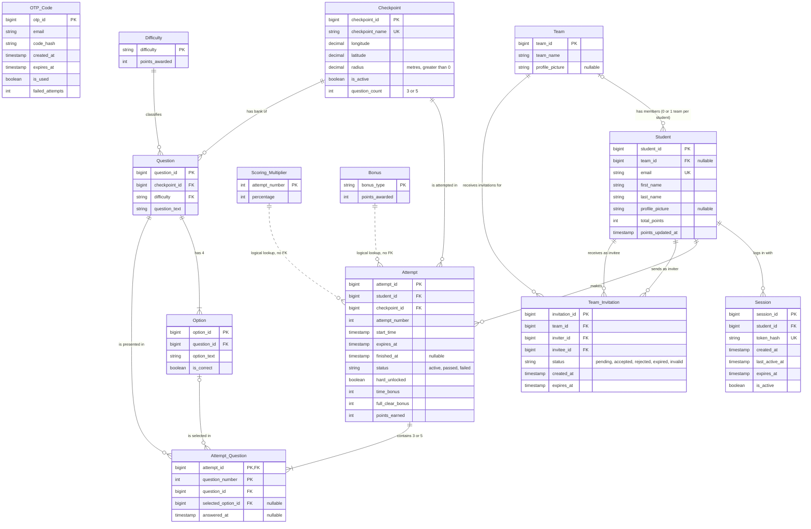
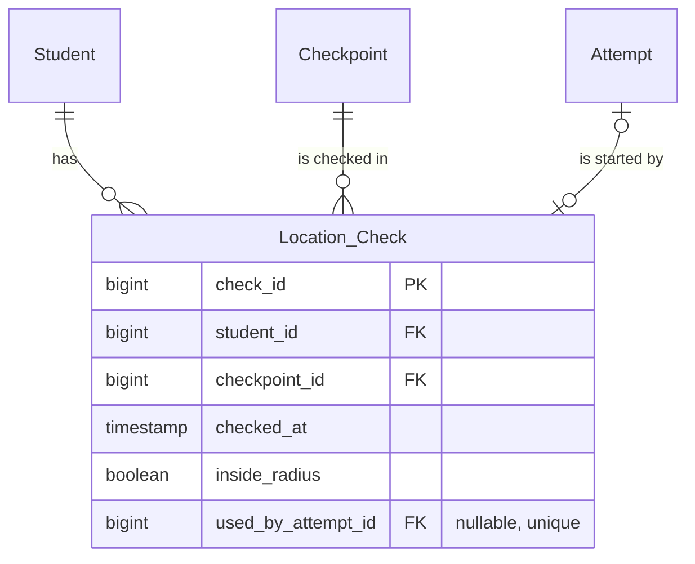

# Campus & City Quest: Data Model

## 0. Scope and status

This file describes the 13 entities of the team's model, the constraints that keep the data correct, and **proposed** additions. It matches `docs/business-rules.md` (rule IDs BRxx, resolutions R-nn, open points OP-nn). The stack is not chosen yet, so types are generic: `bigint` and `int` are whole numbers, `timestamp` is a UTC date-time (time zone aware where the database allows it), `decimal` is exact decimal. Percentages are whole numbers. Physical table names can differ; `Option` and `Session` are reserved or risky words in several databases, so physical names such as `answer_option` and `user_session` are recommended.

**Section 1 shows the source model exactly as handed over. Section 3 lists proposals; they are not part of the model until the team agrees. Rules in `business-rules.md` that depend on a proposal say so.**

## 1. Entity-relationship diagram (source model)

Key markers: `PK` primary key, `FK` foreign key, `UK` unique. The "Geofencing Architecture" page is empty in the source and is not an entity.

Reading notes:

- `OTP_Code` has no foreign key: it is keyed by e-mail because a first-time user has no `Student` row yet (BR01, R-30).
- `Scoring_Multiplier` and `Bonus` are looked up by value (`min(attempt_number, highest row)` and `bonus_type`), not linked by foreign keys; `attempt_number` can exceed 6 (R-18).
- `Bonus.bonus_type` values: `FULL_CLEAR` and `TIME`. `Difficulty.difficulty` values: `NORMAL` and `HARD`.
- `Attempt_Question.question_id` of slot 5 can be changed once, to a hard question (R-13).
- `Student.total_points` and `Student.points_updated_at` are stored results; they can be recomputed from `Attempt` (exact sums, R-02).
- Units: `radius` in metres; coordinates in decimal degrees (WGS 84, `decimal(9,6)` is enough); all timestamps UTC.

## 2. Constraints and indexes

"DB" means the database can enforce it declaratively (PostgreSQL syntax is assumed for partial indexes; MySQL has no partial indexes and needs a generated-column workaround). "App" means the application must enforce it inside a transaction with a row lock. "DB+App" means both, the database as safety net.

| # | Table | Constraint | Kind | Enforcement |
|---|---|---|---|---|
| 1 | Student | `email` unique on `lower(email)`; stored lower-case; `CHECK (email = lower(email) AND email ~ '^[^@[:space:]]+@([a-z0-9-]+\.)*heilbronn\.dhbw\.de$')`, which means exactly one `@` and an address ending with `heilbronn.dhbw.de` preceded by `@` or `.` (R-31); local part length 1 to 64 | UK, CHECK | DB (the same rule is also checked in App; PostgreSQL regex syntax shown, other databases need an equivalent) |
| 2 | Student | `first_name`, `last_name`, `total_points` NOT NULL; `total_points >= 0`, default 0 | NOT NULL, CHECK | DB |
| 3 | Student | `team_id` nullable FK to Team; one column, so at most one team per student | FK | DB (BR05) |
| 4 | Team | Team size at most 5 | Rule | App: lock team row, count members, then join (trigger as safety net) |
| 5 | Team | `team_name` NOT NULL; proposed unique on `lower(team_name)` | NOT NULL, UK | DB (DM-P5) |
| 6 | Team | Teams with fewer than 2 members are not listed on the team leaderboard | Rule | App (query condition) |
| 7 | Session | `token_hash` unique; `expires_at > created_at` | UK, CHECK | DB |
| 8 | Session | At most one active session per student: unique index on `student_id` where `is_active` | Partial UK | DB (BR03); App sets other sessions inactive on login |
| 9 | Session | A session is valid only when `is_active` and `expires_at > now` | Rule | App |
| 10 | OTP_Code | `code_hash` NOT NULL; `expires_at > created_at`; `failed_attempts >= 0` and at most 5 | CHECK | DB |
| 11 | OTP_Code | Index on `(email, created_at desc)` for lookup; job deletes rows older than 24 h | Index | DB + job |
| 12 | OTP_Code | Resend throttle (1 per 60 s, 5 per hour per e-mail) | Rule | App (counted from `created_at`) |
| 13 | Checkpoint | `checkpoint_name` unique; `radius > 0`; latitude in [-90, 90]; longitude in [-180, 180]; `question_count IN (3, 5)` | UK, CHECK | DB (BR08, BR09) |
| 14 | Checkpoint | Exactly the 8 pilot checkpoints exist | Rule | Seed script (BR07) |
| 15 | Checkpoint | Loaded as active only if the bank has at least 10 normal and 3 hard (5-question) or 6 normal (3-question) active questions | Rule | Seed validation only (R-16); not a runtime gate. Runtime technical check: at least `question_count` active normal questions must exist to draw (`DRAW_IMPOSSIBLE`) |
| 16 | Question | `checkpoint_id` and `difficulty` NOT NULL FKs; question belongs to exactly one checkpoint | FK | DB (BR10) |
| 17 | Option | Each question has exactly 4 options | Rule | Seed validation / deferred trigger (BR10) |
| 18 | Option | Exactly one correct option per question: unique index on `question_id` where `is_correct` | Partial UK | DB prevents a second correct option; "at least one" is Seed validation |
| 19 | Option | Unique `(question_id, option_position)` with position 1 to 4 (DM-P7); unique `(option_id, question_id)` to allow constraint 24 | UK, CHECK | DB |
| 20 | Attempt | Unique `(student_id, checkpoint_id, attempt_number)`; `attempt_number >= 1` | UK, CHECK | DB (BR23) |
| 21 | Attempt | At most one `passed` attempt per student and checkpoint: unique index on `(student_id, checkpoint_id)` where `status = 'passed'` | Partial UK | DB (BR23) |
| 22 | Attempt | At most one `active` attempt per student: unique index on `student_id` where `status = 'active'` | Partial UK | DB (R-21) |
| 23 | Attempt | `status IN ('active','passed','failed')`; `expires_at > start_time`; `(status = 'active') = (finished_at IS NULL)`; `finished_at >= start_time`; `time_bonus >= 0`; `full_clear_bonus >= 0`; `points_earned >= 0`; `hard_unlocked` only when `attempt_number = 1`; failed attempts have `time_bonus`, `full_clear_bonus`, `points_earned` and `points_exact` all 0 | CHECK | DB |
| 24 | Attempt_Question | PK `(attempt_id, question_number)`; `question_number` between 1 and 5; unique `(attempt_id, question_id)` so questions in one attempt are distinct; composite FK `(selected_option_id, question_id)` to `Option(option_id, question_id)` so the selected option belongs to the presented question; `(selected_option_id IS NULL) = (answered_at IS NULL)` | PK, UK, FK, CHECK | DB (BR09, BR14) |
| 25 | Attempt_Question | The question belongs to the attempt's checkpoint; the number of rows equals `Checkpoint.question_count`; the answered slot cannot change; slot 5 can change its question only once, only to a hard question, only while `hard_unlocked` | Rule | App (trigger as safety net) |
| 26 | Attempt / Attempt_Question | Closed attempts (`passed` or `failed`) and their answers are never updated | Rule | App; trigger recommended (BR23) |
| 27 | Attempt | Attempt number assigned as 1 + count under a lock; concurrent duplicates fail on constraint 20 and retry | Rule | DB + App |
| 28 | Attempt | Accept answers only while `status = 'active'` and `now < expires_at` | Rule | App, server clock (BR22) |
| 29 | Attempt | `points_exact` credited to `Student.points_exact_x100`, and `total_points` recomputed, in the same transaction as closing the attempt, once | Rule | App (`WHERE status = 'active'` guard) |
| 30 | Student | `total_points = ceil(points_exact_x100 / 100)`; `points_exact_x100 >= 0` (DM-P14) | CHECK | DB (generated column or CHECK) |
| 31 | Team_Invitation | FKs to Team, inviter, invitee; `inviter_id <> invitee_id`; `status IN ('pending','accepted','rejected','expired','invalid')`; `expires_at > created_at` | FK, CHECK | DB |
| 32 | Team_Invitation | At most one pending invitation per `(team_id, invitee_id)`: partial unique where `status = 'pending'` | Partial UK | DB |
| 33 | Team_Invitation | Inviter is a member of the team; invitee is in no team at the time of sending and of accepting; at most 10 pending per team | Rule | App (BR06) |
| 34 | Team_Invitation | Status transitions follow `business-rules.md` R-44; terminal statuses never change | Rule | App |
| 35 | Difficulty, Bonus, Scoring_Multiplier | `points_awarded >= 0`; `percentage BETWEEN 0 AND 100`; `attempt_number >= 1` | CHECK | DB |
| 36 | Location_Check | `inside_radius` NOT NULL; unique `used_by_attempt_id`; no column for coordinates, accuracy or failure reason (DM-P10); rows older than 7 days deleted | NOT NULL, UK | DB + job |
| 37 | All | Foreign keys use RESTRICT on delete: attempts, questions and checkpoints are retired (`is_active`), never deleted. The exception is a student account: BR47 deletes it together with its attempts, answers, location checks, sessions, invitations and log in one transaction (`account.js`) | FK | DB |
| 38 | All | Timestamps are set by the server (`now()`); the client time is never stored as a decision input | Rule | App |

Suggested extra indexes: `Attempt(student_id, checkpoint_id)`, `Attempt(status, expires_at)` (expiry job), `Question(checkpoint_id, difficulty, is_active)`, `Student(total_points desc, points_updated_at asc)` (solo leaderboard), `Team_Invitation(invitee_id, status)`, `Team_Invitation(status, expires_at)`, `Location_Check(student_id, checkpoint_id, checked_at desc)`.

## 3. Proposed additions and corrections (proposals; the team must agree)

Each one is a proposal with its reason. None of them changes the meaning of a business rule.

| ID | Proposal | Reason |
|---|---|---|
| DM-P1 | `Student.nickname` string, nullable, 2 to 20 characters | BR02 allows a nickname but the source has no column. Leaderboards show it (R-37) |
| DM-P2 | `Student.created_at` timestamp NOT NULL; `points_updated_at` NOT NULL and initialised to `created_at` | Needed as the tie-break time for students with 0 points (R-54); avoids NULL ordering problems |
| DM-P3 | `Student.team_joined_at` timestamp, nullable | Time of the join event for the team score time (R-55) |
| DM-P4 | `Student.location_consent_at` timestamp, nullable | Evidence that location consent was given (R-63); a null value blocks location checks |
| DM-P5 | `Team.created_at`, `Team.team_score` int, `Team.score_updated_at` timestamp, unique `lower(team_name)` | BR24 needs a defined "reached the score" time for teams (R-55); cached values can be recomputed from members. Unique names keep leaderboard rows distinguishable (the source does not mark `team_name` unique) |
| DM-P6 | `Checkpoint.pass_threshold` int (4 for 5-question checkpoints, 2 for 3-question ones) with `CHECK (pass_threshold BETWEEN 1 AND question_count)`, and `Checkpoint.hard_question_enabled` boolean (true only for Mensa, Library, Building B, Building C) | Makes BR15 and R-12 data, not code (BR11). Seed values: 4 / true for the four 5-question checkpoints, 2 / false for the others |
| DM-P7 | `Question.is_active` boolean default true; `Option.option_position` int 1 to 4 | Retire questions without breaking history (R-24); fixed option order for BR25 and for the "a. b. c. d." layout of the template |
| DM-P8 | `Attempt.correct_count` int, `Attempt.base_points` int, `Attempt.multiplier_percent` int, `Attempt.end_reason` string (`completed` or `expired`) | Audit of how `points_earned` was computed after the constants change (R-24); distinguishes an expired attempt from a completed one, because the source status has only active, passed, failed |
| DM-P9 | `Attempt_Question.replaced_question_id` bigint FK, nullable (set only on slot 5 when the hard replacement was accepted) | Keeps which normal question was replaced; the composite PK allows only one row per slot (BR20, BR25). "Hard accepted" is derived from this column |
| DM-P10 | New entity `Location_Check`: `check_id` PK, `student_id` FK, `checkpoint_id` FK, `checked_at` timestamp, `inside_radius` boolean, `used_by_attempt_id` bigint FK nullable unique | The only place for the stored "inside radius yes/no + timestamp" (BR12, R-60 to R-63). Written only when a distance decision was made. No coordinates, no accuracy, no failure reason (poor accuracy, denied, unavailable leave no row). Retained 7 days (proposal), then deleted |
| DM-P11 | `Team_Invitation.responded_at` timestamp, nullable | Time of acceptance, rejection or invalidation, for the join time and for audit |
| DM-P12 | Store `Scoring_Multiplier.percentage` as a whole number (100, 85, ...) | Avoids floating-point rounding errors in the "round up" rule (R-02) |
| DM-P13 | Technical tunables (OTP lifetime, session timeout, accuracy limit, resend limits, location retention) in configuration, not in the database | They are not business constants named in BR11; they stay changeable without code but under deployment control (R-33, R-35, R-61, R-63) |
| DM-P14 | `Attempt.points_exact` bigint (points x 100, = raw x multiplier percent) and `Student.points_exact_x100` bigint default 0; `Student.total_points` is derived as `ceil(points_exact_x100 / 100)` | Applies BR04 rounding once per user instead of once per attempt (R-02); keeps the source column `Attempt.points_earned` as the rounded-up display value |

Further source observations: `Attempt` has no question count (derive from the attempt rows); `Attempt.status` has no `expired` value, so DM-P8 `end_reason` is used; there is no table for hard-question eligibility other than `Attempt.hard_unlocked`, which is enough because eligibility is decided once, when question 4 is answered.

### 3.x Additions made while building (2026-10-27)

- `Student.avatar_preset` (0 to 5, nullable): the drawn avatar picked at sign-up; an uploaded picture wins over it.
- `Checkpoint_Fact (checkpoint_id, position 1-5, fact_text)`: the "read these first" facts of the info page (Should item). Seeded with PLACEHOLDER texts.
- `Location_Check` (see R-62 and R-63) holds only inside yes/no and a time.
- `Student.role` (student/admin), `Student.status` (active/blocked/archived) with `status_reason`, `reported_at`, `report_reason` (BR26, BR28, BR30; the `deleted` value and `deleted_at` were removed by migration 011, BR47); table `Audit_Event` (BR29); table `Banned_Term` (admin additions to the built-in list, BR27); table `Checkpoint_Image` (photo url, alt text, credit). Migration `005_admin_and_media.sql`. `Team_Invitation.invited_email` (nullable): the address the inviter typed (BR40), migration `006_invitation_email.sql`. Migration `007_recompute_team_scores.sql` recalculates `Team.team_score` as the rounded-up average of the active students (BR43). Yuri's migrations `003_bildungscampus_checkpoints.sql` and `004_sensoricum.sql` come before ours.

### 3.y Round 6 additions (2026-10-29, migrations 008 to 010)

- `008_team_leader_and_account_states.sql`: `Team.leader_id` (nullable, FK to `Student`, backfilled with the earliest active member, BR44); `Team_Invitation.status` gets the value `cancelled` (BR45); `Student.purged_at` (BR47; removed again by migration 011).
- `011_hard_delete_and_lenient_radius.sql`: deletes the accounts that earlier versions only marked as deleted, with their data (BR47); drops `Student.deleted_at`, `Student.purged_at` and the `deleted` status; raises every checkpoint radius below 60 m to 60 m (BR12).
- `009_map_style.sql`: `Student.map_style` (JSON, nullable; one style per account, BR48).
- `010_quests_and_question_types.sql`:
  - `Checkpoint`: `description`, `map_url`, `time_limit_seconds` (null = 60 s per question), `type_mode` (`MCQ_ONLY`, `MULTI_ONLY`, `MIXED`), `archived_at`; the check now allows 1 to 10 questions and a pass mark up to the question count (BR49).
  - `Question.question_type` (`MCQ`, `MULTI`); the unique index "one right option per question" is gone. The number of right options per type is enforced by the admin service and by the draw query (BR50).
  - `Attempt.question_count` and `Attempt.pass_threshold`: the values the attempt started with. `Attempt_Question.is_correct` (judged when answered).
  - New table `Attempt_Answer (attempt_id, question_number, question_id, option_id)`: every option a student ticked (one row for MCQ, several for MULTI). `Attempt_Question.selected_option_id` keeps the first one.

### 3.z Additions of 2026-11-10 (migration 012)

- `012_settings_and_team_order.sql`:
  - New table `App_Setting (setting_key PK, setting_value, updated_at, updated_by FK Student ON DELETE SET NULL)`: settings an admin changes at run time. Keys: `otp_preview` (`true`/`false`, the code preview switch, BR52) and `pilot_checkpoints_seeded` (the 8 pilot checkpoints were seeded once; the seed never re-creates or edits quests after that, BR55). Existing databases get the marker at once.
  - `Student.team_position` (1 to 5, nullable, null without a team): the team order (BR54). Backfilled by `team_joined_at`, then `student_id`. The leader hand-over (`ensureLeader`) and every member list order by `team_position, team_joined_at, student_id`. Gaps are closed when someone leaves.
- The login code of the code preview is kept **in the API's memory only** (at most 500 addresses, until the code expires or is used); the database keeps storing only code hashes (BR01).

## 4. Seed data for BR11 (no admin UI)

**Approach.** Reference data and the question bank are plain files in the repository (SQL or CSV) loaded by a seed script, run by the developers at deployment. The script is idempotent: it upserts by natural key (`difficulty`, `bonus_type`, `attempt_number`, `checkpoint_name`, and for questions a stable external key kept in the seed file), so running it twice gives the same result. Changing a point value means editing the table (or the seed file) and re-running it; no backend code changes (BR11). The script runs in one transaction and ends with a validation step that fails the whole load if any of these is violated:

1. 8 checkpoints exist with the names of BR07.
2. Every question has exactly 4 options with exactly one correct, non-empty and distinct texts.
3. Every checkpoint that is loaded as active meets the bank minimum (10 normal and 3 hard for 5-question checkpoints, 6 normal for 3-question ones; R-16).
4. `Difficulty`, `Bonus` and `Scoring_Multiplier` contain the rows below, and `Scoring_Multiplier` has rows 1 to 6.
5. No question is loaded from the unverified Mensa sample.

Content changes while attempts are running follow R-24. Seed files contain no real student data and no real student locations.

**Initial contents.**

`Difficulty`

| difficulty | points_awarded |
|---|---|
| NORMAL | 1000 |
| HARD | 2000 |

`Bonus`

| bonus_type | points_awarded | Meaning |
|---|---|---|
| FULL_CLEAR | 200 | Once per passed attempt when all questions are correct |
| TIME | 1 | Per whole remaining second |

`Scoring_Multiplier`

| attempt_number | percentage |
|---|---|
| 1 | 100 |
| 2 | 85 |
| 3 | 70 |
| 4 | 55 |
| 5 | 40 |
| 6 | 0 (applies to attempt 6 and later) |

`Checkpoint` seed (coordinates and radii come from the separate geofencing document and are TBC; OP-10 in `business-rules.md`):

| checkpoint_name | question_count | pass_threshold (DM-P6) | hard_question_enabled (DM-P6) | Minimum active bank (seed validation) |
|---|---|---|---|---|
| Mensa | 5 | 4 | true | 10 normal, 3 hard |
| Library | 5 | 4 | true | 10 normal, 3 hard |
| Building B | 5 | 4 | true | 10 normal, 3 hard |
| Building C | 5 | 4 | true | 10 normal, 3 hard |
| Sensoricum | 3 | 2 | false | 6 normal |
| CAS Cafe | 3 | 2 | false | 6 normal |
| Care.box and Shop.box | 3 | 2 | false | 6 normal |
| Campus Garden | 3 | 2 | false | 6 normal |

A checkpoint is loaded with `is_active = false` until its coordinates, radius and question bank are complete and verified.

## 5. Privacy notes for stored personal data

The location is personal data. Nothing below is legal advice; the data-protection contact of the university must review it (OP-11).

| Data | Where | Treatment |
|---|---|---|
| Raw coordinates, accuracy, failure reasons, device location history | Nowhere | Never stored, never logged, never in tests or fixtures (R-63, R-64). Used in memory to decide, then discarded. The location is sent only in a POST body |
| Location result: "inside radius yes/no" with timestamp | `Location_Check` (DM-P10) | Minimal: student, checkpoint, boolean, time. Deleted after 7 days (proposal) |
| Location consent | `Student.location_consent_at` (DM-P4) | Asked before the browser prompt; no checks without it |
| E-mail | `Student.email`, `OTP_Code.email`, invitations by lookup | Needed as the unique identifier (BR01). Never shown to other users. Not logged in plain text in error reports where avoidable. OTP rows deleted after 24 h |
| First and last name, nickname | `Student` | Other users see only the nickname, or first name plus last initial (R-37) |
| Profile pictures | File storage; path in `Student` / `Team` | Re-encoded, metadata (possible GPS in EXIF) removed, random file names, size and type limits (section 5 of `business-rules.md`) |
| OTP codes | `OTP_Code.code_hash` | Only a keyed hash; the code is never stored; 5 failed tries kill it |
| Session tokens | `Session.token_hash` | Only a hash of a 256-bit random token; the token itself lives only in the cookie |
| Quiz history | `Attempt`, `Attempt_Question` | Needed for BR23 and BR25; linked to the student |
| Deletion and retention | All | Periods and deletion on request: TBC (OP-11). Because foreign keys restrict deletion, a deletion process will have to anonymise (clear names, e-mail, pictures) rather than remove rows |
