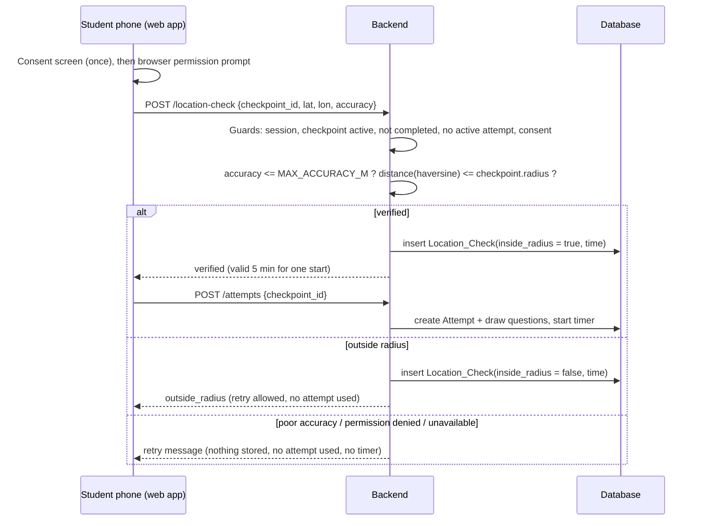

# Geofencing Architecture

This page was empty in the Main Project Document. It describes how location verification works, derived from BR08 and BR12 and the resolutions R-60 to R-65 in [business-rules.md](business-rules.md). Work package: WBS 2.3 (design), 3.5 (build), 4.1 (calibration).

## Principle
- The **server decides**. The phone only reports a position; the client's opinion about "inside" is never trusted.
- Location is verified **once per attempt, when the student starts it** (BR12). After the quiz has started, no location is requested or accepted; leaving the geofence has no effect.
- The server stores only **"inside radius yes/no + timestamp"** (student, checkpoint). It never stores or logs raw coordinates, accuracy or failure reasons.

## Flow

## Outcomes (R-60)

| Outcome | Condition | Consumes attempt | Starts timer | Stored |
|---|---|---|---|---|
| `verified` | accuracy ≤ limit and distance ≤ radius | no | no | inside = true + time |
| `outside_radius` | accuracy ok, distance > radius | no | no | inside = false + time |
| `poor_accuracy` | accuracy > limit | no | no | nothing |
| `permission_denied` | browser reports it | no | no | nothing |
| `unavailable` | timeout / no support | no | no | nothing |

## Parameters
- Accuracy limit: `MAX_ACCURACY_M` (proposed 50 m, `.env`).
- Per-checkpoint `longitude`, `latitude`, `radius` (> 0) and `is_active` live in the `Checkpoint` table (BR08). Radii are **calibrated on site with real phones** (WBS 4.1); the smallest radius should not be below the accuracy limit (OP-22).
- A `verified` result authorises one attempt start within 5 minutes (R-62). Rate limit: 10 checks per student per 10 minutes, counted without storing location.

## Browser side
- Browser Geolocation API (`navigator.geolocation.getCurrentPosition`, high accuracy). Requires **HTTPS** (or `localhost` in development).
- Show a consent screen first (location is personal data); record consent once (`Student.location_consent_at`, proposed).
- Handle the three error cases (denied, unavailable, timeout) with a clear message and a retry button.
- Send the position in a **POST body**, never in a URL.

## Privacy and logging
- Request bodies of the location endpoint must not be logged; error trackers must scrub them.
- Tests and fixtures use invented coordinates only; no real student locations in the repository.
- `Location_Check` rows are deleted after 7 days (proposal, OP-11).

## Test plan
1. Unit: haversine distance (known point pairs), accuracy limit, boundary cases (exactly at the radius).
2. API: each outcome in the table; guards (inactive, completed, active attempt); no row for failures without a distance decision.
3. Real phones (Android Chrome, iOS Safari) at all 8 checkpoints: record the result and, if needed, adjust the radius (WBS 4.1).
4. Log/database search shows no coordinates (acceptance check 22 in business-rules §8).

## Known limits
A web app cannot reliably detect fake GPS, and indoor GPS can be inaccurate. BR12 also allows leaving after the start. The remaining protection is in business-rules §2.6 (timer, random questions, single pass, server authority).
