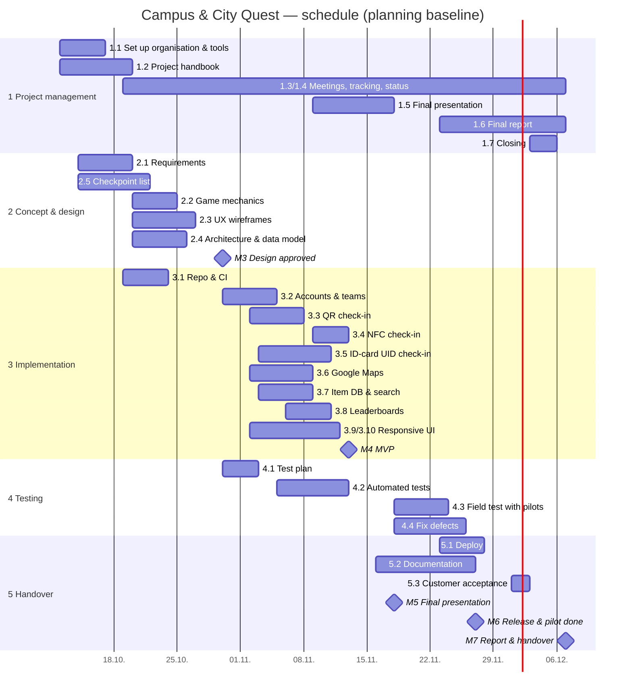
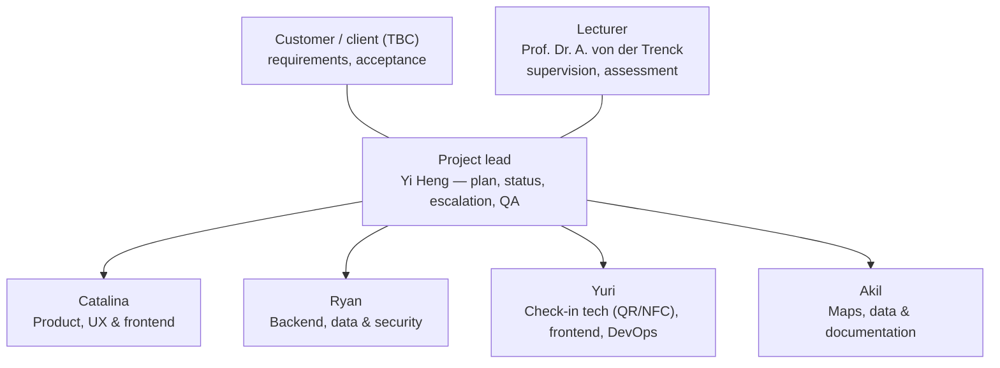

# Project Handbook — Campus & City Quest

| | |
|---|---|
| **Project number** | DHBW-INT-2027-01 |
| **Course** | Business Processes and their Implementation: Project Planning (Incomings 2026), DHBW Heilbronn |
| **Lecturer** | Prof. Dr. Aliona von der Trenck |
| **Project lead** | Yi Heng Lim |
| **Team** | Catalina, Yuri, Ryan, Yi Heng, Akil |
| **Version / date** | 1.0 — 13.10.2026 (planning presentation); final planning submission 19.10.2026, 12:15 |
| **Approach** | Hybrid: classic planning (WBS, schedule, budget) with agile delivery in sprints during implementation |

> **Status of the numbers.** Effort, budget, rates and dates below are *planning assumptions*, not measured facts. Effort estimates are the team's starting baseline and must be confirmed in a Planning Poker session (see §5). Items marked **TBC** need confirmation by the lecturer/customer. They will be validated against tracked hours (§9).

---

## 0. Project Target Cross (start of the presentation)

| | |
|---|---|
| **WHY — Purpose** | Incoming international students at DHBW Heilbronn struggle in their first weeks to find campus facilities (canteen, library, card top-up stations, water coolers) and city essentials (Rewe, Lidl, thrift stores, specific groceries). Static PDF guides are unengaging. |
| **WHAT — Deliverables** | A mobile-responsive, gamified web app (Pokémon GO style): checkpoint collection via a three-tier interaction (DHBW ID card UID reader → NFC tag → QR code fallback), interactive map (Google Maps API), searchable item database, live leaderboards (solo, duo, team, nationality), plus documentation and handover. |
| **WHO — Target audience** | Incoming international students (users); DHBW Heilbronn international office/customer (**TBC**); lecturer (assessment). |
| **HOW WELL — Quality criteria** | See the measurable criteria in §1.3, e.g. ≥ 80% of pilot students complete all campus checkpoints; QR fallback works on 100% of tested devices; leaderboards update within 5 s. |

---

## 1. Objectives to Scope (Must / Should / Could)

### 1.1 Prioritised scope (MoSCoW)

| ID | Objective / feature | Priority | Rationale |
|---|---|---|---|
| M1 | Mobile-responsive web app with user accounts (solo / duo / team) | **Must** | Basis for everything |
| M2 | QR-code checkpoint check-in | **Must** | Foolproof fallback that works on every phone |
| M3 | Campus checkpoint set (canteen, library, card top-up, check-up area, water coolers) with progress tracking | **Must** | Core of "Campus Facility Mastery" |
| M4 | Interactive map (Google Maps API) with campus and city points | **Must** | Core of the navigation goal |
| M5 | Solo leaderboard (live) | **Must** | Minimum gamification |
| M6 | Independent project database; no write access to university systems | **Must** | Charter constraint, privacy |
| S1 | NFC-tag check-in | Should | Better UX; limited browser support (see R3) |
| S2 | DHBW student ID-card UID reader at ≥ 1 major spot | Should | Charter's primary tier, but depends on university permission and GDPR clearance (R2). **TBC with customer** |
| S3 | Duo and team leaderboards | Should | Community building |
| S4 | Nationality/country leaderboard | Should | Community building |
| S5 | Searchable item database (rice, eggs, vegetables, protein bars …) with Rewe/Lidl locations | Should | City & grocery locator |
| C1 | Badges / achievements | Could | Motivation |
| C2 | Multi-language UI (EN/DE + others) | Could | Inclusiveness |
| C3 | Offline-capable (PWA) | Could | Convenience |
| C4 | Admin page to manage checkpoints | Could | Maintainability after handover |
| C5 | Thrift-store layer on the map | Could | Nice to have |
| W1 | Native iOS/Android apps | **Won't** | Charter non-objective |
| W2 | Modifying official university student databases | **Won't** | Charter non-objective (UIDs mapped in our own DB) |
| W3 | Live prices/stock data from supermarkets | **Won't** | Not available/controllable; static item locations only |
| W4 | Payment or card top-up functionality | **Won't** | Only the *location* of top-up stations is shown |

In a bottleneck we steer **Must before Should before Could**. If all Must goals are not fully met, the project has failed; Should goals may be partly met.

### 1.2 Non-objectives (out of scope)
W1–W4 above. They are communicated to the customer to avoid unspoken expectations.

### 1.3 Measurable objectives (SMART)

| Sub-objective | Measurable result | Check method | Priority |
|---|---|---|---|
| Campus facility mastery | ≥ 80% of pilot students complete all campus checkpoints within their first month of use (pilot size agreed with customer) | Checkpoint log in the database | Must |
| Multi-tier interaction | QR check-in works on 100% of tested devices (≥ 6 devices, iOS and Android); NFC works on all NFC-capable Android devices tested; ID-card reader live at ≥ 1 spot **if permitted** | Test protocol (WP 4.3) | Must (QR) / Should (NFC, card) |
| City & grocery locator | Map shows ≥ 10 city POIs; item search returns the correct store for ≥ 20 predefined grocery items | Acceptance test | Must (map) / Should (items) |
| Gamification & leaderboards | Leaderboard updates within 5 s of a check-in; categories solo, duo, team, nationality available | Functional test | Must (solo) / Should (rest) |
| Usability | ≥ 80% of pilot users rate the app "good" (2.0) or better | Feedback form | Should |
| Process | Planned vs. actual hours deviation reported per milestone | Time-tracking report | Must |

> The charter's original wording "100% device compatibility" was sharpened to "100% of tested devices", because Web NFC is not available in iOS browsers. This is exactly why the QR tier exists.

### 1.4 Completeness check: objectives ↔ work packages

| Objective | Covered by WPs |
|---|---|
| M1 accounts, responsive UI | 2.3, 3.2, 3.9, 3.10 |
| M2 / S1 / S2 check-in tiers | 2.4, 3.3, 3.4, 3.5 |
| M3 checkpoints | 2.5, 3.3 |
| M4 map | 3.6 |
| M5 / S3 / S4 leaderboards | 2.2, 3.8 |
| S5 item search | 3.7 |
| M6 privacy / own DB | 2.4, 3.2, 3.5 |
| Quality and acceptance | 4.1–4.4, 5.3 |
| Process (time tracking, reporting) | 1.2, 1.4 |

Every objective is covered by at least one work package.

---

## 2. Work Packages (WBS)

Structure is **mixed**: level 1 follows project phases, level 2 follows deliverables. Project management is the first branch. Titles start with a verb; every package has one owner and is 3–40 h.

```
0 Campus & City Quest
├─ 1 Project management
├─ 2 Concept & design
├─ 3 Implementation
├─ 4 Testing & quality assurance
└─ 5 Deployment & handover
```

| WBS | Work package | Deliverable | Owner | Predecessors |
|---|---|---|---|---|
| 1.1 | Set up project organisation and tools | GitLab project, boards, labels, wiki, branch rules | Yi Heng | – |
| 1.2 | Create and maintain project handbook | This handbook (versioned) | Yi Heng | 1.1 |
| 1.3 | Hold weekly meetings and write minutes | Minutes in wiki (rotating) | All (rotating) | 1.1 |
| 1.4 | Track time and report status | Time report, status slides for lecturer | Yi Heng | 1.1 |
| 1.5 | Prepare final presentation | Slides incl. target cross, "Use of AI Tools" | Catalina | 4.2 |
| 1.6 | Compile final report | Report PDF incl. traceability, time analysis, AI section | Akil | 4.3 |
| 1.7 | Close project and hand over | Closing review, archived docs | Yi Heng | 5.3 |
| 1.8 | Handle risk contingencies | Buffer work from risk list (pool) | All (pool) | – |
| 2.1 | Collect and prioritise requirements | Requirements list with acceptance criteria (customer-approved) | Catalina | 1.1 |
| 2.2 | Design game mechanics and scoring | Rules for points, teams, leaderboards | Catalina | 2.1 |
| 2.3 | Design UX wireframes | Clickable wireframes (mobile first) | Catalina | 2.1 |
| 2.4 | Design architecture and data model | Architecture sketch, ER model, privacy concept | Ryan | 2.1 |
| 2.5 | Define checkpoint and POI list | Campus + city checkpoint list with coordinates | Akil | 2.1 |
| 3.1 | Set up repository, CI and dev environment | Repo baseline, lint/test pipeline | Yuri | 1.1 |
| 3.2 | Implement accounts and team handling | Sign-up/login, solo/duo/team profiles | Ryan | 2.4, 3.1 |
| 3.3 | Implement QR check-in | QR scan flow, checkpoint validation | Yuri | 2.5, 3.2 |
| 3.4 | Implement NFC-tag check-in | NFC read flow with QR fallback | Yuri | 3.3 |
| 3.5 | Implement ID-card UID check-in | Reader integration, UID→user mapping in own DB | Ryan | 2.4, 3.2 |
| 3.6 | Integrate Google Maps | Map with checkpoints and POIs | Akil | 2.5, 3.1 |
| 3.7 | Build item database and search | Item/store data, search UI | Akil | 2.5, 3.2 |
| 3.8 | Implement leaderboards | Solo/duo/team/nationality rankings | Ryan | 2.2, 3.3 |
| 3.9 | Build responsive UI — navigation, profile, map screens | Frontend part 1 | Catalina | 2.3, 3.1 |
| 3.10 | Build responsive UI — check-in, leaderboard, search screens | Frontend part 2 | Yuri | 2.3, 3.1 |
| 4.1 | Write test plan and acceptance criteria | Test plan, device list | Yi Heng | 2.1 |
| 4.2 | Write and run automated tests | Unit/integration tests | Ryan | 3.2 |
| 4.3 | Run field test with pilot students | Test protocol, feedback forms | Yi Heng | 3.3, 3.6, 3.8 |
| 4.4 | Fix defects found in testing | Fixed issues, regression run | Yuri | 4.2, 4.3 |
| 5.1 | Deploy application | Running web app, backup routine | Yuri | 4.4 |
| 5.2 | Write user guide and technical documentation | User guide, README, setup docs | Akil | 3.x |
| 5.3 | Obtain customer acceptance | Signed acceptance / minutes | Yi Heng | 5.1, 5.2 |

WBS codes are unique. Each package is tracked as a GitLab issue labelled with its WBS code.

**Work-package template** (used as GitLab issue template): title (with verb), owner, WBS code, predecessors/successors, objective and inputs, activities and deliverables, start/duration/end, effort and resources, status (identified → planned → assigned → open → in progress → done → accepted).

---

## 3. Schedule (Dependencies and Milestones)

### 3.1 Phases and milestones

| # | Milestone | Date | Result (checkable) |
|---|---|---|---|
| M1 | Planning presentation | 13.10.2026 | Presentation held (13:15–16:30 slot) |
| M2 | Planning submitted, tools in use | 19.10.2026, 12:15 | Handbook/report submitted; GitLab tools selected and in use |
| M3 | Requirements and design approved | 30.10.2026 | Requirements, wireframes and architecture reviewed and accepted by customer |
| M4 | MVP: all Must features working | 13.11.2026 | M1–M6 demonstrable on a test server |
| M5 | Final presentation | 18.11.2026 (move to 16.11. tbd by lecturer) | 15–20 min + 10 min Q&A; starts with target cross, ends with "Use of AI Tools" |
| M6 | Release and pilot test finished | 27.11.2026 | Deployed app, test protocol, Should features done or consciously dropped |
| M7 | Final report and handover | 07.12.2026 | Report submitted, customer acceptance, project closed |

Release gates: at M3, M4 and M6 the team decides go / repeat / stop based on the checkable result.

### 3.2 Gantt chart



### 3.3 Dependencies and critical path

Longest dependent chain (by planned duration):
**2.1 Requirements → 2.4 Architecture → 3.2 Accounts → 3.3 QR check-in → 3.8 Leaderboards → 4.3 Field test → 4.4 Fixes → 5.1 Deploy → 5.3 Acceptance.**
A delay on any of these delays the project end. Packages with float: 2.2, 2.3, 3.6, 3.7, 3.4, 5.2.

### 3.4 Calendarisation
The plan counts working days. Lectures, exams and company phases reduce real capacity. The plan assumes **about 8–12 project hours per person per week from mid-October to 07.12.2026 (to be confirmed by each member)**. Exam weeks are entered in the team calendar and checked at every weekly meeting.

---

## 4. Organisation Chart and Roles



*The role split is the team's proposal and is confirmed at the kick-off meeting. In a small team every member also acts as Project Team Member and reviewer for others.*

### 4.1 Roles — tasks, authority, responsibility (ABV)

| Role | Person | Tasks | Authority | Responsibility |
|---|---|---|---|---|
| Project lead & QA | Yi Heng | Plan, status reports, time-tracking report, test plan, field test, customer/lecturer contact | Prioritises backlog within agreed scope; approves merges to `main` | Schedule, scope, quality gates, escalation |
| Product & UX | Catalina | Requirements, game rules, wireframes, frontend part 1, final presentation | Decides UX/game-design details | Usability, requirements completeness |
| Backend & security | Ryan | Architecture, data model, accounts, ID-card UID, leaderboards, automated tests | Decides backend technology within agreed stack | Data protection, API quality |
| Check-in tech & DevOps | Yuri | Repo/CI, QR and NFC check-in, frontend part 2, defect fixing, deployment | Maintains CI and deployment | Build stability, deployment, backups |
| Maps & data | Akil | Checkpoint/POI list, Google Maps, item database, documentation, final report | Decides data content of checkpoints/items | Data accuracy, documentation |
| Customer | TBC | Provides requirements, accepts milestones | Final acceptance decision | Clear and timely feedback |
| Lecturer | Prof. von der Trenck | Supervises, assesses | Grades | Feedback in status meetings |

**Role-conflict rule:** whoever does the work does not review it. Every merge request needs one approval from another team member (see [git-workflow.md](git-workflow.md)). QA owner Yi Heng does not review their own documents.

### 4.2 RACI matrix

R = responsible, A = accountable, C = consulted, I = informed

| Task | Yi Heng | Catalina | Ryan | Yuri | Akil | Customer | Lecturer |
|---|---|---|---|---|---|---|---|
| Project plan & handbook | A/R | C | C | C | C | C | C |
| Requirements | A | R | C | C | C | A (approves) | I |
| Design & architecture | A | R (UX) | R (tech) | C | C | I | – |
| Implementation | A | R | R | R | R | I | – |
| Testing & QA | A/R | C | R | R | C | C | – |
| Status reports | R | C | C | C | C | I | I |
| Milestone acceptance | R | I | I | I | I | A | I |
| Final presentation & report | A | R | C | C | R | I | I |

---

## 5. Effort Estimation (Hours per Work Package and Role)

**Method.** Planning Poker with the Fibonacci-inspired card set (1, 2, 3, 5, 8, 13, 20, 40 h), two rounds maximum, estimates in net working hours (people × hours). Packages > 40 h are split, < 3 h are merged. No buffers inside the packages — buffer is WP 1.8 (from the risk list). For uncertain packages (3.4, 3.5) a three-point estimate is added: **E = (O + 4M + P) / 6**.

> The values below are the initial team baseline; the Planning Poker session result replaces them if it differs. Time-tracking (§9) is used to validate them.

| WBS | Work package | Hours | Role/owner |
|---|---|---|---|
| 1.1 | Set up organisation and tools | 5 | Yi Heng |
| 1.2 | Handbook | 16 | Yi Heng |
| 1.3 | Meetings and minutes | 20 | All (rotating, 4 h each) |
| 1.4 | Time tracking and status | 12 | Yi Heng |
| 1.5 | Final presentation | 20 | Catalina |
| 1.6 | Final report | 20 | Akil |
| 1.7 | Closing and handover | 8 | Yi Heng |
| 1.8 | Risk contingency pool | 30 | All (6 h each) |
| 2.1 | Requirements | 12 | Catalina |
| 2.2 | Game mechanics | 13 | Catalina |
| 2.3 | UX wireframes | 20 | Catalina |
| 2.4 | Architecture and data model | 13 | Ryan |
| 2.5 | Checkpoint and POI list | 8 | Akil |
| 3.1 | Repo, CI, environment | 8 | Yuri |
| 3.2 | Accounts and teams | 20 | Ryan |
| 3.3 | QR check-in | 13 | Yuri |
| 3.4 | NFC check-in | 13 | Yuri |
| 3.5 | ID-card UID check-in | 20 | Ryan |
| 3.6 | Google Maps | 20 | Akil |
| 3.7 | Item DB and search | 20 | Akil |
| 3.8 | Leaderboards | 20 | Ryan |
| 3.9 | Responsive UI part 1 | 20 | Catalina |
| 3.10 | Responsive UI part 2 | 20 | Yuri |
| 4.1 | Test plan | 8 | Yi Heng |
| 4.2 | Automated tests | 25 | Ryan |
| 4.3 | Field test | 16 | Yi Heng |
| 4.4 | Defect fixing | 20 | Yuri |
| 5.1 | Deployment | 8 | Yuri |
| 5.2 | Documentation | 12 | Akil |
| 5.3 | Customer acceptance | 4 | Yi Heng |
| | **Total** | **464** | |

### 5.1 Hours per person (including the shared pools 1.3 and 1.8: 10 h per person)

| Person | Own WPs | Pools | Total |
|---|---|---|---|
| Yi Heng | 69 | 10 | **79** |
| Catalina | 85 | 10 | **95** |
| Ryan | 98 | 10 | **108** |
| Yuri | 82 | 10 | **92** |
| Akil | 80 | 10 | **90** |
| **Sum** | 414 | 50 | **464** |

### 5.2 Distribution by category (basis for the time-tracking report)

| Category | WBS | Hours | Share |
|---|---|---|---|
| Organisation | 1.x | 131 | 28% |
| Conception | 2.x | 66 | 14% |
| Implementation (incl. testing, deployment) | 3.x–5.x | 267 | 58% |
| **Total** | | **464** | 100% |

Hours spent on the planning phase itself (up to 19.10.2026) are tracked separately and do not count towards this total.

---

## 6. Communication Plan

| With | What | How often | Channel | Responsible |
|---|---|---|---|---|
| Team | Progress, blockers, next steps | Weekly (fixed slot, 30–45 min) | In-person/video meeting | Yi Heng |
| Team | Tasks, merge requests, documentation | Ongoing | GitLab issues/boards/MRs | WP owners |
| Team | Quick coordination | Daily as needed | Team chat (WhatsApp or similar — **choose at kick-off**) | All |
| Customer | Status, clarifying requirements | Every 2 weeks | E-mail/call | Yi Heng |
| Customer | Milestone acceptance (M3, M4, M6, M7) | At each milestone | Meeting + minutes | Yi Heng |
| Lecturer | Project status, **time-tracking review**, 10–15 min | Integration-seminar dates (announced a few days ahead) | In person | Yi Heng |
| All | Minutes and decisions | After every meeting | GitLab wiki | Rotating |
| Customer | Final report ("AGs receive your reports") | M7 | PDF / GitLab | Yi Heng |

Escalation path: team member → project lead → lecturer/customer.

---

## 7. Quality and Risk Management

### 7.1 Quality plan

| Type | Measure |
|---|---|
| **Constructive (prevent)** | Coding guidelines and AI rules in [CLAUDE.md](../CLAUDE.md); Conventional Commits; issue/MR templates; protected `main`/`develop`; definition of done per WP; proven technologies over new ones; pair work on NFC/ID-card parts |
| **Analytical (find)** | Four-eyes review: at least 1 approval from another member per MR; lint + automated tests before merge; acceptance tests against §1.3; field test with pilot students (WP 4.3); checklist before each milestone; feedback loops with customer every 2 weeks |

**Definition of done (per WP):** deliverable exists in the repository/wiki, reviewed by a second person, tests pass, time booked in GitLab, issue closed, AI use logged in `ai-logs/<name>/`.

### 7.2 Risk list

Scale: low / medium / high for probability (P) and severity (S). Priority combines both.

| # | Risk | Cause | Effect | P | S | Priority | Strategy and measure | Owner |
|---|---|---|---|---|---|---|---|---|
| R1 | Team member unavailable | Exams, illness, company phases | Packages delayed | med | high | **high** | Reduce: weekly capacity check, pair ownership for critical WPs, pool 1.8 | Yi Heng |
| R2 | ID-card UID access not granted / GDPR concerns | Card UIDs are personal data; university approval needed | Primary tier unavailable | high | high | **high** | Avoid dependency: ID card is *Should*; QR/NFC already cover the Must goals; clarify permission in week 1; store pseudonymised UIDs only in own DB | Ryan |
| R3 | NFC unsupported on many phones | Web NFC not available in iOS browsers | Tier 2 fails for many users | high | med | **high** | Reduce: QR as always-available fallback (M2); test device list in 4.1 | Yuri |
| R4 | Unfamiliar technology | No prior experience | Estimates too low | high | med | **high** | Reduce: spikes/prototypes early, pair work, time-tracking vs. estimates | Yuri |
| R5 | Scope creep | New wishes from customer mid-project | Must goals at risk | med | high | **high** | Avoid: MoSCoW and non-objectives signed off; change requests go through project lead | Yi Heng |
| R6 | Low pilot participation | Few students available in the test window | KPI "80% completion" not provable | med | med | med | Reduce: recruit early via customer; accept smaller pilot, document sample size | Catalina |
| R7 | Google Maps key leaked or quota/costs exceeded | Key in repo, many requests | Unexpected cost, service cut-off | low | high | med | Reduce: key in `.env` only, referrer restriction, quota alert, budget line | Akil |
| R8 | Code or data loss | No backup routine | Work lost | low | high | med | Reduce: GitLab as single source of truth, protected branches, DB backup in 5.1 | Yuri |
| R9 | Customer slow to reply | Other priorities | Unclear requirements | med | med | med | Reduce: bi-weekly fixed call, decisions logged in minutes | Yi Heng |
| R10 | GitLab access delayed | User assignment via Tessa Steinigke | Tool start delayed | low | med | low | Accept; request users now; use local Git meanwhile | Yi Heng |

Risks are reviewed in every weekly meeting; effectiveness of measures is checked at each milestone; lessons learned go into the final report.

---

## 8. Budget (fictional, with stated assumptions)

No real budget exists. The planning uses plausible assumptions:

| Item | Calculation / assumption | Amount (€) |
|---|---|---|
| Personnel | 464 h × €30/h (assumed internal rate) | 13,920 |
| Software and licences | GitLab provided by DHBW; open-source stack | 0 |
| Google Maps API | Assumed within free usage quota; €50 safety allowance | 50 |
| Hardware | 3 USB NFC/card readers × €40 + 50 NFC tags ≈ €40 | 160 |
| Printing (QR codes, signs) | Assumption | 30 |
| Hosting | ≈ €10/month × 4 months | 40 |
| Travel | None (campus-based) | 0 |
| **Subtotal** | | **14,200** |
| Risk reserve | 10% of subtotal | 1,420 |
| **Total budget** | | **15,620** |

Revenue: none expected (non-profit student service). Follow-up costs after the project: hosting and Google Maps usage (est. ≈ €10–20/month, **TBC**) and content maintenance of checkpoints/items.

---

## 9. Tool Usage and Time Tracking

### 9.1 Tools (same tools for everyone)

| Area | Tool | Purpose | Owner |
|---|---|---|---|
| Project management | DHBW WI GitLab (issues, boards, milestones) — https://wi-git.heilbronn.dhbw.de/ | Backlog, work packages, status | Yi Heng |
| Documentation | GitLab wiki + repository (`docs/`) | Handbook, minutes, decisions | Akil |
| Development | GitLab repository (`main` ← `develop` ← `feature/*`) | Code, versions, reviews | Yuri |
| Communication | Team chat (to be chosen at kick-off), video calls | Quick exchange | All |
| Time tracking | GitLab time tracking (`/estimate`, `/spend`) | Hours per person and task | Everyone |
| Design | Figma or similar (free) | Wireframes | Catalina |
| Maps | Google Maps Platform | Map and POIs | Akil |
| AI assistance | Claude Code (rules in CLAUDE.md), logs in `ai-logs/` | Support, always disclosed | Everyone |

User assignment on the DHBW GitLab is coordinated with Tessa Steinigke. Tool selection and initial use are required by **19.10.2026**. Alternatives only after agreement with the lecturer/customer.

### 9.2 Time tracking and "billing" of hours
- Every issue gets an estimate (`/estimate`, from §5) and every working session is booked with `/spend` (hours rather than minutes).
- Research, coordination, meetings and documentation count as project time.
- Each issue carries a category label: `cat::conception`, `cat::implementation`, `cat::organisation`.
- Monthly export gives the distribution across the three categories overall and per person (Excel may be used for the evaluation only).
- The tracking results are discussed at every status meeting with the lecturer and compared with the estimates in §5.

---

## 10. Use of AI Tools

*Transparency principle: AI is allowed but must be disclosed and critically reflected. This section is placed at the end of both presentation and report, as required.*

| Work step | AI system | How it was used | Treatment |
|---|---|---|---|
| Repository setup | Claude Code (Anthropic) | Generated drafts of `CLAUDE.md`, `docs/git-workflow.md`, `.gitignore`, issue/MR templates and a setup script | Adapted by the team (team to confirm); AI-drafted text not used unreviewed |
| Charter formatting | Claude Code | Reformatted the project charter into Markdown tables | Content from the team's own charter; formatting only |
| Handbook drafting | Claude Code | Drafted the structure and a first version of WBS, schedule, effort, risk and budget tables from the course slides | **First draft only** — team must review, adjust and own all numbers (effort, rates, dates) |
| Effort estimation | — | Initial values were AI-proposed; they are replaced by the team's Planning Poker result where different | Planning Poker (humans, optionally AI as extra participant — must be stated) |

**Evidence:** AI session logs per member in `ai-logs/<name>/` (date, objective, prompts used, decisions made); screenshots in the report appendix.

**Reflection (to be completed by the team after review):**
- *Helpful:* fast structure aligned to the course checklist, consistent tables, reduced formatting effort.
- *Limits:* the AI cannot know the team's real capacity, customer, rates or university rules (e.g. ID-card UID permission); all such values are assumptions and must be verified. The AI may misstate facts, so every claim in this handbook is checked by a team member.

---

## 11. Checklist against the nine required parts

| # | Required part | Where |
|---|---|---|
| 1 | Objectives to scope (Must/Should/Could) | §1 |
| 2 | Work packages (WBS) | §2 |
| 3 | Schedule: dependencies, milestones | §3 |
| 4 | Org chart & roles | §4 |
| 5 | Effort estimation: hours per WP and role | §5 |
| 6 | Communication plan: team, client, lecturers | §6 |
| 7 | Quality & risk: reviews, tests, risk list | §7 |
| 8 | Budget (fictional, assumptions stated) | §8 |
| 9 | Tool usage: PM, docs, development (+ time tracking) | §9 |
| + | Target cross at the start of the presentation | §0 |
| + | "Use of AI Tools" at the end of presentation and report | §10 |
