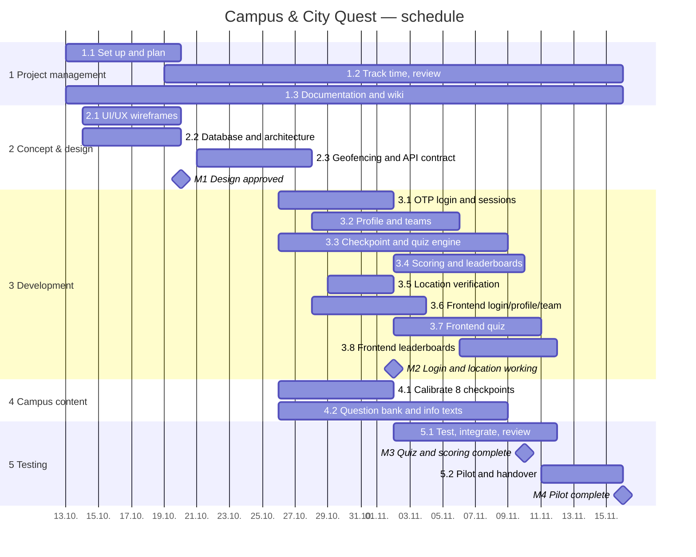
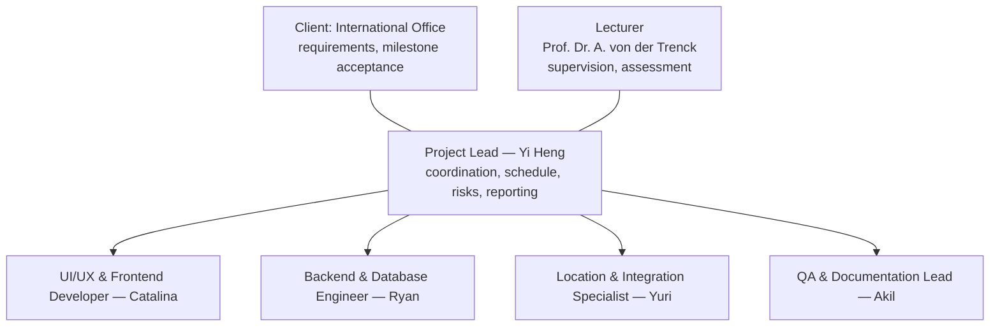

# Project Handbook — Campus & City Quest

| | |
|---|---|
| **Project number** | DHBW-INT-2027-01 |
| **Course** | Business Processes and their Implementation: Project Planning (Incomings 2026), DHBW Heilbronn |
| **Lecturer** | Prof. Dr. Aliona von der Trenck |
| **Project lead** | Yi Heng Lim |
| **Team** | Catalina, Yuri, Ryan, Yi Heng, Akil |
| **Version / date** | 4.0 — 26.10.2026 (based on the team's "Main Project Document": business rules BR01–BR25) |
| **Approach** | Hybrid: classic planning (WBS, schedule, budget) with iterative delivery in the implementation phase |

> **Source of truth for behaviour:** [business-rules.md](business-rules.md) (BR01–BR25 with resolutions and scoring examples), [data-model.md](data-model.md), [geofencing.md](geofencing.md), [question-bank.md](question-bank.md), [traceability.md](traceability.md). This handbook is the *plan*; if it contradicts the business rules, the business rules win.
>
> **Status of the numbers.** Scope and rules come from the team's Main Project Document. Effort (230 h), per-person hour splits, the budget and its rates, role-to-name assignments and the proposed technical limits (OTP lifetime, session timeout, accuracy limit, …) are planning assumptions made when writing this handbook. Confirm them in a team session and replace them if the team disagrees. **TBC** = needs confirmation by the lecturer/client. Actual hours are tracked in GitLab (§9).

---

## 0. Project Target Cross (start of the presentation)

| | |
|---|---|
| **WHY — Purpose** | Incoming international students struggle to learn the campus in their first weeks; static PDF guides are unengaging. A game-like onboarding speeds up adaptation, reduces culture shock and builds community. |
| **WHAT — Deliverables** | A mobile-responsive web app: login by OTP e-mail (`@…heilbronn.dhbw.de`), profile and teams (1–5 members, invitations), **8 pilot checkpoints** (Mensa, Library, CAS Cafe, Campus Garden, Care.box and Shop.box, Building B, Building C, Sensoricum) verified by **live location**, a timed multiple-choice quiz per checkpoint (3 or 5 questions, 1 minute per question, pass at 4/5 or 2/3), a scoring system (question points, time bonus, full-clear bonus, attempt multipliers, hard question) and solo + team leaderboards. Plus a content package (question bank, checkpoint data), documentation and handover. |
| **WHO — Target audience** | Incoming international students (users); DHBW international office (client); lecturer (assessment). |
| **HOW WELL — Quality criteria** | All 25 business rules implemented and traceable to tests; points computed exactly as in the rules (examples in business-rules §3.3 pass); ≥ 50 simultaneous sessions; first question visible ≤ 1.5 s after the quiz starts; ≥ 90% of pilot students complete all checkpoints (see §1.3). |

---

## 1. Objectives to Scope (Must / Should / Could / Won't)

### 1.1 Prioritised scope (MoSCoW)

**All rules BR01–BR25 are Must** (team decision). They are grouped into functional objectives:

| ID | Objective | Business rules | Measurable criterion | Priority |
|---|---|---|---|---|
| M1 | **Login and sessions:** OTP by e-mail to a school address ending with `heilbronn.dhbw.de`; one active session; inactivity expiry; generic response "If the account exists, an email containing the OTP has been sent." | BR01, BR03 | Acceptance checks 1–4 | **Must** |
| M2 | **Sign-up and profile:** first/last name, optional profile picture, optional nickname | BR02 | Validation tests | **Must** |
| M3 | **Teams:** create (name, optional picture), 1–5 members, one team per user, invitations by e-mail (accept/reject, 24 h expiry, invalid when rejected/full/already in team) | BR05, BR06 | Acceptance checks 16–19 | **Must** |
| M4 | **Checkpoints:** 8 pilot checkpoints with unique name, GPS, positive radius, `is_active` | BR07, BR08 | 8 seeded and calibrated on site | **Must** |
| M5 | **Location verification** when starting every attempt; poor accuracy/denied permission = check again without consuming an attempt or starting the timer; leaving the geofence later does not end the attempt | BR12 | Acceptance checks 5, 6, 22; real-phone test at all 8 places | **Must** |
| M6 | **Quiz engine:** random 3 or 5 distinct questions per attempt, 4 options each, 1 minute per question, no retry, right answer revealed, pass at 4/5 or 2/3, server-side timer and state (survives refresh/reconnect), one passed attempt per checkpoint | BR09, BR10, BR13–BR15, BR22, BR23, BR25 | Acceptance checks 7–9, 12, 13, 15, 23 | **Must** |
| M7 | **Scoring:** 1,000 per normal / 2,000 per hard question, time bonus (1 per whole second), full-clear bonus 200, attempt multipliers 100/85/70/55/40/0 % applied after bonuses, hard-question option on attempt 1, fractional points rounded up | BR14, BR16–BR21 | Examples 1–15 in business-rules §3.3 pass | **Must** |
| M8 | **Leaderboards:** solo (total points) and team (average of members, only teams with ≥ 2 members, only visible to team members); equal scores share a rank, earlier achiever listed first | BR04, BR24 | Acceptance checks 19, 20, 24 | **Must** |
| M9 | **Content in the database:** questions, options, answer keys, points, multipliers and bonuses are data, not code; question bank ≥ 2× normal and 3 hard questions in play | BR09, BR11 | Change a value in the DB → behaviour changes without code change | **Must** |
| M10 | **Privacy:** location consent; only "inside radius yes/no + time" stored, never raw coordinates; OTP codes and session tokens stored only as hashes | BR12 (+ team decision) | Acceptance check 22; privacy checklist | **Must** |
| M11 | **Performance:** ≥ 50 simultaneous student sessions; first question ≤ 1.5 s after the quiz starts | – | Load test, timing test | **Must** |
| M12 | **Pilot completion target:** ≥ 90% of incoming international students complete all campus checkpoints within 30 days of semester start | – | Database logs; see §1.3 for the in-project proxy | **Must** |
| S1 | **Read-first info page** per checkpoint (after the location check, before the quiz, no timer) | – | Shown before the quiz for all 8 places | Should |
| C1 | Weekly automated challenge-streak reminders | – | – | Could |
| C2 | Random time-based events giving extra chances to compete | – | – | Could |
| C3 | City expansion: more places around Heilbronn after the campus pilot (only a teaser page exists in the pilot) | – | – | Could |
| W1 | City-wide supermarket (Rewe, Lidl) and clothing-store locators | – | Removed from scope | **Won't** |
| W2 | Native mobile apps (App Store / Google Play) | – | Web app only | **Won't** |
| W3 | NFC tags, student-card reading, physical reader stations | – | Replaced by live-location verification | **Won't** |
| W4 | Duo and nationality leaderboards | – | Not in the rules; only solo and team | **Won't** |
| W5 | Admin user interface (content is loaded by seed scripts, BR11) | – | Not needed | **Won't** |
| W6 | Leaving a team, removing members, deleting teams, editing a profile after sign-up | – | No rule requires it (open points OP-06, OP-16) | **Won't (for now)** |

When there is a bottleneck we steer **Must before Should before Could**. If a Must goal is not fully met, the project has failed.

### 1.2 Non-objectives (out of scope)
W1–W6. Google Maps is not needed: the location check is a distance calculation against stored coordinates.

### 1.3 How the key objectives are verified

| Objective | Check method | When |
|---|---|---|
| Rules BR01–BR25 | Traceability matrix ([traceability.md](traceability.md)); acceptance checks 1–25 in business-rules §8 | WBS 5.1 |
| Scoring | Unit tests with the 15 worked examples (rounding, whole seconds, multiplier after bonuses) | WBS 3.4 |
| M5 location | Real phones (Android Chrome, iOS Safari) at all 8 places; radius calibrated | WBS 4.1, 5.1 |
| M11 performance | Load test with 50 virtual sessions; timing of the first question over ≥ 20 attempts | WBS 5.1 |
| M12 ≥ 90% in 30 days | **The project (13.10.–16.11.) is shorter than 30 days**, so inside the project it is verified by the pilot: ≥ 9 of 10 volunteers pass all 8 checkpoints in the pilot window. The 30-day measurement is a post-project target for the client. *(proposed — confirm with lecturer/client)* | WBS 5.2 and after handover |
| M10 privacy | Database and log inspection shows no coordinates; consent screen exists | WBS 5.1 |

### 1.4 Goal ↔ work-package completeness check
Every business rule is covered by at least one work package: see [traceability.md](traceability.md). Summary: M1 → 3.1, 3.6 · M2/M3 → 3.2, 3.6 · M4 → 4.1 · M5 → 3.5, 3.7 · M6 → 3.3, 3.7 · M7 → 3.3, 3.4 · M8 → 3.4, 3.8 · M9 → 2.2, 4.2 · M10 → 2.3, 3.1, 3.5 · M11/M12 → 5.1, 5.2.

---

## 2. Work Packages and WBS

### 2.1 The seven work packages

| WP | Title | Description | Hours |
|---|---|---|---|
| WP1 | Project management & governance | Setup, risk tracking, milestones, time tracking in GitLab, wiki | 15 |
| WP2 | UI/UX & system architecture design | Wireframes and flows, database schema, geofencing architecture and API contract | 25 |
| WP3 | Backend & database | OTP login/sessions/e-mail, profile and teams, checkpoint and quiz engine, scoring and leaderboards | 78 |
| WP4 | Location verification | Browser geolocation, server-side distance and accuracy checks, consent | 10 |
| WP5 | Frontend web | Auth/profile/team screens, checkpoint list + location check + quiz (timer, reveal, hard option, results), leaderboards, info page (Should) | 52 |
| WP6 | Campus content | Set up and calibrate 8 checkpoints; write 76 questions (+ info texts) | 26 |
| WP7 | QA & pilot | Automated tests, integration, code review, pilot with 10 volunteers, handover | 24 |
| | **Total** | | **230** |

### 2.2 WBS (hierarchical, project management first)

```
0 Campus & City Quest
├─ 1.0 Project management                       (WP1)
│   ├─ 1.1 Set up and plan the project
│   ├─ 1.2 Track time and review progress
│   └─ 1.3 Maintain documentation and GitLab wiki
├─ 2.0 Concept & design                         (WP2)
│   ├─ 2.1 Design UI/UX wireframes and user flows
│   ├─ 2.2 Model the database and architecture
│   └─ 2.3 Design geofencing architecture and API contract
├─ 3.0 System development
│   ├─ 3.1 Build OTP login, e-mail sending and sessions          (WP3)
│   ├─ 3.2 Build profile, teams and invitations                  (WP3)
│   ├─ 3.3 Build checkpoint and quiz engine                      (WP3)
│   ├─ 3.4 Build scoring and leaderboards                        (WP3)
│   ├─ 3.5 Build location verification                           (WP4)
│   ├─ 3.6 Build frontend: login, profile, teams                 (WP5)
│   ├─ 3.7 Build frontend: checkpoints, location check, quiz     (WP5)
│   └─ 3.8 Build frontend: leaderboards and info page            (WP5)
├─ 4.0 Campus content                           (WP6)
│   ├─ 4.1 Set up and calibrate the 8 checkpoints
│   └─ 4.2 Write the question bank and info texts
└─ 5.0 Testing & deployment                     (WP7)
    ├─ 5.1 Test, integrate and review
    └─ 5.2 Run pilot trial and hand over
```

### 2.3 Work-package list

Titles start with a verb; each package has one owner (accountable) and 3–40 h.

| WBS | Work package | Deliverable | Rules | Owner | Predecessors | Hours |
|---|---|---|---|---|---|---|
| 1.1 | Set up and plan the project | GitLab project, boards, labels, wiki, branch rules, handbook | – | Yi Heng | – | 5 |
| 1.2 | Track time and review progress | Weekly time report, status slides | – | Yi Heng | 1.1 | 6 |
| 1.3 | Maintain documentation and wiki | Minutes, decisions, architecture notes | – | Akil | 1.1 | 4 |
| 2.1 | Design UI/UX wireframes and user flows | Mobile wireframes, flows (login, team, quiz, results) | all UI | Catalina | 1.1 | 12 |
| 2.2 | Model the database and architecture | Schema from [data-model.md](data-model.md), seed approach, stack decision | BR11 | Ryan | 1.1 | 8 |
| 2.3 | Design geofencing architecture and API contract | [geofencing.md](geofencing.md) reviewed, API list, error codes | BR12 | Yuri | 2.2 | 5 |
| 3.1 | Build OTP login, e-mail sending and sessions | Login/sign-up API, OTP hashing, e-mail delivery, single active session | BR01–03 | Yuri | 2.2 | 16 |
| 3.2 | Build profile, teams and invitations | Profile, picture upload, teams, invitations | BR02, 05, 06 | Akil | 3.1 | 16 |
| 3.3 | Build checkpoint and quiz engine | Checkpoints, random draw, attempts, timer, answers, hard option, state persistence | BR07–15, 20–23, 25 | Ryan | 2.2 | 28 |
| 3.4 | Build scoring and leaderboards | Points, bonuses, multipliers, rounding, solo/team boards, ranks | BR04, 16–19, 24 | Yi Heng | 3.3 | 18 |
| 3.5 | Build location verification | Browser + server check, consent, retry rules | BR08, 12 | Yuri | 2.3 | 10 |
| 3.6 | Build frontend: login, profile, teams | Screens for BR01–06 | BR01–06 | Catalina | 2.1, 3.1 | 18 |
| 3.7 | Build frontend: checkpoints, location check, quiz | Checkpoint list, location check, quiz with timer, reveal, hard option, result | BR12–15, 20, 21, 25 | Catalina | 2.1, 3.3, 3.5 | 26 |
| 3.8 | Build frontend: leaderboards and info page | Solo/team boards; info page (Should) | BR04, 24 | Catalina | 3.4 | 8 |
| 4.1 | Set up and calibrate the 8 checkpoints | Coordinates and tested radii (on site, real phones) | BR07, 08 | Akil | 1.1 | 8 |
| 4.2 | Write the question bank and info texts | 76 verified questions ([question-bank.md](question-bank.md)), 8 info texts | BR09, 10 | Akil (with Yi Heng) | 4.1 | 18 |
| 5.1 | Test, integrate and review | Automated tests, load test, acceptance checks, review log | all | Akil | 3.x, 4.2 | 16 |
| 5.2 | Run pilot trial and hand over | Pilot report (10 volunteers), handover package | M12 | Yi Heng | 5.1 | 8 |
| | **Total** | | | | | **230** |

**Work-package template** (GitLab issue): title with tag and verb, owner, WBS code, **business rules covered (BR..)**, predecessors, activities and deliverables, estimate and spent time, status (identified → planned → assigned → in progress → done → accepted).

---

## 3. Schedule (Dependencies and Milestones)

### 3.1 Dates and milestones

**Project start 13.10.2026 · project end 16.11.2026.** Today (26.10.) the design phase is finished or ending; implementation runs 26.10.–13.11.

| # | Milestone | Date | Result (checkable) |
|---|---|---|---|
| M1 | UI/UX wireframes, ER model and architecture approved | 20.10.2026 | Documents accepted (status to be confirmed by the team); [business-rules.md](business-rules.md) and [data-model.md](data-model.md) agreed |
| M2 | OTP login, 8 checkpoints in the database and location check working | 02.11.2026 | A student can log in by OTP, see the 8 checkpoints and pass the location check on a phone |
| M3 | Full quiz, scoring and leaderboards working; question bank loaded; integration testing complete | 10.11.2026 | 76 questions seeded, scoring examples pass, acceptance checks pass on the test system |
| M4 | Pilot complete, time-tracking reports final, ready for presentation | 16.11.2026 | Pilot report (10 volunteers), time report |

**Course deadlines:** planning submission 19.10.2026, 12:15 (done/to confirm); final presentation 18.11.2026 (16.11. tbd) with 15–20 min + 10 min Q&A; final report 07.12.2026. Presentation and report preparation are course deliverables and **not included in the 230 h**.

### 3.2 Gantt chart



### 3.3 Dependencies and critical path
Longest dependent chain: **1.1 Set up → 2.2 Database/architecture → 3.3 Quiz engine → 3.4 Scoring → 5.1 Test and integrate → 5.2 Pilot and handover.** A delay in any of these delays the project end. Float exists for 3.2, 3.8, 4.1 (but 4.1/4.2 gate the pilot).

### 3.4 Calendarisation and capacity
230 h in total means about 46 h per person. About 190 h are implementation work in roughly 3 weeks (26.10.–13.11.), i.e. **about 12–15 h per person per week** on top of lectures and exams. Unavailable days are entered in the team calendar and checked at the weekly sync (risk R1).

---

## 4. Organisation Chart and Roles



*Role-to-name assignment is the team's proposal; confirm at the next sync. Every member is also developer and peer reviewer.*

### 4.1 Roles — tasks, authority, responsibility (ABV)

| Role | Person | Tasks | Authority | Responsibility |
|---|---|---|---|---|
| Project Lead | Yi Heng | Coordination, schedule, milestone reporting, risks, time-tracking report, scoring/leaderboards, release merges to `main` | Prioritises backlog within scope; merges `preproduction` → `main` | Schedule, scope, escalation |
| UI/UX & Frontend Developer | Catalina | Wireframes, mobile UI, quiz screens, leaderboards | UX and UI decisions | Usability, frontend quality |
| Backend & Database Engineer | Ryan | Schema, quiz engine, API, integrity (transactions, constraints), privacy by design | Backend technology within the agreed stack | Data protection, rule correctness |
| Location & Integration Specialist | Yuri | OTP login and e-mail delivery, sessions, location verification, integration | Design of login and location checks | Reliability of login and location |
| QA & Documentation Lead | Akil | Wiki, minutes, four-eyes code reviews, test checklists, teams/invitations, checkpoint calibration, question bank | Can block a merge that fails the checklist | Test coverage, documentation, content quality |
| Client | International Office (contact **TBC**) | Requirements, milestone acceptance | Final acceptance | Clear, timely feedback |
| Lecturer | Prof. von der Trenck | Supervision, assessment | Grades | Feedback in status meetings |

**Role-conflict rule:** whoever does the work does not review it. Every merge request needs one approval from another team member ([git-workflow.md](git-workflow.md)).

### 4.2 RACI matrix

R = responsible, A = accountable, C = consulted, I = informed

| Task | Yi Heng | Catalina | Ryan | Yuri | Akil | Client | Lecturer |
|---|---|---|---|---|---|---|---|
| Plan & handbook | A/R | C | C | C | C | C | C |
| UI/UX design | A | R | C | C | C | C | I |
| Architecture, schema, rules | A | C | R | C | C | I | I |
| Login, sessions, location | A | C | C | R | C | I | – |
| Quiz engine, scoring, leaderboards | A/R (scoring) | C | R (quiz) | C | C | I | – |
| Teams and invitations | A | C | C | C | R | I | – |
| Frontend | A | R | C | C | C | I | – |
| Checkpoints and question bank | A | C | C | C | R | C | – |
| Testing, reviews, pilot | A | C | C | C | R | I | – |
| Status reports | R | C | C | C | C | I | I |
| Milestone acceptance | R | I | I | I | I | A | I |

---

## 5. Effort Estimation (Hours per Work Package and Role)

**Method.** Fibonacci-based Planning Poker (cards 1, 2, 3, 5, 8, 13, 20, 40 h), two rounds, net working hours. Packages > 40 h are split, < 3 h merged. Uncertain packages (3.3, 3.1 e-mail) may use the three-point estimate **E = (O + 4M + P) / 6**. The total of **230 h** is the team's decision after the business rules were extended (8 checkpoints, OTP login, teams, scoring); the split below is the starting baseline.

### 5.1 Hours per work package and role

| WP | Title | Yi Heng (Lead) | Catalina (UX/FE) | Ryan (BE/DB) | Yuri (Login/Location) | Akil (QA/Docs) | **Total** |
|---|---|---|---|---|---|---|---|
| WP1 | Project management | 9 | – | – | – | 6 | **15** |
| WP2 | UI/UX & architecture design | 5 | 10 | 7 | 3 | – | **25** |
| WP3 | Backend & database | 12 | – | 35 | 14 | 17 | **78** |
| WP4 | Location verification | – | – | 2 | 8 | – | **10** |
| WP5 | Frontend web | 6 | 30 | – | 12 | 4 | **52** |
| WP6 | Campus content | 8 | 4 | 2 | 2 | 10 | **26** |
| WP7 | QA & pilot | 6 | 3 | 4 | 3 | 8 | **24** |
| | **Total** | **46** | **47** | **50** | **42** | **45** | **230** |

### 5.2 Distribution by category (basis for the time-tracking report)

| Category | WP | Hours | Share |
|---|---|---|---|
| Organisation | WP1 | 15 | 6.5% |
| Conception | WP2 | 25 | 10.9% |
| Implementation (incl. content, testing, pilot) | WP3–WP7 | 190 | 82.6% |
| **Total** | | **230** | 100% |

> **Planning warning:** the schedule leaves about 3 weeks for 190 implementation hours. WP3 (78 h for login, teams, quiz engine, scoring) and WP6 (76 questions to write and verify on site) are the packages most likely to overrun. See risks R1, R2, R7 and the 10% reserve (§8). If tracked hours exceed the estimate by more than 20% at M2, the project lead proposes to move S1/C-items and, in agreement with the client, simplify team features first.

---

## 6. Communication Plan

| With | What | How | Who | Frequency |
|---|---|---|---|---|
| Team | Progress, blockers, next steps | Weekly sync, **every Monday, 1 h**, Discord or in person | Project lead | Weekly |
| Team | Tasks, merge requests, decisions | GitLab issues, boards, MRs | WP owners | Ongoing |
| Client (International Office) | Status, open rule questions (§7.3, business-rules §7) | Call or e-mail | Project lead | Bi-weekly |
| Client | Formal milestone acceptance (M1–M4) | Review meeting with **signed minutes** | Project lead | At each milestone |
| Lecturer | Project status incl. time-tracking review | In person, 10–15 min | Project lead | Integration-seminar dates |
| All | Meeting minutes | GitLab wiki, immediately after each session | Akil (rotating if needed) | After each meeting |

Escalation path: team member → project lead → lecturer/client.

---

## 7. Quality and Risk Management

### 7.1 Quality plan

| Type | Measures |
|---|---|
| **Constructive (prevent)** | [business-rules.md](business-rules.md) as single source of truth; scoring and points read from database tables (BR11); server-authoritative time and state; database constraints from [data-model.md](data-model.md) §2 (one passed attempt per checkpoint, one active attempt, one active session); ESLint + Prettier via `npm run check`; Conventional Commits; protected `main` and `preproduction` |
| **Analytical (find)** | Four-eyes code review (1 approval from another member per MR); automated tests that cite BR IDs ([traceability.md](traceability.md)); the 25 acceptance checks and 15 scoring examples in business-rules §3.3/§8; real-phone tests at all 8 places; load test (50 sessions); **pilot with 10 student volunteers**; checklist before each milestone |

**Definition of done (per work package):** deliverable in repository/wiki, reviewed by a second person, `npm run check` passes, BR IDs named in issue and tests, time booked in GitLab, issue closed, AI use logged in `ai-logs/<name>/`.

### 7.2 Risk list

Scale: low / medium / high for probability (P) and severity (S).

| # | Risk | P | S | Priority | Mitigation (strategy) | Owner |
|---|---|---|---|---|---|---|
| R1 | Schedule compression: ~190 implementation hours in ~3 weeks; unavailable members | high | high | **high** | Weekly capacity check; implement in the order of the critical path; parallel work per role; cut S1/C items first; early decision on the team-feature rules (reduce) | Yi Heng |
| R2 | Scope too large (all 25 rules Must) or scope creep | high | high | **high** | Rules fixed in business-rules.md; changes only via project lead; no new features before all Must are done (avoid) | Yi Heng |
| R3 | OTP e-mail delivery fails (SMTP access, spam filters, university mail system) | med | high | **high** | Clarify sender/SMTP in week 1; use a reliable provider's free tier; test with real `@heilbronn.dhbw.de` addresses early (reduce) | Yuri |
| R4 | GPS inaccurate indoors or permission denied | high | med | **high** | Rules allow retry without consuming an attempt (BR12); radius calibrated on site; clear messages (reduce) | Yuri |
| R5 | Personal data: e-mail, names, pictures, location result (GDPR) | med | high | **high** | Consent screen; store only inside yes/no + time; hashed OTP/tokens; picture re-encoding; clarify with DHBW data-protection contact (avoid/reduce) | Ryan |
| R6 | Cheating after verification (leaving the geofence is allowed by BR12; answers are revealed and shared) | high | med | med | Server timer, random draw, bank 2× the draw, single pass per checkpoint, decreasing multipliers; residual risk accepted and documented (accept) | Ryan |
| R7 | Content effort: 76 questions to write and fact-check on site; bank minimum (10 normal) above the source template (8) | high | med | **high** | Start in week 1; split questions per member; reviewer ≠ author; seed validation refuses incomplete banks (reduce) | Akil |
| R8 | Quiz/timer/race-condition bugs (double submit, concurrent invitations, expiry vs last answer) | med | high | **high** | Row locks and DB constraints, strict server clock, tests for every acceptance check (reduce) | Ryan |
| R9 | Profile-picture upload abuse (size, malware, EXIF location) | med | med | med | Size/type limits, content sniffing, re-encode, strip metadata (reduce) | Akil |
| R10 | Open rule questions: no leaving/removing from teams, solo creators cannot join other teams (R-41), sub-domain e-mail addresses, rounding place (OP-07) | med | med | med | Confirm with client early (business-rules §7); document the chosen reading (reduce) | Yi Heng |
| R11 | Low student adoption/engagement in the pilot | med | med | med | Buddy onboarding, leaderboards (reduce) | Catalina |
| R12 | Pilot cannot prove the 30-day KPI inside the project | high | low | med | Use the agreed pilot proxy (§1.3) (accept) | Yi Heng |
| R13 | Code or data loss | low | high | med | GitLab as single source, protected branches, DB backup before the pilot (reduce) | Ryan |

Risks are reviewed at every Monday sync; mitigations are checked at each milestone; lessons learned go into the final report.

### 7.3 Open points to confirm
The full list (OP-01 … OP-23) is in [business-rules.md](business-rules.md) §7. Most urgent: team rules (OP-06), rounding place (OP-07), e-mail sub-domains (OP-02), data-protection contact (OP-11), geofence coordinates and radii (OP-10).

---

## 8. Budget (fictional, assumptions stated)

No real budget exists, so the planning uses plausible assumptions. No hardware is needed (students use their own phones).

| Item | Calculation / assumption | Amount (€) |
|---|---|---|
| Personnel | 230 h × €30/h (assumed internal rate) | 6,900 |
| Hosting | ≈ €10/month × 4 months | 40 |
| E-mail delivery (OTP) | Free tier or university SMTP; allowance for a paid tier | 20 |
| Software, licences, TLS | GitLab provided by DHBW; open-source stack; free TLS certificate (assumed) | 0 |
| Hardware / travel | None | 0 |
| **Subtotal** | | **6,960** |
| Risk reserve | 10% of subtotal | 696 |
| **Total budget** | | **7,656** |

Revenue: none expected (non-profit student service). Follow-up costs: hosting, e-mail service, and updating checkpoint/question content (**TBC**).

---

## 9. Tool Usage and Time Tracking

### 9.1 Tools (same tools for everyone)

| Area | Tool | Purpose | Owner |
|---|---|---|---|
| Project management & backlog | DHBW WI GitLab Issues and Kanban boards — https://wi-git.heilbronn.dhbw.de/ | Backlog, work packages, status | Yi Heng |
| Documentation & wiki | GitLab wiki + repository (`docs/`) | Handbook, rules, minutes, decisions | Akil |
| Version control | GitLab repository (`main` ← `preproduction` ← `wip/[name]/feature` and `wip/[name]/bugfix`), see [git-workflow.md](git-workflow.md) | Code, versions, reviews | Ryan |
| Dev tooling | npm only: ESLint, Prettier, Vitest — see [requirements.md](../requirements.md) | Lint, format, test | Everyone |
| Backend data | MySQL 8.4 (Docker Compose, decided in WBS 2.2) + migrations and seed scripts | Rules and content in data (BR11) | Ryan |
| E-mail | SMTP server or provider | OTP e-mails | Yuri |
| Location | Browser Geolocation API (HTTPS; `localhost` in development) | Location verification | Yuri |
| Test devices | Real Android and iOS phones | On-site calibration and tests | Akil |
| Communication | Discord (team), e-mail/call (client) | Syncs | All |
| Design | Figma or similar (to be agreed) | Wireframes | Catalina |
| Time tracking | GitLab built-in time tracking (`/estimate`, `/spend`); no Excel for raw logs | Hours per person and task | Everyone |
| AI assistance | Claude Code (rules in CLAUDE.md), logs in `ai-logs/` | Support, always disclosed | Everyone |

User assignment on the DHBW GitLab is coordinated with Tessa Steinigke.

### 9.2 Time tracking and "billing" of hours
- Every issue gets an estimate (`/estimate`, from §5); every working session is booked with `/spend` (hours, not minutes), by person and task.
- Research, coordination, meetings and documentation count as project time.
- Each issue has a label `cat::conception`, `cat::implementation` or `cat::organisation`, and the BR labels (`br::BR01` …).
- The report shows the distribution over the three categories overall and per person. Excel may be used for evaluation only.
- Tracked-vs-estimated is reviewed in every lecturer status meeting. Planning-phase hours are tracked separately.

---

## 10. Use of AI Tools

*Transparency principle: AI is allowed but must be disclosed and critically reflected. This section also closes the presentation and the report.*

| Work step | AI system | How it was used | Treatment |
|---|---|---|---|
| Repository setup | Claude Code (Anthropic) | Drafted `CLAUDE.md`, the Git workflow guide, `.gitignore`, issue/MR templates, setup script, npm tooling files and `requirements.md` | Adapted by the team (team to confirm); lint/format/test commands run and passed |
| Charter and handbook | Claude Code | Formatted the charter; restructured the team's plan into this handbook; added dependency analysis, RACI, budget assumptions, hour splits; reworked scope after the team replaced NFC readers with live location and again after the Main Project Document (BR01–BR25) | **First draft** — scope, rules and numbers come from the team's documents; AI-added numbers (hour splits, budget, technical limits) are marked as assumptions and must be reviewed |
| Business rules and data model specification | Claude Code (two sub-agents competing in a "tournament"; a judge picked the more correct text) | Turned the team's 25 rules, entity list and tables into an unambiguous specification: resolved ambiguities, scoring formula, 15 worked examples, state machine, constraints, proposed additions | The team's original rules were transcribed unchanged; **all AI resolutions are marked as assumptions or proposals** (business-rules R-nn, OP-nn). The scoring examples were re-computed with a separate script. The team must review and accept them. |
| Question content | — | Not AI-generated; the team writes and fact-checks questions on site | – |
| Effort estimation | — | Planning Poker to be done by the humans (AI as an extra participant only if stated) | Replaces AI-proposed splits |

**Evidence:** AI session logs per member in `ai-logs/<name>/`; screenshots in the report appendix.

**Reflection (team to complete after review):**
- *Helpful:* quick, consistent structure; found contradictions in the source rules (e.g. question-bank size 8 vs "2×", a missing nickname column, undefined "reached the score" time for teams).
- *Limits:* the AI cannot know real campus conditions, university rules, e-mail infrastructure or the team's capacity; its numbers are assumptions. Every rule interpretation must be confirmed by the team.

---

## 11. Checklist against the nine required parts

| # | Required part | Where |
|---|---|---|
| 1 | Objectives to scope (Must/Should/Could) | §1 |
| 2 | Work packages (WBS) | §2 |
| 3 | Schedule: dependencies, milestones | §3 |
| 4 | Org chart & roles | §4 |
| 5 | Effort estimation: hours per WP and role | §5 |
| 6 | Communication plan: team, client, lecturers | §6 |
| 7 | Quality & risk: reviews, tests, risk list | §7 |
| 8 | Budget (fictional, assumptions stated) | §8 |
| 9 | Tool usage: PM, docs, development (+ time tracking) | §9 |
| + | Target cross at the start of the presentation | §0 |
| + | "Use of AI Tools" at the end of presentation and report | §10 |
