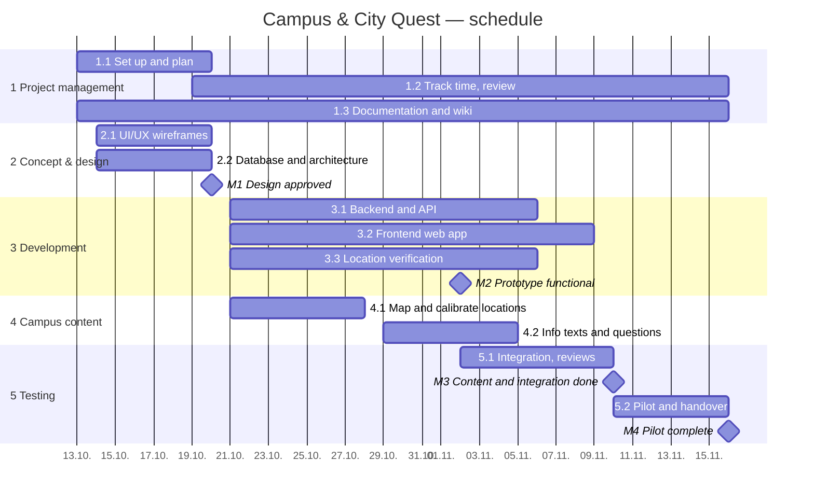
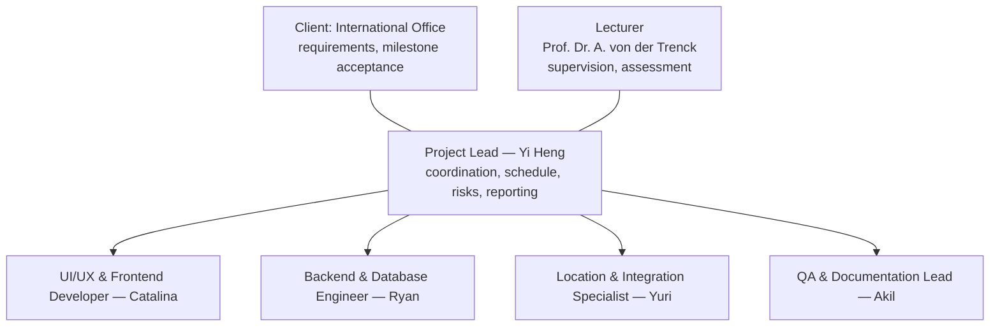

# Project Handbook — Campus & City Quest

| | |
|---|---|
| **Project number** | DHBW-INT-2027-01 |
| **Course** | Business Processes and their Implementation: Project Planning (Incomings 2026), DHBW Heilbronn |
| **Lecturer** | Prof. Dr. Aliona von der Trenck |
| **Project lead** | Yi Heng Lim |
| **Team** | Catalina, Yuri, Ryan, Yi Heng, Akil |
| **Version / date** | 3.0 — 13.10.2026 (planning presentation); final planning submission 19.10.2026, 12:15 |
| **Approach** | Hybrid: classic planning (WBS, schedule, budget) with iterative delivery in the implementation phase |

> **Status of the numbers.** Scope, work packages, schedule and the 145 h total come from the team's agreed plan. The quiz/scoring numbers (radius, accuracy, cooldown, point values), per-person hour splits, the budget and its rates, and role-to-name assignments are planning assumptions made when writing this handbook. Confirm them in a team session and replace them if the team disagrees. Items marked **TBC** need confirmation by the lecturer/client. Actual hours are tracked in GitLab (§9) and compared with these estimates.

---

## 0. Project Target Cross (start of the presentation)

| | |
|---|---|
| **WHY — Purpose** | Incoming international students struggle to learn the campus (canteen, library, card top-up area, check-up area, …) in their first weeks; static PDF guides are unengaging. A game-like onboarding speeds up adaptation, reduces culture shock and builds community. |
| **WHAT — Deliverables** | A mobile-responsive web app with secure login and **live-location verification** at 5 campus checkpoints: arriving at a place unlocks its information page; a timed quiz (5-minute timer, ≥ 80% to pass) awards points; leaving the place cancels the attempt. Plus a content package (5 locations, info texts, 5–8 questions each), documentation and handover. |
| **WHO — Target audience** | Incoming international students (users); DHBW international office (client); lecturer (assessment). |
| **HOW WELL — Quality criteria** | ≥ 90% of incoming students complete all campus checkpoints within 30 days of semester start; place info ≤ 3 s after arrival is verified; first question ≤ 1.5 s after pressing Start; ≥ 50 simultaneous sessions; no points without being at the place. See §1.3. |

---

## 1. Objectives to Scope (Must / Should / Could / Won't)

### 1.1 Prioritised scope (MoSCoW)

| ID | Objective / feature | Measurable criterion | Priority |
|---|---|---|---|
| M1 | **Core web app:** mobile-responsive web application with secure user authentication | Supports ≥ 50 simultaneous student sessions | **Must** |
| M2 | **Location-verified checkpoints:** 5 geofenced campus checkpoints (canteen, library, card top-up area, check-up area, plus a 5th location — **TBC**) using the phone's live location | Arrival verified at all 5 locations in on-site test (radius calibrated per location; default 75 m, reported accuracy ≤ 50 m) | **Must** |
| M3 | **Read-first info + quiz flow:** arrival unlocks the place information (no time limit); the student starts the quiz when ready | Info ≤ 3 s after arrival is verified (GPS fix time excluded); first question ≤ 1.5 s after pressing Start | **Must** |
| M4 | **Anti-cheat rules:** quiz only possible at the location; attempt is cancelled when the student is away > 30 s; 5-minute quiz timer measured on the server; **pass = ≥ 80% correct** (≥ 4 of 5) | Automated tests (§1.3); no points ever awarded outside the radius | **Must** |
| M5 | **Scoring:** points depend on first try, speed and number of correct answers (§1.4) | Scoring unit tests match the table in §1.4 | **Must** |
| M6 | **Campus completion target** | ≥ 90% of incoming international students complete all campus checkpoints within 30 days of semester start (database logs) | **Must** |
| M7 | **Privacy:** consent screen for location; only "inside radius yes/no + timestamp" is stored, no raw coordinates; independent project database | Privacy checklist passed; no coordinates in the database or logs | **Must** |
| S1 | **Extended campus coverage:** more checkpoints (vending machines, department wings) | ≥ 10 locations | Should |
| S2 | **Competitive leaderboards:** individual, duo and nationality rankings | Updated instantly after a passed quiz | Should |
| C1 | Weekly automated challenge-streak reminders to student accounts | – | Could |
| C2 | Sudden events: random time-based events giving more chances to compete | – | Could |
| W1 | City-wide supermarket (Rewe, Lidl) and clothing-store locators | Explicitly removed from scope for now | **Won't** |
| W2 | Native mobile apps (Apple App Store / Google Play) | Mobile-responsive web app only | **Won't** |
| W3 | Modifying official university student databases | Not needed — no university data is used | **Won't** |
| W4 | NFC tags, student-card UID reading and physical reader stations | Replaced by live-location verification | **Won't** |

When there is a bottleneck we steer **Must before Should before Could**. If a Must goal is not fully met, the project has failed; Should goals may be met partly.

### 1.2 Non-objectives (out of scope)
W1–W4. They are communicated to the client to avoid unspoken expectations. Because W1 removes the city features, the Google Maps integration from the original pitch is **not** part of this plan (a plain location check does not need a map service).

### 1.3 How each Must objective is verified

| Objective | Check method | When |
|---|---|---|
| M1 ≥ 50 sessions | Automated load test (50 virtual sessions) | WBS 5.1 |
| M2 five checkpoints | On-site walk-through with real phones (Android Chrome, iOS Safari) at each location; radius calibrated and recorded | WBS 4.1 / 5.1 |
| M3 timings | Timestamps measured over ≥ 20 attempts (arrival verified → info visible; Start → first question) | WBS 5.1 |
| M4 anti-cheat | Automated tests: outside radius → rejected; accuracy > 50 m → not accepted; away 29 s → continues; away 31 s → cancelled; answer at 299 s accepted, at 301 s rejected; 3/5 fails, 4/5 passes; implausible jump → rejected | WBS 3.3 / 5.1 |
| M5 scoring | Unit tests with the examples in §1.4 | WBS 3.1 |
| M6 ≥ 90% within 30 days | Database logs. **The project (13.10.–16.11.) is shorter than 30 days**, so inside the project it is verified through the pilot: ≥ 9 of 10 volunteers pass all 5 checkpoints in the pilot window. The full 30-day measurement is a post-project target for the client. *(proposed — confirm with lecturer/client)* | WBS 5.2 and after handover |
| M7 privacy | Checklist: consent screen, database inspected for coordinates, log inspection, privacy notice | WBS 5.1 |

### 1.4 Quiz, scoring and anti-cheat rules (proposed defaults — confirm)

**Visit flow**

1. The student opens the app, accepts the location consent and goes to a checkpoint.
2. Arrival is verified (live location inside the radius with sufficient accuracy) → the **place information** unlocks. There is **no time limit** for reading.
3. The student presses **Start quiz** when ready → **5 questions** are drawn at random from the location's question bank (5–8 questions) → a **5-minute timer** starts (server clock).
4. **Pass = at least 80% correct** (4 of 5). The result screen shows pass/fail and points.
5. After a fail or cancellation the student may retry after a **2-minute cooldown**, while still at the place.

**Staying at the place (strict)**
- While the page is open the app sends a location heartbeat about every 10 s (browser Geolocation API, high accuracy; Screen Wake Lock keeps the screen on).
- The server accepts a sample only if it is inside the radius, the reported accuracy is ≤ 50 m, the timestamp is fresh and the movement since the last sample is physically plausible.
- No accepted sample for **more than 30 s** (or location permission revoked, or the page is backgrounded) → the attempt is **cancelled**. A visible warning counts down ("Return to the place within 30 s").
- Answers are rejected unless the latest accepted sample is inside the radius and the attempt is within the 5-minute window.

**Points per passed attempt**

| Component | Rule |
|---|---|
| Correct answers | 10 points per correct answer (max 50) |
| Perfect score | +10 if 5/5 correct |
| Speed bonus | `remaining_seconds / 300 × 20`, i.e. 0–20 points |
| Attempt multiplier | 1st attempt × 1.0 · 2nd attempt × 0.6 · 3rd and later × 0.3 |
| Failed / cancelled attempt | 0 points |
| Repeat of an already passed location | No points (practice only) |

Examples: 5/5 correct, 60 s used (240 s left), first attempt → (50 + 10 + 16) × 1.0 = **76**. 4/5 correct, 200 s left, second attempt → (40 + 0 + 13) × 0.6 = **32** (rounded). Maximum for one location ≈ 80. Leaderboard tie-break: earlier completion time.

**Limits we accept and document:** a web app cannot reliably detect GPS spoofing; indoor GPS (library, canteen) can be inaccurate; some phones pause location when the browser is in the background. Mitigations are in §7.

### 1.5 Goal ↔ work-package completeness check

| Objective | Covered by |
|---|---|
| M1 web app, authentication, 50 sessions | 2.1, 2.2, 3.1, 3.2, 5.1 |
| M2 geofenced checkpoints | 3.3, 4.1, 5.2 |
| M3 info + quiz flow | 2.1, 3.1, 3.2, 4.2 |
| M4 anti-cheat rules | 3.1, 3.3, 5.1 |
| M5 scoring | 3.1, 5.1 |
| M6 completion target | 4.1, 4.2, 5.2 |
| M7 privacy | 2.2, 3.1, 3.3, 5.1 |
| S1 more checkpoints | 4.1 (only if time allows) |
| S2 leaderboards | 2.1, 3.1, 3.2 |

---

## 2. Work Packages and WBS

### 2.1 The seven work packages

| WP | Title | Description | Hours |
|---|---|---|---|
| WP1 | Project management & governance | Project setup, risk tracking, milestone scheduling, time tracking in GitLab | 12 |
| WP2 | UI/UX & system architecture design | Wireframes (info page, quiz, timer, leave warning, results), user flows, database schema | 16 |
| WP3 | Backend & database development | Server logic, user accounts, visit/attempt state machine, quiz and scoring rules, point tracking, API endpoints, leaderboards | 30 |
| WP4 | Location verification & anti-cheat | Browser geolocation (`watchPosition`), heartbeat, accuracy and plausibility checks, 30-s leave rule, consent screen, per-location radius support | 25 |
| WP5 | Frontend web development | Mobile-responsive UI, login, info page, quiz screen with timer, leave-warning countdown, result screen, live leaderboards | 35 |
| WP6 | Campus content & trivia population | Catalogue 5 campus locations (coordinates, radius), read-first info text per location, 5–8 trivia questions per location | 15 |
| WP7 | Quality assurance & pilot testing | End-to-end integration tests on real phones, bug fixes, performance monitoring, pilot with 10 volunteers | 12 |
| | **Total** | | **145** |

### 2.2 WBS (hierarchical, project management first)

```
0 Campus & City Quest
├─ 1.0 Project management                 (WP1)
│   ├─ 1.1 Set up and plan the project
│   ├─ 1.2 Track time and review progress
│   └─ 1.3 Maintain documentation and GitLab wiki
├─ 2.0 Concept & design                   (WP2)
│   ├─ 2.1 Design UI/UX wireframes and user journey
│   └─ 2.2 Model the database and architecture
├─ 3.0 System development
│   ├─ 3.1 Build backend server and REST API                    (WP3)
│   ├─ 3.2 Build frontend mobile web app                        (WP5)
│   └─ 3.3 Build live-location verification and anti-cheat      (WP4)
├─ 4.0 Campus content                     (WP6)
│   ├─ 4.1 Map and calibrate campus locations
│   └─ 4.2 Write info texts and the trivia question bank
└─ 5.0 Testing & deployment               (WP7)
    ├─ 5.1 Integrate the system and run code reviews
    └─ 5.2 Run pilot trial and hand over
```

### 2.3 Work-package list (WBS code, owner, dependencies)

Titles start with a verb; every package has one owner and is between 3 and 40 h.

| WBS | Work package | Deliverable | Owner | Predecessors | Hours |
|---|---|---|---|---|---|
| 1.1 | Set up and plan the project | GitLab project, boards, labels, wiki, branch rules, handbook | Yi Heng | – | 5 |
| 1.2 | Track time and review progress | Weekly time report, status slides for lecturer | Yi Heng | 1.1 | 4 |
| 1.3 | Maintain documentation and wiki | Minutes, decisions, architecture notes in wiki | Akil | 1.1 | 3 |
| 2.1 | Design UI/UX wireframes and user journey | Clickable mobile wireframes, user-flow map | Catalina | 1.1 | 10 |
| 2.2 | Model the database and architecture | ER model, API outline, privacy concept, location-sample protocol | Ryan | 1.1 | 6 |
| 3.1 | Build backend server and REST API | Auth, accounts, visit/attempt state machine, quiz rules (80% pass, 5-min timer), scoring, leaderboards | Ryan | 2.2 | 30 |
| 3.2 | Build frontend mobile web app | Login, info page, quiz screen, timer, leave warning, results, leaderboards | Catalina | 2.1, 3.1 (API contract) | 35 |
| 3.3 | Build live-location verification and anti-cheat | Geolocation client, heartbeat, server-side radius/accuracy/plausibility checks, 30-s leave rule, consent screen | Yuri | 2.2 | 25 |
| 4.1 | Map and calibrate campus locations | 5 locations with coordinates and tested radius (on-site, real phones) | Akil | 1.1 | 5 |
| 4.2 | Write info texts and question bank | 5 info texts, 5–8 reviewed questions per location | Akil (with Yi Heng) | 4.1 | 10 |
| 5.1 | Integrate system and run code reviews | Integrated system on pre-production, test results, review log | Akil | 3.1, 3.2, 3.3, 4.2 | 7 |
| 5.2 | Run pilot trial and hand over | Pilot report (10 volunteers), handover package | Yi Heng | 5.1 | 5 |
| | **Total** | | | | **145** |

**Work-package template** (GitLab issue): title with verb and tag (`FEATURE:`/`BUG-FIX:`/…), owner, WBS code, predecessors, objective and inputs, activities and deliverables, start/duration/end, estimate and spent time, status (identified → planned → assigned → in progress → done → accepted).

---

## 3. Schedule (Dependencies and Milestones)

### 3.1 Dates and milestones

**Project start: 13.10.2026 · Project end: 16.11.2026**

| # | Milestone | Date | Result (checkable) |
|---|---|---|---|
| M1 | UI/UX wireframes and technical architecture approved | 20.10.2026 | Wireframes + ER model + architecture accepted by client and lecturer |
| M2 | Core web app, database and location-verification prototype functional | 02.11.2026 | Entering a test geofence unlocks the info page on a phone; leaving > 30 s cancels a test attempt |
| M3 | 5 campus locations populated with info and trivia; integration testing complete | 10.11.2026 | 5 calibrated locations, ≥ 25 questions loaded, test report passed |
| M4 | Pilot testing complete, time-tracking reports final, ready for final presentation | 16.11.2026 | Pilot report (10 volunteers), time report |

**Course deadlines (fixed by the lecturer):** planning presentation 13.10.2026 (13:15–16:30); planning submission 19.10.2026, 12:15 (tool selection and first use of GitLab by this date); final presentation 18.11.2026 (16.11. tbd) with 15–20 min + 10 min Q&A; final report 07.12.2026. Preparing the final presentation and report is part of the course deliverables and **is not included in the 145 h**.

Go / repeat / stop decisions are taken at M1–M4.

### 3.2 Gantt chart



### 3.3 Dependencies and critical path
Longest dependent chain: **1.1 Set up → 2.2 Database/architecture → 3.1 Backend → 5.1 Integration → 5.2 Pilot and handover.** A delay in any of these delays the project end. Location verification (3.3) runs in parallel but must be ready for 5.1 and its on-site calibration (4.1) depends on access to the campus locations; delays there are the main schedule risk (R1, R8). Float exists for 2.1, 4.1, 4.2.

### 3.4 Calendarisation
The plan counts working hours: 145 h over about 5 weeks is about 6 h per person per week. Lectures, exams and company phases reduce capacity; each member enters unavailable days in the team calendar, reviewed at the weekly sync.

---

## 4. Organisation Chart and Roles



*Role-to-name assignment is the team's proposal; confirm at the kick-off. Every member also acts as developer and as peer reviewer.*

### 4.1 Roles — tasks, authority, responsibility (ABV)

| Role | Person | Tasks | Authority | Responsibility |
|---|---|---|---|---|
| Project Lead | Yi Heng | Overall coordination, schedule adherence, milestone reporting to lecturer/client, risk mitigation, time-tracking report, release merges to `main` | Prioritises backlog within agreed scope; merges `preproduction` → `main` | Schedule, scope, escalation |
| UI/UX & Frontend Developer | Catalina | Wireframes, mobile-responsive UI, info page, quiz screen and timer, results, leaderboards | UX and UI design decisions | Usability, frontend quality |
| Backend & Database Engineer | Ryan | Server logic, database, authentication, API, attempt state machine, scoring, privacy by design | Backend technology within the agreed stack | Data protection, API quality |
| Location & Integration Specialist | Yuri | Geolocation client, heartbeat, radius/accuracy/plausibility checks, 30-s leave rule, consent screen, integration with backend/frontend | Location-verification design | Reliability and anti-cheat quality of the location check |
| QA & Documentation Lead | Akil | GitLab wiki, meeting minutes, four-eyes code reviews, test checklists, location calibration, campus content | Can block a merge that fails the checklist | Test coverage, documentation |
| Client | International Office (contact **TBC**) | Requirements, milestone acceptance | Final acceptance | Clear, timely feedback |
| Lecturer | Prof. von der Trenck | Supervision, assessment | Grades | Feedback in status meetings |

**Role-conflict rule:** whoever does the work does not review it. Every merge request needs one approval from another team member ([git-workflow.md](git-workflow.md)).

### 4.2 RACI matrix

R = responsible, A = accountable, C = consulted, I = informed

| Task | Yi Heng | Catalina | Ryan | Yuri | Akil | Client | Lecturer |
|---|---|---|---|---|---|---|---|
| Project plan & handbook | A/R | C | C | C | C | C | C |
| UI/UX design | A | R | C | C | C | C | I |
| Architecture & database | A | C | R | C | C | I | I |
| Backend & frontend | A | R (frontend) | R (backend) | C | C | I | – |
| Location verification & anti-cheat | A | C | C | R | C | I | – |
| Campus content & calibration | A | C | I | C | R | C | – |
| Testing, code reviews, pilot | A | C | C | C | R | I | – |
| Status reports | R | C | C | C | C | I | I |
| Milestone acceptance | R | I | I | I | I | A | I |

---

## 5. Effort Estimation (Hours per Work Package and Role)

**Method.** Fibonacci-based Planning Poker (cards 1, 2, 3, 5, 8, 13, 20, 40 h), two rounds maximum, estimates in net working hours. Packages > 40 h are split, < 3 h merged. No buffers inside packages. For uncertain packages (3.3 location verification) a three-point estimate **E = (O + 4M + P) / 6** may be added.

### 5.1 Hours per work package and role

| WP | Title | Yi Heng (Lead) | Catalina (UX/FE) | Ryan (BE/DB) | Yuri (Location) | Akil (QA/Docs) | **Total** |
|---|---|---|---|---|---|---|---|
| WP1 | Project management | 8 | – | – | – | 4 | **12** |
| WP2 | UI/UX & architecture design | 5 | 7 | 4 | – | – | **16** |
| WP3 | Backend & database | 5 | – | 18 | – | 7 | **30** |
| WP4 | Location verification & anti-cheat | – | – | 5 | 20 | – | **25** |
| WP5 | Frontend web app | – | 20 | 3 | 7 | 5 | **35** |
| WP6 | Campus content & trivia | 5 | 4 | – | – | 6 | **15** |
| WP7 | QA & pilot testing | 4 | – | 2 | 2 | 4 | **12** |
| | **Total** | **27** | **31** | **32** | **29** | **26** | **145** |

*The per-role split is the team baseline; replace it with the Planning Poker result if it differs.*

### 5.2 Distribution by category (basis for the time-tracking report)

| Category | WP | Hours | Share |
|---|---|---|---|
| Organisation | WP1 | 12 | 8% |
| Conception | WP2 | 16 | 11% |
| Implementation (incl. content, testing, pilot) | WP3–WP7 | 117 | 81% |
| **Total** | | **145** | 100% |

> **Planning warning:** 145 h for a backend + frontend + location verification + content + pilot project is tight, and WP6 (15 h for 5 info texts and 25–40 questions plus on-site calibration) is the most likely to overrun. The risk list (R7) and the 10% reserve (§8) account for this. If tracked hours exceed the estimate by more than 20% at M2, the project lead proposes cutting Should items first.

---

## 6. Communication Plan

| With | What | How | Who | Frequency |
|---|---|---|---|---|
| Team | Progress, blockers, next steps | Weekly sync, **every Monday, 1 h**, Discord or in person | Project lead | Weekly |
| Team | Tasks, merge requests, decisions | GitLab issues, boards, MRs | Work-package owners | Ongoing |
| Client (International Office) | Status updates, clarifying requirements | Call or e-mail | Project lead | Bi-weekly |
| Client | Formal milestone acceptance (M1–M4) | Review meeting with **signed minutes** | Project lead | At each milestone |
| Lecturer | Project status incl. time-tracking review | In person, 10–15 min | Project lead | Integration-seminar dates |
| All | Meeting minutes | GitLab wiki, **immediately after each session** | Akil (rotating if needed) | After each meeting |

Escalation path: team member → project lead → lecturer/client.

---

## 7. Quality and Risk Management

### 7.1 Quality plan

| Type | Measures |
|---|---|
| **Constructive (prevent)** | Strict coding guidelines ([CLAUDE.md](../CLAUDE.md)); ESLint + Prettier via `npm run check`; Conventional Commits; acceptance criteria per work package (§1.3); protected `main` and `preproduction`; proven browser APIs; server-authoritative timing and location checks; privacy by design (no coordinates stored) |
| **Analytical (find)** | Four-eyes code reviews (1 approval from another member per MR); automated tests (`npm test`) for geofence maths, accuracy/plausibility checks, leave rule, state machine, 80% pass rule and scoring; real-phone checks (Android Chrome, iOS Safari); on-site calibration at every location; load test for 50 sessions; timing measurements; **pilot test with 10 student volunteers**; checklist before each milestone |

**Definition of done (per work package):** deliverable exists in repository/wiki, reviewed by a second person, `npm run check` passes, time booked in GitLab, issue closed, AI use logged in `ai-logs/<name>/`.

### 7.2 Risk list

Scale: low / medium / high for probability (P) and severity (S).

| # | Risk | P | S | Priority | Mitigation (strategy) | Owner |
|---|---|---|---|---|---|---|
| R1 | GPS inaccurate or drifting indoors (library, canteen), or location permission denied | high | high | **high** | Per-location radius calibrated on site with real phones; accuracy threshold; clear error messages and retry; pilot test (reduce) | Yuri |
| R2 | Low student adoption or engagement | med | med | med | Partner with student buddies for onboarding; promote live leaderboards (reduce) | Catalina |
| R3 | Scope creep from extra features | high | high | **high** | Strictly adhere to Must/Should boundaries; reject unplanned additions; change requests via project lead (avoid) | Yi Heng |
| R4 | Location data privacy / missing consent | med | high | **high** | Consent screen; store only "inside radius yes/no + timestamp", no coordinates; short retention; privacy notice; clarify with DHBW data-protection officer in week 1 (avoid/reduce) | Ryan |
| R5 | Team member unavailable (exams, illness) | med | high | **high** | Weekly capacity check; every WP has a reviewer who can step in (reduce) | Yi Heng |
| R6 | GPS spoofing / cheating | med | med | med | Plausibility checks (speed, jumps), server-side timing, randomised questions, 30-s leave rule; residual risk accepted and noted in the report (reduce/accept) | Ryan |
| R7 | Effort underestimated (145 h is tight; WP6 content) | high | med | **high** | Track hours weekly vs. estimate; 10% reserve; drop Should items first (reduce/accept) | Yi Heng |
| R8 | Browser pauses location in background / battery or iOS limits | med | high | **high** | Screen Wake Lock; foreground requirement explained in the UI; test on iOS Safari and Android Chrome early (reduce) | Yuri |
| R9 | Honest students cancelled by GPS jitter (30-s rule too strict) | med | med | med | 30-s grace, accuracy-aware checks, 2-minute retry, tune in pilot (reduce) | Yuri |
| R10 | Pilot cannot prove the 30-day KPI inside the project | high | low | med | Use agreed pilot proxy (§1.3); hand over measurement plan (accept) | Yi Heng |
| R11 | Code or data loss | low | high | med | GitLab as single source; protected branches; DB backup before pilot (reduce) | Ryan |

Risks are reviewed at every Monday sync; effectiveness of mitigations is checked at each milestone; lessons learned go into the final report.

---

## 8. Budget (fictional, assumptions stated)

No real budget exists, so the planning uses plausible assumptions. No hardware is needed (students use their own phones).

| Item | Calculation / assumption | Amount (€) |
|---|---|---|
| Personnel | 145 h × €30/h (assumed internal rate) | 4,350 |
| Hosting | ≈ €10/month × 4 months | 40 |
| Software, licences, TLS | GitLab provided by DHBW; open-source stack; free TLS certificate (assumed) | 0 |
| Hardware | None (phones of students/team are used for testing) | 0 |
| Travel | Campus-based | 0 |
| **Subtotal** | | **4,390** |
| Risk reserve | 10% of subtotal | 439 |
| **Total budget** | | **4,829** |

Revenue: none expected (non-profit student service). Follow-up costs after the project: hosting and updating location and question content (**TBC**).

---

## 9. Tool Usage and Time Tracking

### 9.1 Tools (same tools for everyone)

| Area | Tool | Purpose | Owner |
|---|---|---|---|
| Project management & backlog | DHBW WI GitLab Issues and Kanban boards — https://wi-git.heilbronn.dhbw.de/ | Backlog, work packages, status | Yi Heng |
| Documentation & wiki | GitLab wiki + repository (`docs/`) | Handbook, meeting minutes, architectural decisions | Akil |
| Version control & development | GitLab repository (`main` ← `preproduction` ← `wip/[name]/feature` and `wip/[name]/bugfix`)\|bugfix/…`), see [git-workflow.md](git-workflow.md) | Code, versions, reviews | Ryan |
| Dev tooling | npm only: ESLint, Prettier, Vitest — see [requirements.md](../requirements.md) | Lint, format, test | Everyone |
| Location | Browser Geolocation API + Screen Wake Lock (HTTPS required; `localhost` allowed in development) | Live-location verification | Yuri |
| Test devices | Real Android and iOS phones | On-site calibration and tests | Akil |
| Communication | Discord (team), e-mail/call (client) | Syncs, quick questions | All |
| Design | Figma or similar (to be agreed) | Wireframes | Catalina |
| Time tracking | GitLab built-in time tracking (`/estimate`, `/spend`) — no Excel for raw logs | Hours per person and task | Everyone |
| AI assistance | Claude Code (rules in CLAUDE.md), logs in `ai-logs/` | Support, always disclosed | Everyone |

User assignment on the DHBW GitLab is coordinated with Tessa Steinigke. Tool selection and first use are required by **19.10.2026**.

### 9.2 Time tracking and "billing" of hours
- Every issue gets an estimate (`/estimate`, from §5) and every working session is booked with `/spend` (hours rather than minutes), by person and task.
- Research, coordination, meetings and documentation count as project time.
- Each issue has a label `cat::conception`, `cat::implementation` or `cat::organisation`.
- The report shows the aggregated distribution over the three categories overall and per person. Excel may be used for evaluation only.
- The tracked-vs-estimated comparison is reviewed in every status meeting with the lecturer. Hours spent on the planning phase itself are tracked separately.

---

## 10. Use of AI Tools

*Transparency principle: AI is allowed but must be disclosed and critically reflected. This section also closes the presentation and the report.*

| Work step | AI system | How it was used | Treatment |
|---|---|---|---|
| Repository setup | Claude Code (Anthropic) | Drafted `CLAUDE.md`, the Git workflow guide, `.gitignore`, issue/MR templates, setup script, npm tooling files (`package.json`, ESLint/Prettier config) and `requirements.md` | Adapted by the team (team to confirm); lint/format/test commands were run and passed |
| Charter and handbook | Claude Code | Formatted the charter; restructured the team's own plan into this handbook; added dependency analysis, RACI, budget assumptions, hour splits per role; reworked the design after the team replaced NFC readers with live-location verification (quiz and scoring rules, anti-cheat, risks) | **First draft** — scope and numbers originate from the team's plan; AI-added numbers (radius, accuracy, cooldown, points, per-role hours, budget) are marked as assumptions and must be reviewed by the team |
| Effort estimation | — | Planning Poker is to be done by the humans (optionally with AI as an extra participant — must then be stated) | Replaces AI-proposed splits |

**Evidence:** AI session logs per member in `ai-logs/<name>/` (date, objective, prompts, decisions); screenshots in the report appendix.

**Reflection (team to complete after review):**
- *Helpful:* fast structure aligned to the course checklist, consistent tables, spotting inconsistencies (e.g. the project is shorter than the 30-day KPI window; browser location limits).
- *Limits:* the AI cannot know real capacity, campus conditions (indoor GPS quality), university data-protection rules, rates or client wishes; those are assumptions to verify. Every claim must be checked by a team member.

---

## 11. Checklist against the nine required parts

| # | Required part | Where |
|---|---|---|
| 1 | Objectives to scope (Must/Should/Could) | §1 |
| 2 | Work packages (WBS) | §2 |
| 3 | Schedule: dependencies, milestones | §3 |
| 4 | Org chart & roles | §4 |
| 5 | Effort estimation: hours per WP and role | §5 |
| 6 | Communication plan: team, client, lecturers | §6 |
| 7 | Quality & risk: reviews, tests, risk list | §7 |
| 8 | Budget (fictional, assumptions stated) | §8 |
| 9 | Tool usage: PM, docs, development (+ time tracking) | §9 |
| + | Target cross at the start of the presentation | §0 |
| + | "Use of AI Tools" at the end of presentation and report | §10 |
